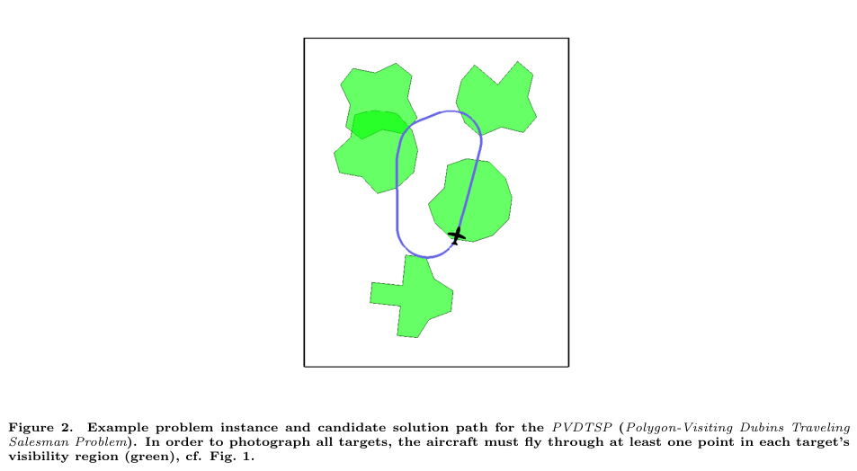
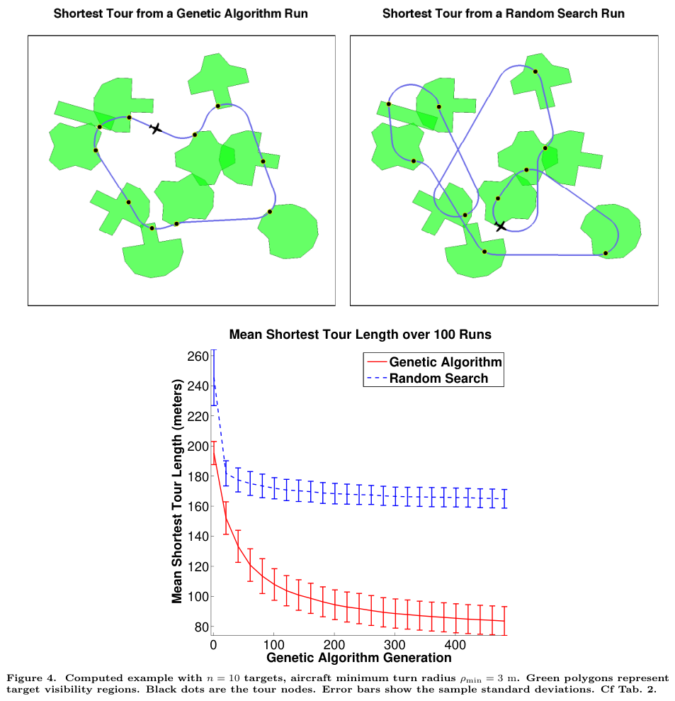

# Obermeyer 2009 · Lập đường cho UAV trinh sát mục tiêu mặt đất trong địa hình

## Tóm tắt một dòng
Quy bài toán chụp ảnh mọi mục tiêu tĩnh (bị địa hình che) về PVDTSP: tìm tour Dubins kín ngắn nhất đi qua ít nhất một điểm trong mỗi đa giác vùng nhìn thấy; giải bằng thuật toán di truyền mã hoá (thứ tự, điểm trên biên đa giác, hướng), tour ngắn gần một nửa so với tìm ngẫu nhiên cùng thời gian.

## Vì sao đọc
PVDTSP chính là dạng "DTSP với lân cận" của SigDrop khi vùng nghe của cell là đa giác (do che khuất, kênh không đều) — dùng để định vị
CHORD/LM-Tour và biện luận độ khó [L1], [TOUR].

## Bài toán và mô hình
- **[GĐ]** Một máy bay cánh bằng, camera EO; mục tiêu tĩnh trong địa hình; vùng nhìn thấy V(T_i) = mọi trạng thái máy bay mà từ đó chụp được
  T_i (đủ gần cho độ phân giải và không bị địa hình chắn) (tr. 1–2, Fig. 1).
- **[GĐ]** Giả định đơn giản hoá: máy bay là xe Dubins độ cao cố định, vùng nhìn thấy xấp xỉ bằng đa giác phẳng, khoảng cách thời gian
  tối thiểu giữa hai trạng thái là "hộp đen" d(x, x′) (tr. 2–3).
- **[GĐ]** DTSP (điểm) NP-khó theo số mục tiêu n, PVDTSP tổng quát hơn (tr. 2).

## Định nghĩa và ký hiệu
| Ký hiệu | Nghĩa |
|---|---|
| T = {T₁, …, T_n} | tập mục tiêu |
| V(T_i) ⊂ X | vùng nhìn thấy (trong không gian trạng thái) |
| PVDTSP | Polygon-Visiting Dubins TSP |
| nhiễm sắc thể c | hoán vị k₁…k_n, điểm x_i trên biên đa giác, hướng tại x_i |
| f(c) = 1/C(c) | độ thích nghi = nghịch đảo độ dài tour |
| N, p_c, p_m, N_e, N_g | kích thước quần thể, xác suất lai, đột biến, số cá thể ưu tú, số thế hệ |

## Kết quả chính
- **[KQ]** Bài toán trinh sát tổng quát (với giả định trên) quy về PVDTSP (mục II, tr. 2–4).
- **[KQ]** Ưu thế của GA so với tìm ngẫu nhiên tăng theo số mục tiêu (kết luận, tr. 11).

## Thuật toán
- **[TT] GA** (Bảng 1, tr. 5–7). Khởi tạo N nhiễm sắc thể ngẫu nhiên; mỗi thế hệ: giữ N_e tốt nhất; chọn cha mẹ theo bánh xe roulette;
  lai với xác suất p_c (toán tử lai riêng ở phụ lục A); đột biến dịch hướng và dịch vị trí với xác suất p_m; lặp N_g thế hệ.

## Thực nghiệm và số liệu
- **[TS]** C++ trên i686 2,33 GHz; 100 lần chạy mỗi instance; N = 50–100, N_g = 500, N_e = 4, p_c = 0,7, p_m = 0,1; bán kính quay ρ_min = 3 m
  (ví dụ Fig. 4) (Bảng 2, tr. 7–10).
- **[SỐ]** Độ dài tour tốt nhất trung bình GA so với ngẫu nhiên: n = 5: 37,51 m vs 58,77 m (2,54 s/lần); n = 10: 83,37 m vs 164,67 m (10,72 s);
  n = 20: 211,11 m vs 438,98 m (22,26 s) (Bảng 2).

## Hình tiêu biểu

*Đọc hình:* tour không cần đi qua mục tiêu, chỉ cần cắt mỗi vùng — đúng cấu trúc "vùng nghe" của SigDrop.

*Đọc hình:* GA hội tụ sau ~300 thế hệ về tour ~83 m, chỉ bằng một nửa tìm ngẫu nhiên.

## Trích nguyên văn
- **[TRÍCH]** "For a Dubins vehicle, find a shortest closed planar path which visits at least one point in each of a set of polygons." (tr. 1)

## Liên hệ SigDrop
- **[NX] [L1]** PVDTSP chứa DTSP (đa giác co về điểm) nên NP-khó — cùng lập luận co vùng như Babel 2017; có thể dẫn Obermeyer làm ví dụ bài toán
  DTSP-N trong ứng dụng UAV.
- **[NX] [TOUR]** Mã hoá (thứ tự, điểm trên biên, hướng) và đột biến dịch vị trí/hướng là cách tham số hoá tour hợp lý cho LM-Tour; nhưng GA
  không cho cận, nên làm tham chiếu thì Isaacs 2011 (lấy mẫu + GTSP) tốt hơn.

## Hạn chế và câu hỏi mở
- Đọc partial: bỏ mục II.A (tính vùng nhìn thấy từ mô hình địa hình) và phụ lục toán tử lai.
- Chỉ so với tìm ngẫu nhiên; không có cận dưới hay so với lời giải tối ưu.
- Bán kính quay 3 m và tour vài trăm mét — thang nhỏ hơn nhiều so với UAV cánh bằng thực.
