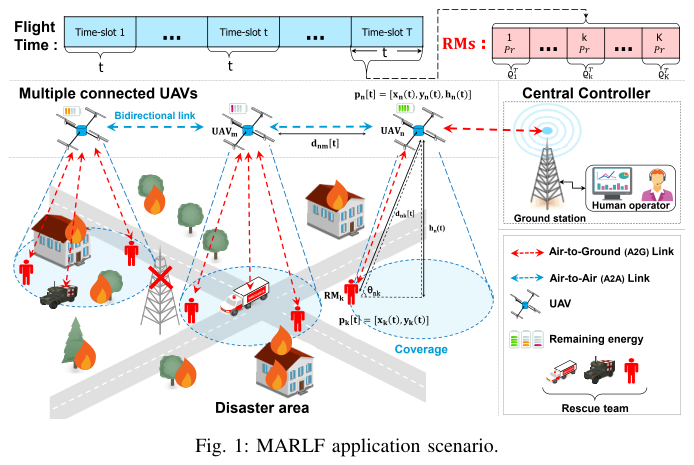

# Oubbati et al. 2023 · Tối ưu vùng phủ bằng nhiều UAV cho cứu hộ dùng học tăng cường

## Tóm tắt một dòng
MARLF: nhóm UAV làm trạm gốc bay, giữ liên kết với nhau và với trạm mặt đất, theo dõi các thành viên cứu hộ di chuyển khó đoán; học quỹ đạo tiết kiệm năng lượng bằng MADDPG để tối đa số người được phủ và thông lượng; tốt hơn các phương pháp cơ sở (ví dụ 20 thành viên, 7 UAV).

## Vì sao đọc
Chỉ để biết: bối cảnh SAR với UAV làm hạ tầng tạm thời — phần mở đầu/động cơ của SigDrop [ĐV].

## Bài toán và mô hình
- **[GĐ]** Sau thảm hoạ, hạ tầng mất; nhiều UAV phục vụ thành viên cứu hộ (RM) di động; ba khó khăn: điều khiển di chuyển, năng lượng hạn chế, tầm liên lạc hạn chế (tr. 1).
- **[GĐ]** UAV phải giữ kết nối A2A với nhau và với trạm mặt đất (Fig. 1).

## Định nghĩa và ký hiệu
| Ký hiệu | Nghĩa |
|---|---|
| RM | rescue member |
| MARLF | framework học tăng cường đa tác tử của bài |
| MADDPG | multi-agent deep deterministic policy gradient |

## Kết quả chính
- **[KQ]** MARLF thích nghi với môi trường động, tốt hơn baseline về thông lượng, năng lượng và số người được phủ trung bình (tr. 6).

## Thuật toán
- **[TT]** MADDPG, huấn luyện tập trung, thực thi phân tán (Fig. 2; không đọc chi tiết).

## Thực nghiệm và số liệu
Không đọc (mức abstract); Fig. 4 với 20 RM và 7 UAV.

## Hình tiêu biểu

*Đọc hình:* mạng tạm gồm liên kết A2G tới đội cứu hộ và A2A giữa các UAV tới trạm điều khiển.

## Trích nguyên văn
- **[TRÍCH]** "Unmanned Aerial Vehicles (UAVs) could be launched as flying base stations to provide the required coverage to Rescue Members" (tr. 1)

## Liên hệ SigDrop
- **[NX] [ĐV]** Dẫn ở phần động cơ SAR; khác SigDrop: người dùng di động, mục tiêu phủ liên tục, không phải phát khối dữ liệu cho mạng cảm biến tĩnh.

## Hạn chế và câu hỏi mở
- Chỉ đọc abstract, mở đầu, kết luận.
