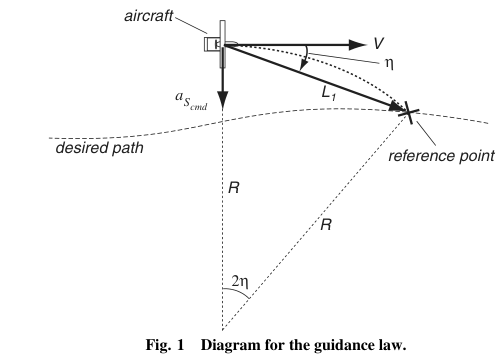
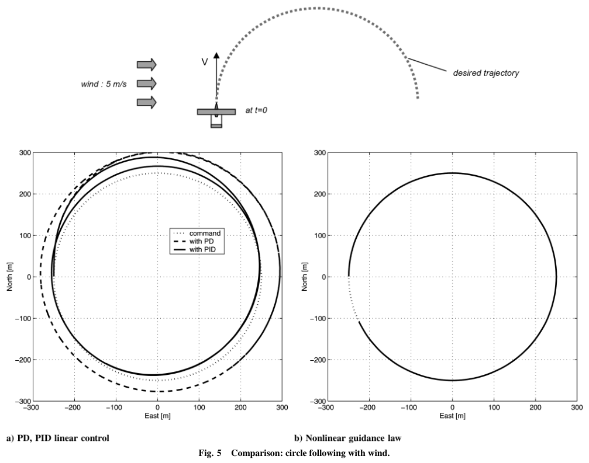
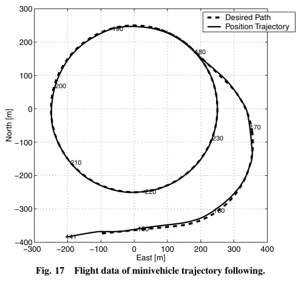

# Park, Deyst, How 2007 · Hiệu năng và ổn định Lyapunov của luật dẫn bám đường phi tuyến (L1)

## Tóm tắt một dòng
Luật dẫn L1: gia tốc ngang lệnh a_s = 2V²/L₁·sin η (V tốc độ mặt đất, η góc giữa vận tốc và đoạn L₁ tới điểm tham chiếu trên đường); quanh đường thẳng tương đương PD với ζ = 0,707, ω_n = √2·V/L₁; có tính dự đoán khi bám cung tròn, tự thích nghi với tốc độ mặt đất do gió; ổn định tiệm cận Lyapunov kể cả khi bão hoà gia tốc; bay thử sai số RMS 1,6 m trên quỹ đạo tròn.

## Vì sao đọc
Luật L1 là bộ dẫn đường chuẩn trong autopilot UAV cánh bằng (ArduPilot/PX4 dùng biến thể của nó) — cần để mô tả UAV của SigDrop
thực sự bám tour thế nào và sai số bám cỡ bao nhiêu khi có gió [GIÓ].

## Bài toán và mô hình
- **[GĐ]** Tách vòng ngoài (dẫn đường: sinh lệnh gia tốc ngang) và vòng trong (điều khiển tư thế); bài thiết kế vòng ngoài (tr. 1).
- **[GĐ]** Điểm tham chiếu nằm trên đường mong muốn, cách UAV khoảng L₁ phía trước (Fig. 1) (tr. 2).
- **[GĐ]** Dùng tốc độ mặt đất V trong lệnh, nên tự bù thay đổi tốc độ do gió (tr. 1).

## Định nghĩa và ký hiệu
| Ký hiệu | Nghĩa |
|---|---|
| a_{s,cmd} | lệnh gia tốc ngang (vuông góc vận tốc) |
| L₁ | đoạn từ UAV tới điểm tham chiếu trên đường |
| η | góc từ vận tốc V tới đoạn L₁ |
| d | sai số ngang (cross-track) |
| R | bán kính đường tròn cần bám |
| ζ, ω_n | hệ số tắt dần, tần số dao động riêng của mô hình tuyến tính |

## Kết quả chính
- **[KQ] (1)** (tr. 2). a_{s,cmd} = 2V²/L₁·sin η. Với đường tròn bán kính R mà L₁ = 2R sin η thì a_s = V²/R đúng bằng gia tốc hướng tâm cần,
  nên bám được mọi đường tròn bán kính lớn hơn giới hạn động học.
- **[KQ] (4)–(5) Tuyến tính hoá quanh đường thẳng** (tr. 3). d̈ + (2V/L₁)ḋ + (2V²/L₁²)d = (2V²/L₁²)d_ref: hệ bậc hai ζ = 0,707, ω_n = √2·V/L₁;
  L₁/V là hằng thời gian; L₁ nhỏ → độ lợi cao.
- **[KQ] Tính dự đoán** (tr. 3–4). Khi bám đường cong, điểm tham chiếu phía trước tạo thành phần "feedforward" theo độ cong; PD tuyến
  tính độ lợi cố định không có.
- **[KQ] Ổn định Lyapunov** (tr. 5–9). Bám đường tròn: ổn định tiệm cận với mọi vận tốc trong toàn miền điều kiện đầu hữu ích; mở rộng
  cho trường hợp bão hoà gia tốc ngang (tập phân tách, đa giác Lyapunov, Fig. 10–13). Với đường tròn, ζ thay đổi theo L₁/R còn ω_n giữ nguyên (tr. 6).

## Thuật toán
- **[TT]** Mỗi chu kỳ: tìm điểm trên đường cách UAV L₁, tính η, phát a_s = 2V²/L₁·sin η cho vòng trong (tr. 2).

## Thực nghiệm và số liệu
- **[SỐ]** Mô phỏng quỹ đạo tròn trong gió 5 m/s: PD/PID tuyến tính lệch ra ngoài ở vùng xuôi gió, vào trong ở vùng ngược gió; luật L1
  bám gần như hoàn hảo (Fig. 5, tr. 5).
- **[SỐ]** Bay thử hai UAV nhỏ, gió trung bình 5 ± 1 m/s: sai số RMS ≤ 1,6 m khi bám đường tròn; hẹn gặp hai máy bay với khoảng cách dọc
  12 m và sai số vị trí tương đối RMS 1,4 m (tr. 1, 10).

## Hình tiêu biểu

*Đọc hình:* UAV "đuổi" một điểm chạy trước trên đường; khi trên đường tròn, cung tạo bởi L₁ cho đúng độ cong cần.

*Đọc hình:* bộ tuyến tính lệch hàng chục mét theo hướng gió; luật L1 khớp đường đặt.

*Đọc hình:* sai lệch chỉ thấy ở chỗ chuyển từ đoạn thẳng vào cung.

## Trích nguyên văn
- **[TRÍCH]** "Ground speed is incorporated into the computation of commanded lateral acceleration, which adds an adaptive capability to accommodate vehicle speed changes due to external disturbances such as wind." (tr. 1)

## Liên hệ SigDrop
- **[NX] [GIÓ]** Sai số bám ngang ~1–2 m (RMS) là rất nhỏ so với vùng nghe 100 m; vì vậy mô hình lệch quỹ đạo của SigDrop nên tập trung
  vào lệch thời gian/tốc độ mặt đất (xuôi–ngược gió) và trôi khi quay (Techy 2009), không phải lệch ngang.
- **[NX] [TOUR]** Bán kính quay hiệu dụng khi bám tour phụ thuộc L₁; đường Dubins bán kính tối thiểu chỉ bám được nếu R lớn hơn giới hạn
  động học — nên dùng ρ có biên an toàn khi lập tour.

## Hạn chế và câu hỏi mở
- Đọc partial: bỏ chứng minh chi tiết mục III–IV (tập phân tách, đa giác Lyapunov).
- Gió coi như nhiễu tốc độ; không có mô hình nhiễu loạn.
