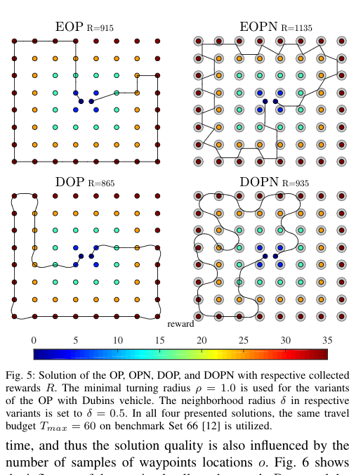

# Pěnička, Faigl, Váňa, Saska 2017 · Bài toán orienteering Dubins có lân cận (DOPN)

## Tóm tắt một dòng
Định nghĩa DOPN: chọn tập con điểm và đường Dubins có độ dài ≤ T_max để tối đa tổng thưởng, thưởng thu được khi vào đĩa bán kính δ quanh điểm; giải bằng Variable Neighborhood Search với lấy mẫu o vị trí trên biên đĩa và m hướng; δ lớn tăng thưởng, ρ lớn giảm thưởng.

## Vì sao đọc
Mô hình "vùng nghe là đĩa δ quanh nút + giới hạn quãng bay" là đúng dạng SigDrop khi UAV có pin hạn chế; cho cách lấy mẫu biên đĩa và số liệu
về ảnh hưởng của δ và ρ [TOUR], [ĐV].

## Bài toán và mô hình
- **[GĐ]** Các điểm có thưởng; điểm đầu s₁ và cuối s_k cố định (δ = 0); đường Dubins bán kính ρ; độ dài ≤ T_max (pin) (tr. 1–3).
- **[GĐ]** Thưởng của một điểm thu được khi đường đi qua đĩa bán kính δ quanh nó; cùng δ cho mọi điểm (tr. 3).
- **[GĐ]** Động cơ: thu dữ liệu từ cảm biến không dây hoặc camera góc rộng không cần tới đúng vị trí (tr. 1).

## Định nghĩa và ký hiệu
| Ký hiệu | Nghĩa |
|---|---|
| OP, EOP, OPN, DOP, DOPN | orienteering (Euclid), có lân cận, Dubins, Dubins có lân cận |
| T_max | ngân sách quãng bay |
| δ | bán kính lân cận |
| ρ | bán kính quay |
| o, m | số mẫu vị trí trên biên đĩa, số mẫu hướng |
| R_max, R_avg | thưởng lớn nhất, trung bình qua các lần chạy |

## Kết quả chính
- **[KQ]** DOPN tổng quát hoá DOP (Pěnička 2017, [6]) bằng ý lấy mẫu của DTSPN (Váňa–Faigl 2015, [22]); waypoint lấy mẫu trên biên đĩa (tr. 3–4).
- **[KQ]** Với ρ = 0 (OPN), VNS tốt hơn phương pháp SOM khi các lân cận không chồng nhau (δ ≤ 1,5) (Fig. 4, tr. 6).
- **[KQ]** δ lớn hơn → thưởng cao hơn; ρ lớn hơn → đường giữa waypoint dài hơn, thăm ít điểm hơn, thưởng thấp hơn (tr. 6).

## Thuật toán
- **[TT] VNS** (mục IV, tr. 4–5). Lời giải là dãy điểm + vị trí mẫu trên biên + hướng mẫu; "shaking" bằng path move / path exchange ngẫu nhiên (Fig. 2);
  "local search" bằng one-point move / exchange (Fig. 3); đánh giá độ dài bằng tối ưu hướng và vị trí mẫu theo thứ tự (kiểu đồ thị tầng).

## Thực nghiệm và số liệu
- **[TS]** Bộ benchmark OP: Tsiligirides Set 1–3 (≤ 32 điểm), Chao Set 64 (kim cương) và Set 66 (vuông) (tr. 5–6).
- **[SỐ] Bảng II** (Set 66, T_max = 60, tr. 6). ρ = 0: R_max 915 (δ = 0) → 1680 (δ = 1,5); ρ = 1,0: 870 → 1585; ρ = 1,5: 785 → 1455.
  Thời gian tính từ 46 s tới 102 phút.
- **[SỐ]** Bảng III–V cho R_max theo T_max với δ ∈ {0; 0,5; 1,0}, ρ ∈ {0; 1,0}; ví dụ Set 66, T_max = 60: 915/865 (δ = 0), 1155/940 (δ = 0,5),
  1545/1375 (δ = 1,0) (tr. 6–7).
- **[SỐ]** Số mẫu vị trí o tăng làm R_max tăng rồi bão hoà nhưng thời gian tính tăng mạnh (Fig. 6, δ = 0,5, ρ = 0,5, m = 16, tr. 7).

## Hình tiêu biểu

*Đọc hình:* lân cận cho phép đường "lướt qua" nhiều điểm hơn (thưởng 1135 so với 915); ràng buộc Dubins làm mất một phần lợi ích đó (935).

## Trích nguyên văn
- **[TRÍCH]** "the reward can be collected within a close distant neighborhood of the target locations." (tr. 1)

## Liên hệ SigDrop
- **[NX] [TOUR]** Lấy mẫu vị trí trên biên đĩa vùng nghe (o mẫu) + hướng (m mẫu) là cách rời rạc hoá chuẩn cho LM-Tour; Fig. 6 cho thấy o ~ 8–16 là đủ.
- **[NX] [ĐV]** Nếu SigDrop có giới hạn pin UAV, bài toán thành DOPN với "thưởng" = dữ liệu phát được/nút phục vụ; khác ở chỗ SigDrop cần dừng đủ lâu
  trong vùng (thời gian lưu) chứ không chỉ chạm biên.

## Hạn chế và câu hỏi mở
- Chạm biên đĩa là đủ thu thưởng (không có thời gian lưu hay tốc độ dữ liệu).
- Đọc partial: bỏ chi tiết toán tử VNS; benchmark trừu tượng (không đơn vị).
