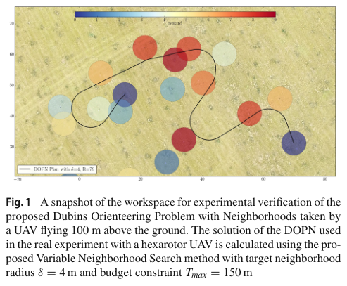
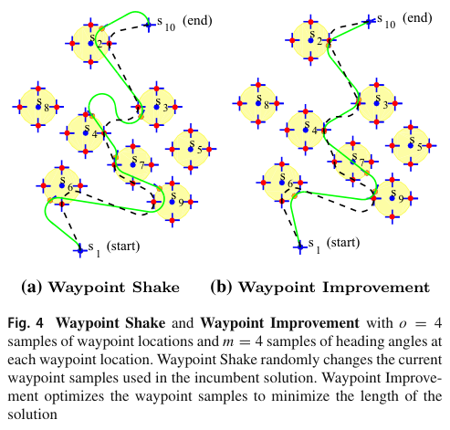

# Pěnička, Faigl, Saska, Váňa 2019 · Lập kế hoạch thu dữ liệu với khoảng cảm nhận khác 0 cho UAV có giới hạn quãng bay và độ cong (bản tạp chí DOPN)

## Tóm tắt một dòng
Bản tạp chí của DOPN (penicka2017-dopn): VNS ghép tối ưu tổ hợp (chọn và sắp điểm) với tối ưu liên tục vị trí waypoint trong đĩa δ (Waypoint Shake / Waypoint Improvement); lấy mẫu thưa ban đầu cho lời giải ~90 % thưởng tốt nhất trong vài giây, vượt kỷ lục cũ và phương pháp SOM; thử thực tế với hexarotor (δ = 4 m, T_max = 150 m).

## Vì sao đọc
Như bản 2017 nhưng thêm tối ưu liên tục waypoint trong vùng — đúng phần "chọn điểm đi qua trong vùng nghe" của LM-Tour [TOUR]; và có kiểm
chứng bay thực.

## Bài toán và mô hình
- **[GĐ]** DOPN như penicka2017-dopn: điểm có thưởng, lân cận đĩa δ, đường Dubins ρ, độ dài ≤ T_max, điểm đầu/cuối cố định (tr. 1, 5–6).
- **[GĐ]** Với VTOL bay tốc độ không đổi v_c và gia tốc tối đa a_max: ρ = v_c²/a_max (tr. 16).
- **[GĐ]** Mục tiêu phụ: khi thu được hết điểm, tối thiểu độ dài (tr. 2).

## Định nghĩa và ký hiệu
| Ký hiệu | Nghĩa |
|---|---|
| o, m | số mẫu vị trí waypoint trong đĩa, số mẫu hướng |
| Waypoint Shake | đổi ngẫu nhiên mẫu waypoint của lời giải hiện tại |
| Waypoint Improvement | tối ưu mẫu waypoint để giảm độ dài đường |

## Kết quả chính
- **[KQ] Đóng góp** (tr. 2). Ghép chặt tối ưu tổ hợp và liên tục trong một khung VNS; lấy mẫu thưa ban đầu + tham lam theo "thưởng trên độ tăng
  quãng" cho lời giải ≈ 90 % thưởng tốt nhất đã biết trong vài giây; tối ưu liên tục đẩy lên trên kỷ lục (vốn cần lấy mẫu dày, khởi tạo hàng chục phút).
- **[KQ] Kết luận** (tr. 17). Tối ưu liên tục giảm mạnh thời gian tính và cải thiện lời giải tốt nhất ở nhiều instance; vượt phương pháp SOM
  (Faigl–Pěnička 2017) cả chất lượng và thời gian.

## Thuật toán
- **[TT] VNS–DOPN** (mục 4, tr. 6–11). Shaking: Path Move, Path Exchange (Fig. 2), Waypoint Shake (Fig. 4a); local search: One Point Move/Exchange
  (Fig. 3), Waypoint Improvement (Fig. 4b); local search ngẫu nhiên hoá.

## Thực nghiệm và số liệu
- **[TS]** Benchmark Tsiligirides Set 1–3 và Chao Set 64, 66; so DOPN 2017 và SOM (mục 5.1, Fig. 6–9).
- **[TS]** Bay thực hexarotor ngoài trời, ảnh chụp từ 100 m; δ = 4 m, T_max = 150 m; mô hình Dubins dùng cho VTOL bay tốc độ không đổi (Fig. 1, 10–11, tr. 2, 16).
- Bảng số so sánh mục 5.1 không đọc chi tiết.

## Hình tiêu biểu

*Đọc hình:* đường Dubins đi qua (chạm) các đĩa thưởng cao, bỏ các đĩa thưởng thấp ở xa.

*Đọc hình:* tối ưu vị trí waypoint trong đĩa làm đường (xanh) ngắn lại, chừa ngân sách thăm thêm điểm.

## Trích nguyên văn
- **[TRÍCH]** "combinatorial optimization of the sequence for visiting the target locations is simultaneously addressed with continuous optimization for finding Dubins vehicle waypoints inside the neighborhoods of the visited targets." (tr. 1)

## Liên hệ SigDrop
- **[NX] [TOUR]** Waypoint Improvement là bước hậu xử lý rẻ có thể thêm vào CHORD: giữ thứ tự cell, tối ưu điểm vào/ra vùng nghe để rút ngắn tour.
- **[NX]** Mô hình "chạm đĩa là thu đủ" không đúng với SigDrop (cần thời gian lưu để phát đủ gói); cần ghi rõ khác biệt khi dẫn.

## Hạn chế và câu hỏi mở
- Đọc partial: bỏ mục 2 (tổng quan) và bảng số mục 5.1; chỉ đọc đóng góp, thuật toán (lướt), thí nghiệm thực, kết luận.
- Thưởng tĩnh, không phụ thuộc thời gian lưu hay kênh.
