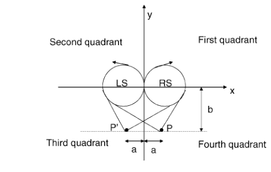
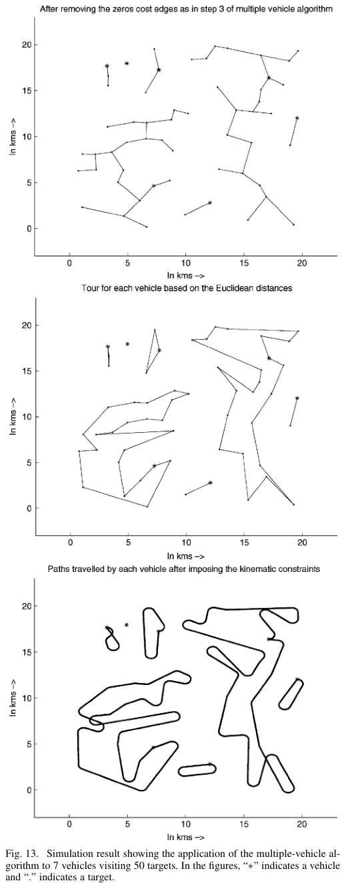

# Rathinam, Sengupta, Darbha 2007 · Phân bổ mục tiêu cho nhiều xe có ràng buộc góc quay

## Tóm tắt một dòng
Với các mục tiêu cách nhau (và cách điểm xuất phát) ≥ 2r, giải TSP Euclid bằng Christofides rồi nối liên tiếp bằng đường LS/RS (hướng tại mục tiêu tự do) cho xấp xỉ hằng số 4,56 với một xe; nhiều xe dùng MST có cạnh 0 giữa các xe, nhân đôi cạnh, đi Euler, cho hệ số 6,07; mục tiêu là tổng quãng đường.

## Vì sao đọc
Một trong ít kết quả xấp xỉ hằng số cho Dubins TSP (một và nhiều UAV) dưới giả định khoảng cách ≥ 2r — liên quan nếu SigDrop dùng nhiều UAV
(đội 1, đội 2) hoặc cần cận hằng số cho tour khi cell đủ thưa [TOUR], [A].

## Bài toán và mô hình
- **[GĐ]** n xe, m mục tiêu tĩnh; mỗi mục tiêu đúng một xe thăm; mỗi xe quay về vị trí đầu; tốc độ quay bị chặn (bán kính r); hướng tại mục
  tiêu không cho trước; tối thiểu tổng quãng đường (tr. 1).
- **[GĐ]** Khoảng cách Euclid giữa hai mục tiêu bất kỳ và giữa điểm đầu xe với mục tiêu ≥ 2r, (1) — biện minh: cảm biến nhìn được vùng rộng
  ≥ 2r (tr. 1).
- **[GĐ]** Khoảng cách Dubins bất đối xứng (Fig. 1) (tr. 1).

## Định nghĩa và ký hiệu
| Ký hiệu | Nghĩa |
|---|---|
| r | bán kính quay tối thiểu |
| α(P, A) | hệ số xấp xỉ = sup_I C(I, A)/C_o(I), (2) |
| LS, RS | đường quay trái/phải rồi đi thẳng tới điểm (hướng cuối tự do) |
| SVA | single vehicle algorithm |

## Kết quả chính
- **[KQ] Bổ đề II.1** (tr. 2). Với (x₁, y₁, θ₁) và điểm (x₂, y₂) cách ≥ 2r, tồn tại duy nhất đường RS và LS; đường ngắn nhất hướng cuối
  tự do là một trong hai.
- **[KQ] Bổ đề II.3–II.5** (tr. 3). Độ dài đường S (LS/RS ngắn hơn) so với khoảng cách Euclid bị chặn bởi hằng số khi khoảng cách ≥ 2r
  (dựa trên hình học Fig. 4–5).
- **[KQ] Định lý (một xe)** (tr. 3). SVA có hệ số (3/2)(π + 1 − tan⁻¹ 2) ≈ 4,56 (3/2 từ Christofides nhân với tỉ số Dubins/Euclid tối đa).
- **[KQ] Nhiều xe** (tr. 4–5). Hệ số ≈ 6,07 (tóm tắt, tr. 1).
- **[KQ]** So sánh: thuật toán ATSP của [17] có hệ số tăng theo log; Kumar–Li có hệ số tăng theo d_max/d_min (tr. 1–2).

## Thuật toán
- **[TT] SVA** (tr. 2–3). (1) Christofides cho ETSP; (2) theo thứ tự đó, nối bằng đường S (LS hoặc RS ngắn hơn) từ cấu hình hiện tại tới
  mục tiêu kế; hướng đến là hướng tại mục tiêu.
- **[TT] Nhiều xe** (Fig. 6–12, tr. 4–5). MST trên đồ thị mục tiêu + vị trí xe, cạnh giữa các xe trọng số 0; bỏ cạnh 0 được rừng mỗi cây
  một xe; nhân đôi cạnh, đi Euler, rút gọn thành tour; nối bằng đường S. Có bản phân tán: xe sắp theo hoành độ, gộp MST láng giềng (Prim).

## Thực nghiệm và số liệu
- **[SỐ]** Mô phỏng 7 xe, 50 mục tiêu trong vùng 20 × 20 km (Fig. 13, tr. 6) — chỉ minh hoạ, không có thống kê.

## Hình tiêu biểu

*Đọc hình:* với điểm cách ≥ 2r, quay một cung rồi đi thẳng là đủ; chiều dài thêm so với đường thẳng bị chặn.

*Đọc hình:* phân bổ theo MST tạo các cụm gọn cho từng xe; ràng buộc góc quay làm đường cuối có các vòng quay.

## Trích nguyên văn
- **[TRÍCH]** "We assume that the targets are at least 2r apart, where r is the minimum turning radius of the vehicle." (tr. 1)

## Liên hệ SigDrop
- **[NX] [TOUR] [A]** Với cell bán kính 100 m và ρ = 63,7 m, khoảng cách tâm cell ~200 m ≥ 2ρ = 127 m: giả định (1) đúng, nên có thể dùng hệ số
  4,56 làm cận trên cho tour một UAV (cho bài toán qua tâm cell, chưa tính lân cận).
- **[NX]** Mục tiêu tổng quãng đường; nếu SigDrop dùng nhiều UAV và tối thiểu thời gian hoàn thành (makespan) thì cần bài khác (min–max, xem bài 36).

## Hạn chế và câu hỏi mở
- Đọc partial: bỏ chứng minh hình học Bổ đề II.3–II.5 và phân tích nhiều xe chi tiết.
- Không xét lân cận (vùng), giới hạn quãng bay hay thời gian; hướng mở: ràng buộc thứ tự, thăm nhiều lần, bất định (tr. 6).
