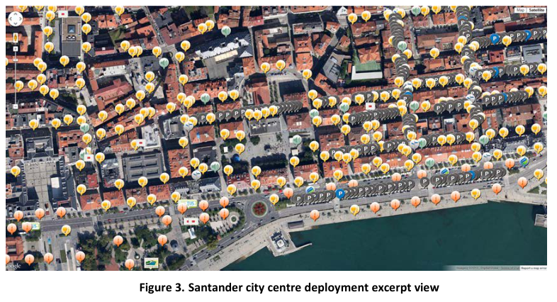
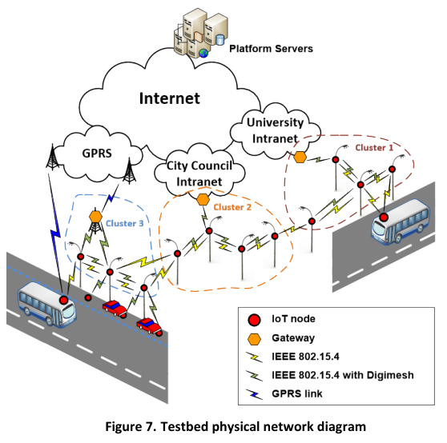

# Sanchez et al. 2014 · SmartSantander: thử nghiệm IoT trên testbed thành phố thông minh

## Tóm tắt một dòng
Mô tả kiến trúc ba tầng (node IoT, gateway, server) và đợt triển khai ở Santander: 740 điểm cảm biến gắn cột đèn, 390 cảm biến đỗ xe chôn dưới mặt đường, 23 gateway, dồn dày trong khoảng 1 km² trung tâm, mỗi node có hai radio 802.15.4 (một cho thử nghiệm, một Digimesh cho quản lý).

## Vì sao đọc
Là nguồn gốc của dòng SmartSantander trong bảng mật độ CONTEXT J1 mục 8; ghi lại số node thật mà bài công bố và kiến trúc cụm
quanh gateway, gần với cụm/CH của SigDrop.

## Bài toán và mô hình
- **[GĐ]** Testbed IoT cỡ thành phố, vừa cho nhà nghiên cứu chạy thử nghiệm vừa chạy dịch vụ thật cho dân (tr. 4–5).
- **[GĐ]** Ba tầng: node IoT (nhiều nhất, tài nguyên hạn chế), gateway (máy nhúng mạnh hơn, nối ra mạng lõi), server (ảo hoá trên
  cloud) (tr. 5–6, Fig. 1).
- **[GĐ]** Node cố định xếp thành cụm, mỗi cụm một gateway làm cluster head; node ngoài tầm gateway dùng node repeater; node gần
  nhau nhưng khác cụm không chuyển tiếp cho nhau (tr. 12, 14).
- **[GĐ]** Nguồn điện: node cảm biến gắn cột đèn công cộng, ban ngày chạy pin, ban đêm sạc khi đèn bật; cảm biến đỗ xe chôn dưới
  mặt đường chỉ chạy pin, sống hơn 3 năm (tr. 10–11).

## Định nghĩa và ký hiệu
| Ký hiệu | Nghĩa |
|---|---|
| point of presence | một vị trí lắp đặt, có thể gắn nhiều cảm biến (tr. 11) |
| GW | gateway: bo ALIX 500 MHz, 256 MB RAM, tới 32 GB lưu trữ, hai XBee-Pro, WiFi, 3G, Bluetooth, Ethernet, vỏ IP67 (tr. 12) |
| Digimesh | giao thức định tuyến độc quyền trên 802.15.4 của module XBee, dùng cho mạng quản lý và dịch vụ (tr. 13) |
| experimentation plane / management plane | mạng 802.15.4 gốc dành cho thử nghiệm / mạng Digimesh cho quản lý và dịch vụ (tr. 12–13) |

## Kết quả chính
- **[KQ]** Mỗi node gắn cột đèn có hai module XBee-Pro 2,4 GHz tạo hai mạng vật lý độc lập, để lưu lượng quản lý không chen vào thử
  nghiệm; testbed WSN trước đó thường dùng dây USB cho quản lý, không làm được khi node rải khắp thành phố (tr. 12–13).
- Bài không có thí nghiệm đo hiệu năng mạng; phần lớn là kiến trúc và quy trình quản lý.

## Thuật toán
- **[TT] Quản lý testbed** (tr. 15–). Ba quy trình tự động: phát hiện tài nguyên (đăng ký node mới theo mô hình mô tả tài nguyên),
  giám sát tài nguyên (phát hiện node hỏng), cấu hình lại (loại node hỏng, đổi tham số). Đọc lướt, không ghi chi tiết.

## Thực nghiệm và số liệu
- **[SỐ]** Chu kỳ 1: 740 điểm cảm biến cố định, gồm hơn 50 cảm biến tiếng ồn, 600 nhiệt độ, 500 ánh sáng, 30 CO; thêm 390 node phát
  hiện xe ở chỗ đỗ và 23 gateway (tr. 11).
- **[SỐ]** Chu kỳ 2: thêm 3 cụm cố định khoảng 50 node cho tưới tiêu thông minh, 150 node di động trên xe buýt, xe công vụ, taxi (nối
  GPRS), 2 000 thẻ QR và NFC (tr. 11).
- **[SỐ]** Node dồn dày nhất ở trung tâm thành phố, một vùng khoảng 1 km² (tr. 10). Bài không ghi bao nhiêu node nằm trong vùng này.
- **[TS]** Node cột đèn: ATmega1281, 8 KB SRAM, 4 KB EEPROM, 128 KB flash, thẻ SD 2 GB (tr. 12).
- **[TS]** Gateway đặt ở trụ sở thành phố hoặc trường đại học, nối vòng cáp quang; không có chỗ như vậy thì dùng 3G hoặc GPRS (tr. 11, 14).

## Hình tiêu biểu

*Đọc hình:* ở trung tâm, node gắn dọc gần như mọi dãy phố, cách nhau vài chục mét; cảm biến đỗ xe nối thành dải dọc lề đường.

*Đọc hình:* dữ liệu dịch vụ đi đa chặng Digimesh trong cụm về gateway, còn mạng 802.15.4 gốc nối được cả các node khác cụm.

## Trích nguyên văn
- **[TRÍCH]** "the deployment process intentionally accomplishes a concentration of IoT devices in the city centre (a 1 Km2 area). This area has the highest IoT node density in Santander" (tr. 10)
- **[TRÍCH]** "IoT nodes that are physically close but belong to different cluster groups are not part of the same mesh network and therefore cannot relay each other's sensor observations towards the servers." (tr. 14)

## Liên hệ SigDrop
- **[NX] [ĐV]** Số trong bài: khoảng 1 130 node cố định (740 + 390) và 23 gateway ở chu kỳ 1, trung bình khoảng 49 node mỗi gateway (người
  ghi tính). Hai dòng SmartSantander trong CONTEXT mục 8 (hơn 10 000 node trên 6 km², 15 000–20 000 trên 35 km²) không có trong bài
  này; đó là số kế hoạch từ báo chí. Nếu dùng số đã triển khai thì mật độ thật thấp hơn nhiều. Bài không cho diện tích toàn vùng
  nên chưa tính được mật độ chung. Nếu giả sử phần lớn 1 130 node nằm trong 1 km² trung tâm thì được cỡ 1 000 node/km², nhưng
  đây chỉ là cận trên thô, chưa kiểm.
- **[NX] [ĐV]** Cụm quanh một gateway, node khác cụm không chuyển tiếp cho nhau, gateway nối ra ngoài bằng cáp quang hoặc 3G: rất gần
  cấu trúc cụm và CH của SigDrop, chỉ khác là CH của SigDrop nối LoRa và có UAV ghé qua.
- **[NX] [KÊNH]** Hai mạng 802.15.4 tách riêng cho dữ liệu và điều khiển là một cách tránh chi phí điều khiển chen vào kênh dữ liệu;
  River làm việc tương tự bằng lịch kênh định trước.

## Hạn chế và câu hỏi mở
- Đọc kỹ mục 1–4 (kiến trúc, triển khai); mục 5–6 (quản lý testbed, API thử nghiệm) chỉ đọc lướt.
- Đây là bản thảo gửi tạp chí; số trang `tr. N` tính theo PDF bản thảo, không phải bản in.
- Không có số đo hiệu năng mạng (PDR, trễ, tuổi thọ thực tế); không cho khoảng cách giữa node hay diện tích từng cụm.
