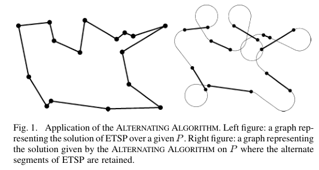
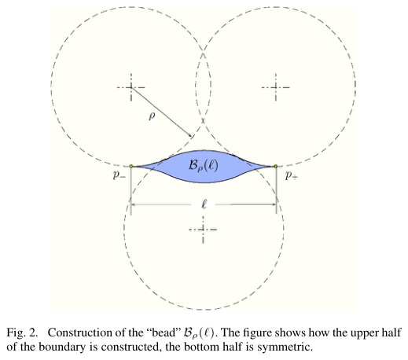
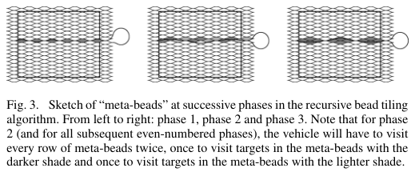

# Savla, Frazzoli, Bullo 2008 · Bài toán người du lịch cho xe Dubins

## Tóm tắt một dòng
Ba kết quả cho DTSP: (1) trường hợp xấu nhất độ dài tour tăng tuyến tính theo n, ALTERNATING ALGORITHM (giữ thứ tự ETSP, bỏ xen kẽ cạnh) xấp xỉ hằng số khi khoảng cách điểm bị chặn dưới, kèm cận điểm–điểm D ≤ E + κπρ; (2) điểm ngẫu nhiên đều: tour cỡ n^{2/3}, RECURSIVE BEAD-TILING đạt hằng số với xác suất 1; (3) DTRP: thời gian hệ thống cỡ λ² (Euclid chỉ cỡ λ).

## Vì sao đọc
Là nguồn của cận "đường Dubins ≤ đường Euclid + hằng số", được Le Ny 2012 dùng trong phép quy NP-khó — tức là mắt xích
của bổ đề L1. Cũng cho thang n^{2/3} khi nút dày đặc ngẫu nhiên, hữu ích để ước lượng độ dài tour của CHORD/LM-Tour.

## Bài toán và mô hình
- **[GĐ]** Xe Dubins phẳng, cấu hình (x, y, θ), tốc độ đơn vị, độ cong ≤ 1/ρ, không lùi (tr. 2).
- **[GĐ]** DTSP: tour kín ngắn nhất đi qua mọi điểm của P, \|P\| = n, trong vùng compact Q; so với ETSP(P) (tr. 2).
- **[GĐ]** Ba thiết lập: điểm chọn đối nghịch (worst case, mục III); điểm i.i.d. đều trong hình chữ nhật W × H (mục IV);
  điểm sinh theo Poisson không gian–thời gian cường độ λ (DTRP, mục V) (tr. 2–9).

## Định nghĩa và ký hiệu
| Ký hiệu | Nghĩa |
|---|---|
| ρ | bán kính quay tối thiểu |
| ETSP(P), DTSP_ρ(P) | độ dài tour Euclid, tour Dubins tối ưu |
| L_ρ(q_i, q_f) | độ dài đường Dubins ngắn nhất giữa hai cấu hình |
| κ | hằng số trong cận điểm–điểm; κ ∈ [2,657; 2,658] theo trích dẫn ở Le Ny 2012 (chữ ở đây bị mất) |
| B_ρ(ℓ) | "bead" độ dài ℓ giữa hai điểm p₋, p₊, dựng từ các cung bán kính ρ (Fig. 2) |
| λ | cường độ thời gian của quá trình sinh mục tiêu (DTRP) |
| T̄ | thời gian hệ thống trung bình ở trạng thái dừng |

## Kết quả chính
- **[KQ] (1)** (tr. 2). Nhắc lại ETSP: với Q compact có hằng β_Q sao cho ETSP(P) ≤ β_Q√n với mọi P; ngẫu nhiên:
  ETSP(P)/√n → β_TSP ∫√f, β_TSP ≈ 0,7124 (giá trị theo tài liệu, chữ bị mất).
- **[KQ] Định lý 3.1** (tr. 3; chứng minh phác ở phụ lục, tr. 11–12). Cận dưới trường hợp xấu nhất: tồn tại tập n điểm
  (đặt đều trên đường tròn bán kính nhỏ) mà DTSP tăng tuyến tính theo n; Nhận xét 3.2: DTSP ∈ Ω(n) trong worst case.
  *Ý chứng minh:* mọi đoạn nối hai điểm liên tiếp ngoài đĩa nhỏ phải quay một góc bị chặn dưới, cộng dồn theo n.
- **[KQ] Định lý 3.4** (tr. 3–4; chứng minh ở phụ lục, tr. 12–13). Cận độ dài điểm–điểm: L_ρ(q_i, q_f) ≤ ‖p_f − p_i‖ + κπρ
  (dạng theo Le Ny 2012 Định lý 4; ký hiệu ở đây không trích được). Tác giả phỏng đoán một giá trị κ nhỏ hơn dựa trên
  kiểm số (Phụ lục D, tr. 13).
- **[KQ] Bổ đề 3.5** (tr. 4). Độ dài tour ALTERNATING ≤ ETSP(P) + ⌈n/2⌉κπρ; nếu khoảng cách giữa hai điểm bất kỳ ≥ ε > 0
  thì là xấp xỉ hằng số (1 + κπρ/ε) của tối ưu. Nhận xét 3.6: với ρ đủ nhỏ, thứ tự ETSP tối ưu cũng là thứ tự DTSP tối
  ưu; trong vùng bị chặn, ε → 0 khi n → ∞ nên chỉ là hằng số với tập điểm hữu hạn.
- **[KQ] Định lý 3.7** (tr. 4). ALTERNATING nằm trong hằng số lần tối ưu cho tập điểm worst case; độ phức tạp chính là
  giải ETSP (dạng O(n³) theo ghi chú NOTES; chữ bị mất).
- **[KQ] Định lý 4.1** (tr. 4, lấy từ [32]). Điểm đều trong W × H: E[DTSP] ≥ c(ρWH)^{1/3}n^{2/3}; DTSP ∈ Ω(n^{2/3})
  (hằng số c không trích được).
- **[KQ] Tính chất bead** (tr. 5). Khi ℓ/ρ → 0: độ dày cực đại cỡ ℓ²/(8ρ), diện tích cỡ ℓ³/(…ρ) (giá trị theo ký hiệu bị
  mất — chỉ ghi được dạng); với mọi điểm trong bead có đường Dubins qua p₋, p₊ nằm trọn trong bead, dài ≈ ℓ; mặt phẳng lát
  kín được bằng bead.
- **[KQ] Định lý 4.3, Hệ quả 4.4** (tr. 6–7). Sau các pha đệ quy, số mục tiêu chưa thăm < c·log n với xác suất → 1 (và
  với xác suất 1 tiệm cận). *Ý chứng minh:* chặn tổng biến nhị phân bằng biến nhị thức, Chernoff, Borel–Cantelli.
- **[KQ] Định lý 4.8, Bổ đề 4.9, Nhận xét 4.10** (tr. 8–9). RECURSIVE BEAD-TILING cho tour cỡ (ρWH)^{1/3}n^{2/3} với xác suất 1;
  DTSP tập trung quanh kỳ vọng (martingale Doob + Azuma); vậy DTSP ∈ Θ(n^{2/3}) với xác suất 1 và thuật toán là xấp xỉ hằng số.
- **[KQ] Định lý 5.1, 5.3** (tr. 10). DTRP tải nặng (λ → ∞): T̄ có cận dưới cỡ λ² (Euclid: cỡ λ); BEAD-TILING (một lớp bead,
  độ dài ℓ chọn theo (6), mỗi vòng thăm một mục tiêu mỗi bead) ổn định với T̄ cỡ λ², phân tích theo hàng đợi M/D/1.
  Nhận xét 5.4: với điểm sinh đối nghịch không có chính sách ổn định (do DTSP worst case tuyến tính).
- **[KQ] Kết luận** (tr. 11). Worst case DTSP ∈ Θ(n), ngẫu nhiên Θ(n^{2/3}), ETSP Θ(√n); ràng buộc độ cong làm hệ nhạy
  với cường độ sinh mục tiêu hơn hẳn.

## Thuật toán
- **[TT] ALTERNATING ALGORITHM** (tr. 3). (i) Tính tour ETSP tối ưu, đánh số cạnh; (ii) giữ các cạnh lẻ (đi thẳng, hướng tại
  điểm = hướng đoạn thẳng), thay cạnh chẵn bằng đường Dubins ngắn nhất giữa hai cấu hình đã gán; (iii) trả về dãy cấu hình
  (Fig. 1).
- **[TT] RECURSIVE BEAD-TILING** (tr. 5). Lát Q bằng bead độ dài ℓ (chọn theo n); pha 1 quét từng hàng trái–phải rồi
  phải–trái, mỗi bead khác rỗng thăm ít nhất một mục tiêu; pha k gộp 2^{k−1} bead thành meta-bead và lặp lại; mục tiêu
  còn sót thăm bằng ALTERNATING (Fig. 3).
- **[TT] BEAD-TILING cho DTRP** (tr. 10). Lát cố định, lặp vòng quét thăm một mục tiêu mỗi bead khác rỗng.

## Thực nghiệm và số liệu
- **[TS]** Điểm đều trong hình chữ nhật, mỗi điểm dữ liệu là trung bình 10 lần (W, H, ρ cụ thể bị mất chữ) (tr. 9).
- **[SỐ]** Đồ thị log–log độ dài RBTA theo n nằm giữa hai đường dốc 2/3 của cận dưới và cận trên; cận dưới khá bảo thủ,
  cận trên càng sát khi n lớn (Fig. 4, tr. 9).

## Hình tiêu biểu

*Đọc hình:* một nửa số cạnh giữ nguyên đoạn thẳng, nửa còn lại thành vòng quay Dubins — mỗi vòng thêm tối đa κπρ.

*Đọc hình:* bead là vùng mà xe Dubins đi qua p₋, p₊ có thể ghé mọi điểm bên trong mà gần như không dài thêm.

*Đọc hình:* mỗi pha quét lại vùng với ô gộp gấp đôi, nên tổng độ dài các pha hội tụ.

## Trích nguyên văn
- **[TRÍCH]** "unlike other variations of the TSP, there are no known reductions of the Dubins TSP to a problem on a finite-dimensional graph" (tr. 1–2)
- **[TRÍCH]** "bounded-curvature constraints make the system much more sensitive to increases in the target generation rate." (tr. 11)

## Liên hệ SigDrop
- **[NX] [L1]** Định lý 3.4 / Bổ đề 3.5 cho cận DTSP(P) ≤ ETSP(P) + Cn với C = κπρ: đây là cận mà Le Ny 2012 dùng để phóng
  to phép quy Papadimitriou. Khi viết L1, trích Savla 2008 Định lý 3.4 cho cận này.
- **[NX] [A] [TOUR]** Với bán kính quay 63,7 m, κπρ ≈ 532 m mỗi chặng; độ dài tour của UAV phục vụ n cell bị chặn bởi
  ETSP + 532·⌈n/2⌉ m nếu dùng ALTERNATING. Thang n^{2/3} (điểm dày ngẫu nhiên) cho thấy khi số cell lớn, chi phí quay chiếm ưu thế.
- **[NX] [TOUR]** Ý bead (vùng quanh một đoạn mà xe ghé mọi điểm với chi phí ~0) gần với việc UAV chỉ cần đi qua vùng
  nghe của cell chứ không cần đi qua tâm — tương tự DTSP-N.

## Hạn chế và câu hỏi mở
- Ký hiệu toán không trích được, các hằng số cụ thể (cận dưới Định lý 3.1, 4.1, cận trên 4.8, 5.1, 5.3, giá trị phỏng
  đoán κ) cần đối chiếu PDF khi trích con số.
- ALTERNATING chỉ là xấp xỉ hằng số khi khoảng cách tối thiểu bị chặn dưới.
- Tác giả nêu hướng mở: một thuật toán duy nhất xấp xỉ hằng số cho cả worst case và ngẫu nhiên; phân bố không đều; nhiều xe (tr. 11).
