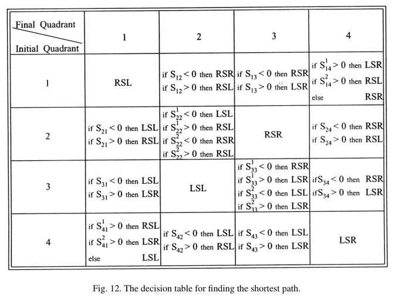

# Shkel, Lumelsky 2001 · Phân loại tập Dubins

## Tóm tắt một dòng
Thay vì tính cả 6 đường Dubins rồi so, chia hướng đầu α và cuối β theo góc phần tư (16 lớp a_ij, gộp thành nhóm tương đương) và dùng hàm chuyển S_ij để chọn trực tiếp đường ngắn nhất từ bảng quyết định (Fig. 12); làm đầy đủ cho "trường hợp đường dài" (hai cặp đường tròn quay ở hai đầu không giao nhau).

## Vì sao đọc
Công cụ: tính khoảng cách Dubins nhanh khi phải tính rất nhiều cặp (ma trận ATSP n·m nút cho tour tham chiếu) [TOUR].

## Bài toán và mô hình
- **[GĐ]** Hai cấu hình (P_i, α), (P_f, β); đường trơn ngắn nhất độ cong ≤ 1/ρ; tập đủ là tập Dubins (LSL, RSR, LSR, RSL, RLR, LRL) (tr. 1).
- **[GĐ]** Trường hợp đường dài (Mệnh đề 5): {C_il ∪ C_ir} ∩ {C_fl ∪ C_fr} = ∅ khi d > √(4 − (\|cos α\| + \|cos β\|)²) + \|sin α\| + \|sin β\| (d chuẩn hoá theo ρ) (tr. 9).

## Định nghĩa và ký hiệu
| Ký hiệu | Nghĩa |
|---|---|
| a_ij | lớp ứng với α thuộc góc phần tư i, β thuộc góc phần tư j |
| S_ij, S_ij^k | hàm chuyển (dấu quyết định loại đường) |
| C_il, C_ir, C_fl, C_fr | đường tròn quay trái/phải ở đầu và cuối |

## Kết quả chính
- **[KQ]** Ở trường hợp đường dài, CCC không bao giờ tối ưu (Fig. 5, tr. 11); đường tối ưu được chọn từ bảng 4 × 4 theo góc phần tư, phần lớn ô chỉ cần một
  phép so dấu S_ij (Fig. 12, tr. 22). Ví dụ ô (1, 1): RSL; ô (1, 3): RSR hoặc LSR theo dấu S₁₃.
- **[KQ]** Trường hợp đường ngắn làm tương tự nhưng phức tạp hơn, không trình bày đầy đủ (tr. 23).

## Thuật toán
- **[TT]** Xác định góc phần tư của α, β → tra bảng Fig. 12 → nếu cần, tính hàm chuyển S_ij → ra loại đường và độ dài.

## Thực nghiệm và số liệu
Không đọc (mức abstract).

## Hình tiêu biểu

*Đọc hình:* đa số tổ hợp chỉ có 1–2 ứng viên; không cần tính đủ 6 đường.

## Trích nguyên văn
- **[TRÍCH]** "the logical classification scheme considered in this work allows one to extract the shortest path from the Dubins set directly, without explicitly calculating the candidate paths." (tr. 1)

## Liên hệ SigDrop
- **[NX] [TOUR]** Với cell cách nhau ~200 m và ρ = 63,7 m (d/ρ ≈ 3), nhiều cặp rơi vào trường hợp đường ngắn — bảng không áp dụng trực tiếp; thực tế tính đủ 6
  đường (O(1) mỗi cặp) vẫn rẻ, nên bài này chỉ là tối ưu hoá phụ.

## Hạn chế và câu hỏi mở
- Chỉ đọc abstract, mở đầu, Mệnh đề 5, bảng Fig. 12 và kết luận.
