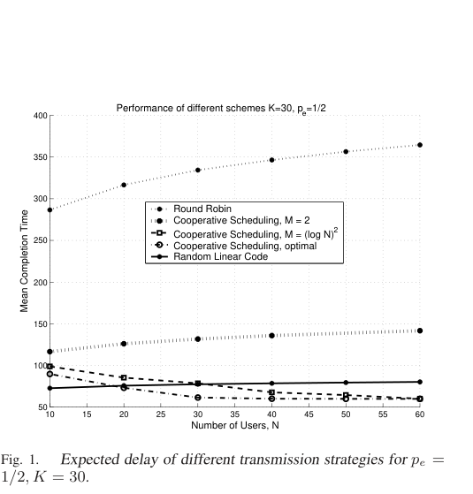
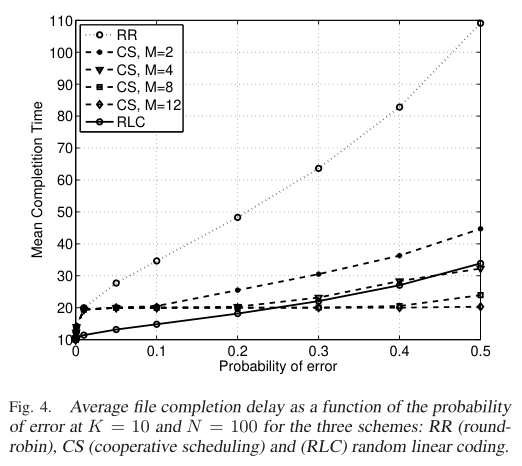

# Stojanovic, Wu, Sharif, Starobinski 2009 · Phổ biến qua kênh quảng bá: network coding hay hợp tác

## Tóm tắt một dòng
Trạm gốc phát tệp K gói cho N máy thu qua kênh on/off độc lập (xác suất mất p_e): round-robin tốn K·log_{1/p_e}N; RLC tốn log_{1/p_e}N khi K cố định nhưng ≈ (1 + 1/log(1/p_e))K khi K ≳ (log N)^r; hợp tác hai giai đoạn với M = (log N)^r nút chuyển tiếp đạt 2K(1 + o(1)) với mọi K.

## Vì sao đọc
Bài có đúng cấu trúc "nguồn phát quảng bá → các nút đã nhận hợp tác phát lại" của SigDrop, ở bản một chặng, và cho các
luật tỉ lệ đóng (closed-form) để so FC/RLC với hợp tác. Là cơ sở lý thuyết cho định lý crossover [A] và baseline [FC].

## Bài toán và mô hình
- **[GĐ]** Một trạm gốc một anten, N máy thu một anten, một tệp K gói mà mọi máy cần; khe thời gian, mỗi khe một gói (tr. 2).
- **[GĐ]** Kênh Rayleigh block fading, độc lập giữa khe và giữa người dùng, mô hình thành kênh on/off với xác suất "off"
  (outage) p_e cố định, không phụ thuộc N; mạng đồng nhất (tr. 2).
- **[GĐ]** Kênh giữa hai máy thu cùng phân bố với kênh trạm–máy thu; máy thu biết CSI của mình, bên phát không có CSI (tr. 2).
- **[GĐ]** Bỏ qua chi phí kênh điều khiển, chi phí mã hoá mạng và trao đổi giữa các nút hợp tác; nên kết quả là cận dưới
  của trễ thực tế (tr. 1, 5).
- **[GĐ]** Trễ = số lần dùng kênh tới khi mọi nút có đủ tệp; cận dưới hiển nhiên là K (tr. 2).

## Định nghĩa và ký hiệu
| Ký hiệu | Nghĩa |
|---|---|
| N, K | số máy thu; số gói của tệp |
| p_e | xác suất mất gói (outage) trên mỗi liên kết |
| D_RR, D_RLC, D_CS | trễ của round-robin, mã tuyến tính ngẫu nhiên, hợp tác |
| T_n | số khe để nút n nhận K tổ hợp độc lập (nhị thức âm tham số 1 − p_e, K) |
| M | số nút hợp tác ở giai đoạn 2 |
| p_e(M) = βρ^{−(M+1)} = (γp_e)^{M+1} | xác suất lỗi khi M + 1 bên phát dùng mã không–thời gian (độ lợi phân tập M + 1) |

## Kết quả chính
- **[KQ] Mệnh đề 3.1** (tr. 2). Round-robin: E[D_RR] = K·log_{1/p_e}(N) + O(1) với N lớn, mọi K.
- **[KQ] (2)** (tr. 3). E[D_RLC] = K + Σ_{t≥K} [1 − (Σ_{τ=K}^{t} C(τ−1, K−1) p_e^{τ−K}(1−p_e)^K)^N], giả định trường đủ lớn
  để cần đúng K gói nhận được.
- **[KQ] Định lý 4.1** (tr. 3). RLC, N lớn:
  (1) K cố định: E[D_RLC] = log_{1/p_e}N + (K − 1)log_{1/p_e}log N + o(log log N);
  (2) K = log N: E[D_RLC] = β₁K + o(log N), 3,146/log(1/p_e) ≤ β₁ ≤ 1 + 3,146/log(1/p_e);
  (3) K ≳ (log N)^r, r > 1: E[D_RLC] = β₂K + o((log N)^r), 1/log(1/p_e) ≤ β₂ ≤ 1 + 1/log(1/p_e).
  *Ý chứng minh:* kẹp biến hình học giữa biến mũ Y (λ = log 1/p_e) và Z = Y + 1 theo thứ tự ngẫu nhiên; E[max Y_n] là
  tích phân (4) với S_K(x) = Σ_{i<K} xⁱ/i!, tiệm cận (5) lấy từ [16]; cận trên cộng thêm K. Phần (2), (3) chỉ phác thảo.
- **[KQ]** Hệ quả: với p_e ≤ 0,36, RLC trong vòng hệ số 2 của kênh không lỗi (tr. 3).
- **[KQ] Định nghĩa 5.1, Định lý 5.1** (tr. 4). Hợp tác (CS): mỗi gói, giai đoạn 1 trạm phát tới khi ≥ M nút nhận; giai
  đoạn 2 trạm và M nút đó cùng phát (mã không–thời gian). Với M = (log N)^r, r > 1: E[D_CS] = 2K(1 + o(1)) với mọi K.
  *Ý chứng minh:* P{N_s^k < M} = e^{−N log(1/p_e) + o(N)} nên giai đoạn 1 tốn K(1 + o(1)); giai đoạn 2 xác suất lỗi
  (γp_e)^{M+1} nên E[D_stage2] ≤ K(M−1)/M + E[D_RR]/M = K + O((K/M) log_{1/(γp_e)}N), (8)–(12).
- **[KQ]** Thêm nút hợp tác không giảm dưới 2K, chỉ làm hội tụ nhanh hơn; xác suất một nút làm relay O(log N/N) nên công
  suất phát trung bình mỗi nút → 0 (tr. 5).
- **[KQ] Kết luận** (tr. 5–6). Không cách nào trội ở mọi chế độ: tệp nhỏ (K cố định) → hợp tác tốt hơn; tệp lớn
  (K ≳ (log N)^r) và p_e < 0,36 → RLC tốt hơn.

## Thuật toán
- **[TT] RR, RLC, CS** như trên. RLC: gói P[i] = Σ a_k[i]P_k, a_k đều trên F_q (tr. 2).

## Thực nghiệm và số liệu
- **[TS]** Mô phỏng số với N = 100–500, K tới 100, p_e ∈ {0,1; 0,5}, M ∈ {2, α log N, (log N)², không giới hạn},
  α = 1/log(1/p_e) (tr. 5).
- **[SỐ]** K = 30, p_e = 1/2: chỉ M = 2 đã giảm trễ mạnh so với RR; M = (log N)² cho trễ thấp hơn RLC khi N tăng (Fig. 1, tr. 5).
- **[SỐ]** p_e = 1/2, M = α log N: hợp tác tốt hơn RLC khi K ≲ 30 với N = 100–500 (Fig. 2, tr. 5).
- **[SỐ]** p_e = 0,1: RLC tốt hơn ở hầu hết K trừ tệp rất ngắn; tỉ số CS/RLC tối đa tiến tới 2 (Fig. 3, tr. 5).
- **[SỐ]** K = 10, N = 100: RLC tốt hơn khi p_e nhỏ, CS (đủ relay) tốt hơn khi p_e lớn và giữ ~2K = 20 trên dải rộng p_e;
  cả hai hơn RR tới ~4 lần (Fig. 4, tr. 5).

## Hình tiêu biểu

*Đọc hình:* RR tăng theo log N và cao hơn hẳn; RLC và CS ở gần nhau, CS với nhiều relay tiến về 2K = 60.

*Đọc hình:* đường RLC cắt các đường CS: dưới điểm cắt RLC thắng, trên điểm cắt hợp tác thắng — một hiện tượng crossover theo p_e.

## Trích nguyên văn
- **[TRÍCH]** "if K is fixed, cooperation outperforms network coding ... while it grows logarithmically with N in the latter case." (tr. 1)
- **[TRÍCH]** "one should choose network coding when broadcasting large files and cooperative scheduling for transmission of smaller files." (tr. 5–6)

## Liên hệ SigDrop
- **[NX] [A]** Đây là tiền lệ trực tiếp cho định lý crossover: có ngưỡng (theo K so với log N, và theo p_e) mà dưới đó
  hợp tác thắng, trên đó mã hoá thắng. Định lý A của SigDrop có thể phát biểu song song: crossover giữa FC (UAV bay đủ
  lâu cho mọi nút) và River/hợp tác mặt đất theo kích thước dữ liệu và mất gói A2G.
- **[NX] [FC]** Định lý 4.1(1) cho dạng "đuôi log N" của FC khi K nhỏ: thời gian đến nút tệ nhất ~log_{1/p_e}N; dùng làm
  cận dưới cho T_FC khi UAV phải phục vụ N nút với p_e đồng nhất.
- **[NX] [B]** Ý "chỉ cần (log N)^r nút đã nhận làm relay" ủng hộ việc takeover: một tập nhỏ nút mặt đất nhận đủ từ UAV là
  đủ để mạng mặt đất hoàn tất.
- **[NX] [KÊNH]** Giả định p_e đồng nhất, độc lập giữa người dùng khác hẳn kênh A2G phụ thuộc khoảng cách và lệch quỹ đạo
  của SigDrop; cần nói rõ khi dẫn.

## Hạn chế và câu hỏi mở
- Một chặng, mọi nút nghe nhau; không có đa chặng hay di động.
- Bỏ qua chi phí điều khiển, ước lượng kênh, đồng bộ mã không–thời gian giữa các relay.
- Chứng minh phần (2), (3) của Định lý 4.1 bị lược bỏ "for the sake of brevity" (tr. 3).
