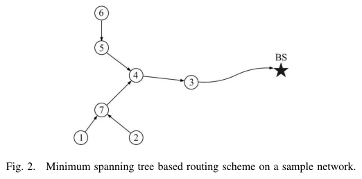

# Tan, Körpeoğlu 2003 · PEDAP: gom và tổng hợp dữ liệu tiết kiệm năng lượng trong WSN

## Tóm tắt một dòng
PEDAP định tuyến gom dữ liệu theo cây khung nhỏ nhất (MST) với tổng hợp tại nút, PEDAP-PA là bản có tính năng lượng còn lại để cân tải; tuổi thọ mạng hơn LEACH 4–20 lần và hơn PEGASIS (định tuyến chuỗi) khoảng 3 lần, kể cả khi trạm gốc ở giữa vùng.

## Vì sao đọc
Chỉ để biết: chuẩn so sánh gom dữ liệu WSN (LEACH, PEGASIS, PEDAP) — chiều thu, ngược với phát của SigDrop; cây MST là cấu trúc hợp tác mặt đất cơ bản.

## Bài toán và mô hình
- **[GĐ]** Mỗi vòng mọi nút có dữ liệu gửi về trạm gốc; có tổng hợp/hợp nhất dữ liệu; tối thiểu tổng năng lượng mỗi vòng và cân tải để kéo dài tuổi thọ (tr. 1).

## Định nghĩa và ký hiệu
| Ký hiệu | Nghĩa |
|---|---|
| PEDAP, PEDAP-PA | Power Efficient Data gathering and Aggregation Protocol; bản power-aware |
| LEACH, PEGASIS | giao thức cụm, giao thức chuỗi (so sánh) |

## Kết quả chính
- **[SỐ]** Tuổi thọ mạng: PEDAP hơn LEACH 4–20 lần, hơn PEGASIS ~3 lần (tr. 1).
- **[KQ]** PEDAP-PA tốt nhất nếu cần mọi nút cùng sống lâu; PEDAP tốt nếu quan trọng tuổi thọ nút cuối hoặc nút không biết năng lượng (tr. 6).

## Thuật toán
- **[TT]** Trạm gốc tính MST (trọng số theo năng lượng truyền, bản PA chia cho năng lượng còn lại), phát lịch định tuyến; mỗi vòng gom theo cây (không đọc chi tiết).

## Thực nghiệm và số liệu
Không đọc (mức abstract); mô phỏng C, vùng 50 × 50 m và 100 × 100 m, trạm gốc ở xa hoặc ở giữa (Fig. 3–6).

## Hình tiêu biểu

*Đọc hình:* mỗi nút gửi về cha gần nhất trên MST rồi tổng hợp, thay vì chuỗi dài như PEGASIS (Fig. 1).

## Trích nguyên văn
- **[TRÍCH]** "PEDAP achieves between 4x to 20x improvement in network lifetime compared with LEACH, and about three times improvement compared with PEGASIS." (tr. 1)

## Liên hệ SigDrop
- **[NX]** Chiều thu (many-to-one), không trực tiếp liên quan; ý "trạm gốc tính cấu trúc và phát lịch" giống Manifest/LWB.

## Hạn chế và câu hỏi mở
- Chỉ đọc abstract, mở đầu, kết luận; mô phỏng C đơn giản (tác giả định kiểm lại bằng ns).
