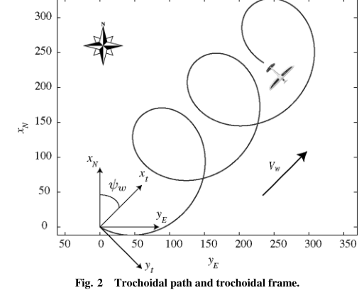
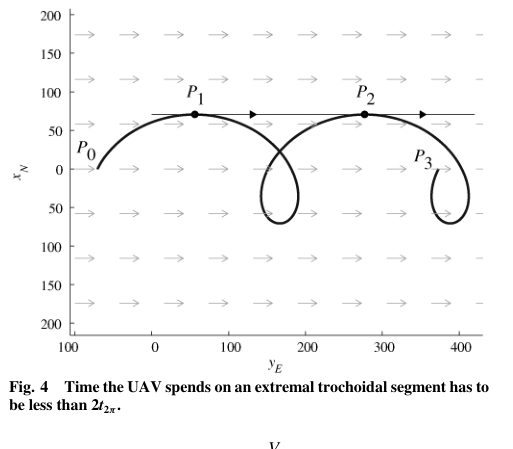
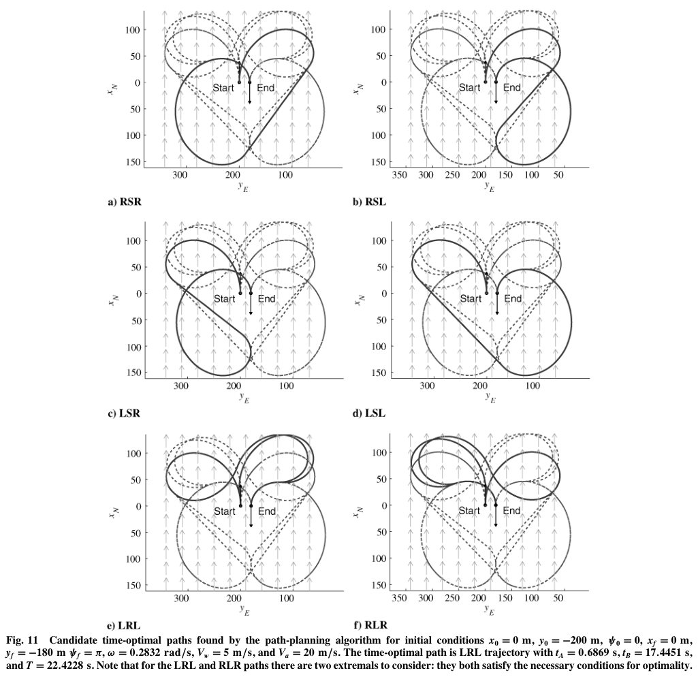

# Techy, Woolsey 2009 · Lập đường bay thời gian ngắn nhất cho UAV trong gió đều

## Tóm tắt một dòng
Trong gió đều V_w < V_a, quay tốc độ tối đa vẽ ra đường trochoid trong hệ mặt đất; đường cực trị gồm trochoid và đoạn thẳng (BSB, BBB); LSL/RSR giải tường minh, LSR/RSL/BBB giải bằng tìm nghiệm số; điều kiện cần mới: mỗi đoạn trochoid kéo dài < 2 vòng; có cực trị không ứng với đường Dubins nào trong hệ không khí.

## Vì sao đọc
Là mô hình chuẩn của "đường Dubins trong gió" — cơ sở để lập luận lệch quỹ đạo [GIÓ] của SigDrop: với gió, vòng quay
bán kính ρ trong hệ không khí thành trochoid trên mặt đất, nên vùng UAV đi qua lệch khỏi tour lập kế hoạch không gió.

## Bài toán và mô hình
- **[GĐ]** UAV là chất điểm bay ở độ cao không đổi, tốc độ không khí V_a không đổi, tốc độ quay bị chặn đối xứng
  |u| ≤ u_max; gió đều không đổi (V_x, V_y), V_w = √(V_x² + V_y²) < V_a (tr. 2).
- **[GĐ]** Động học (1): ẋ_N = V_a cos ψ + V_x, ẏ_E = V_a sin ψ + V_y, ψ̇ = u; điều kiện đầu/cuối là vị trí và hướng mũi (2)–(3);
  mục tiêu min T (tr. 2).
- **[GĐ]** Gió và điều kiện biên biết trước (tr. 10).

## Định nghĩa và ký hiệu
| Ký hiệu | Nghĩa |
|---|---|
| F_I, F_A, F_T | hệ quán tính, hệ không khí (trôi theo gió), hệ trochoid (trục x xuôi gió, cố định với đất) |
| V_a, V_w, V_g | tốc độ không khí, tốc độ gió, tốc độ mặt đất V_g = √(V_a² + V_w² + 2V_aV_w cos ψ), (14) |
| ψ, χ | hướng mũi (heading), hướng đi trên mặt đất (course), χ = atan2(V_a sin ψ, V_a cos ψ + V_w), (15) |
| ω | tốc độ quay tối đa; R₀ = V_a/ω bán kính quay trong hệ không khí |
| t_{2π} = 2π/ω | thời gian một vòng quay đủ |
| B, S; L, R | bang (quay tối đa), straight (đoạn thẳng, cung kỳ dị); trái, phải |
| BSB, BBB | quay–thẳng–quay; quay–quay ngược–quay |

## Kết quả chính
- **[KQ] (7)–(10) Trochoid** (tr. 2). Quay tối đa trong hệ F_T: x_t(t) = (V_a/δω) sin(δωt + φ_t) + V_w t + x_t0,
  y_t(t) = −(V_a/δω) cos(δωt + φ_t) + y_t0, δ ∈ {−1, 1} chiều quay.
- **[KQ] Nguyên lý cực tiểu** (tr. 3). Từ Hamiltonian H = 1 + λ₁(V_a cos ψ + V_w) + λ₂V_a sin ψ + λ₃u: λ₃ ≠ 0 ⇒ u = −sign(λ₃)u_max
  (quay tối đa); λ₃ ≡ 0 ⇒ ψ hằng (đoạn thẳng). Đường tối ưu chỉ gồm trochoid và đoạn thẳng.
- **[KQ] Bổ đề 1** (tr. 3). Hướng mũi ψ ∈ [0, 2π) và hướng đi χ tương ứng một–một khi và chỉ khi V_a > V_w.
- **[KQ] Bổ đề 2** (tr. 3–4). Điều kiện cần: mỗi đoạn trochoid kéo dài Δt < 2t_{2π}. *Ý chứng minh:* nếu có ≥ 2 vòng, đoạn
  giữa hai điểm có hướng đi trùng gió dài D = V_w t_{2π} + … có thể thay bằng đoạn thẳng xuôi gió với thời gian
  t_s = V_w t_{2π}/(V_a + V_w) < t_{2π}, nên không tối ưu.
- **[KQ] (24)–(30) BSB** (tr. 4–5). Điều kiện: vận tốc bằng nhau tại hai điểm chuyển P_A, P_B; đoạn P_AP_B tiếp xúc cả hai;
  t_A ∈ [0, 2t_{2π}), t_B ∈ (−t_{2π}, t_{2π}]. Dẫn tới phương trình siêu việt E cos(·) + F sin(·) = G cho t_A.
- **[KQ] (36)–(37) LSL, RSR tường minh** (tr. 5). Cùng chiều quay: t_A = (t_{2π}/2πδ₁)[sin⁻¹((V_w/V_a) sin α) + α − φ_t1 + 2πm],
  α là góc đoạn tiếp tuyến; t_B suy ra từ (34); số nghiệm hữu hạn (m, k nguyên nhỏ).
- **[KQ] Cực trị "không quy ước"** (tr. 6–7, mục IV.C). Có những cực trị (trong gió) mà trong hệ không khí không có đường
  Dubins tương ứng (đọc từ abstract; chi tiết mục này chỉ xem lướt).
- **[KQ] BBB** (mục V và Phụ lục). Giải bằng Newton–Raphson 2 chiều trên lưới điểm đầu; BBB không gió chỉ tồn tại khi d ≤ 4R₀,
  nên nếu điểm đủ xa thì chỉ cần xét BSB (tr. 9).

## Thuật toán
- **[TT] Lập đường** (tr. 3–9). Tính LSL, RSR tường minh (36)–(37); LSR, RSL bằng tìm nghiệm 1 chiều (30) trên lưới N_i = 10;
  LRL, RLR bằng Newton–Raphson 2 chiều (10 × 10 điểm đầu); chọn ứng viên có T nhỏ nhất.

## Thực nghiệm và số liệu
- **[TS]** Monte Carlo N = 10 000: V_a = 20 m/s, V_w = 5 m/s, ω = 0,2832 rad/s (góc nghiêng 30°, R₀ ≈ 70,6 m); điểm đầu
  x, y ∈ [−500, 500] m, ψ₀, ψ_f, ψ_w ∈ [0, 2π), điểm cuối cách R ∈ [−500, 500] m theo hướng θ ∈ [0, 2π) (Bảng 1, tr. 9).
- **[SỐ]** Thời gian chạy trung bình 308 ms (σ = 18 ms) trên CPU 2,66 GHz; chỉ BSB: 3,2 ms (tr. 9).
- **[SỐ]** Phân bố loại đường tối ưu: LSL 26 %, RSR 25 %, LSR 19,6 %, RSL 19,9 %, RLR 4,9 %, LRL 4,6 % (Bảng 2, tr. 10).
- **[SỐ]** Ví dụ Fig. 11: từ (0, −200 m, ψ = 0) tới (0, −180 m, ψ = π): tối ưu là LRL, t_A = 0,6869 s, t_B = 17,4451 s, T = 22,4228 s (tr. 9).

## Hình tiêu biểu

*Đọc hình:* vòng tròn bán kính R₀ trong hệ không khí bị gió kéo thành các vòng lặp trôi xuôi gió trên mặt đất.

*Đọc hình:* giữa P₁ và P₂ hướng đi trùng gió nên có thể cắt ngang bằng đường thẳng.

*Đọc hình:* đường nét liền là đường tối ưu trong từng loại; với điểm gần nhau, đường ba cung (LRL) thắng.

## Trích nguyên văn
- **[TRÍCH]** "An essential observation is that maximum-rate turns correspond to trochoidal path segments, as observed from an Earth-fixed inertial frame." (tr. 1)
- **[TRÍCH]** "for some candidate extremal paths, no corresponding Dubins path exists in the (moving) air-relative frame." (tr. 1)

## Liên hệ SigDrop
- **[NX] [GIÓ]** Khi UAV bay tour Dubins được lập kế hoạch không gió mà gặp gió V_w, mỗi vòng quay trôi ~V_w·t_{2π} theo
  chiều gió (với V_w = 5, ω = 0,2832: t_{2π} ≈ 22 s, trôi ~110 m mỗi vòng). Đây là cỡ lệch đáng kể so với bán kính cell
  100 m — dùng để lập luận cần biên an toàn hoặc lập lại kế hoạch.
- **[NX] [TOUR]** Muốn tour thời gian tối ưu trong gió thì khoảng cách Dubins đối xứng bị thay bằng thời gian trochoid
  (bất đối xứng mạnh theo hướng gió): ATSP qua GTSP vẫn dùng được (Le Ny 2012) với ma trận chi phí tính bằng thuật toán này.
- **[NX] [B]** Mệnh đề B (takeover) kiểm trên dữ liệu gió: bài cho mô hình động học chuẩn để sinh quỹ đạo có gió trong mô phỏng.

## Hạn chế và câu hỏi mở
- Gió đều không đổi, biết trước; không có nhiễu loạn hay sai số bám đường (xem Nelson 2007, Park 2007 cho bám đường).
- Đọc mức partial: bỏ qua chi tiết mục IV.B–C, V và Phụ lục (giải BBB); ký hiệu Hy Lạp mất trong chữ trích.
- Tác giả gợi ý áp dụng cho tàu ngầm tự hành trong dòng chảy (tr. 10).
