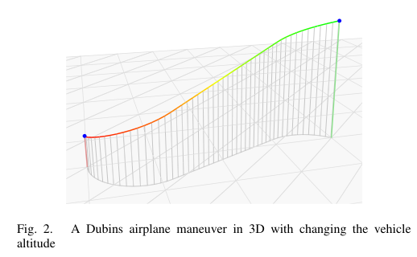

# Váňa, Faigl, Sláma, Pěnička 2017 · Lập kế hoạch thu dữ liệu với mô hình máy bay Dubins và ngân sách quãng bay

## Tóm tắt một dòng
DA-OP: orienteering cho mô hình Dubins airplane 3D (độ cong và góc chúc ngóc bị chặn), điểm mục tiêu ở độ cao khác nhau; lấy mẫu đều hướng tiếp cận và giải bằng Randomized VNS; thử trên benchmark OP sửa thêm độ cao.

## Vì sao đọc
Chỉ để biết: mở rộng 3D của nhóm DOP/DOPN; liên quan nếu SigDrop cần đổi độ cao bay giữa các cell.

## Bài toán và mô hình
- **[GĐ]** UAV cánh bằng ngân sách quãng bay hạn chế (pin/nhiên liệu); mục tiêu là điểm 3D có thưởng; điểm đầu/cuối cố định (tr. 1).
- **[GĐ]** Mô hình Dubins airplane (Chitsaz–LaValle 2007): độ cong bị chặn, góc chúc ngóc ψ ∈ [ψ_min, ψ_max] đổi tức thời; tại mục tiêu góc chúc ngóc = 0 (tr. 2–3).

## Định nghĩa và ký hiệu
| Ký hiệu | Nghĩa |
|---|---|
| DA-OP | Dubins Airplane Orienteering Problem |
| ψ | góc chúc ngóc (pitch) |
| T_max | ngân sách quãng bay |
| RVNS | Randomized Variable Neighborhood Search |

## Kết quả chính
- **[KQ]** Có lẽ là mở rộng đầu tiên của orienteering cho thu dữ liệu 3D bằng UAV (theo tác giả, tr. 6); lời giải khả thi trên các instance thử (Fig. 5–6).

## Thuật toán
- **[TT] RVNS** (Algorithm 1, tr. 3–4). Lời giải ban đầu → shake → localSearch → selectLocations theo ngân sách → chấp nhận nếu thưởng tăng; đường ngắn nhất qua dãy điểm với hướng lấy mẫu tính trên đồ thị (Fig. 3).

## Thực nghiệm và số liệu
Không đọc (mức abstract); benchmark OP Set 64 với độ cao điểm thay đổi (β) (Fig. 4).

## Hình tiêu biểu

*Đọc hình:* đường gồm cung tròn và đoạn thẳng như Dubins phẳng, cộng thêm thành phần leo/hạ với góc bị chặn.

## Trích nguyên văn
- **[TRÍCH]** "The proposed DA-OP stands to find the most rewarding data collection trajectory visiting a subset of the given target locations while the trajectory does not exceed the limited travel budget." (tr. 1)

## Liên hệ SigDrop
- **[NX]** SigDrop bay ở độ cao cố định nên chỉ cần mô hình phẳng; dẫn bài này nếu bàn đổi độ cao để tăng bán kính nghe (Al-Hourani 2014) trong cell xa.

## Hạn chế và câu hỏi mở
- Chỉ đọc abstract, mở đầu, kết luận.
