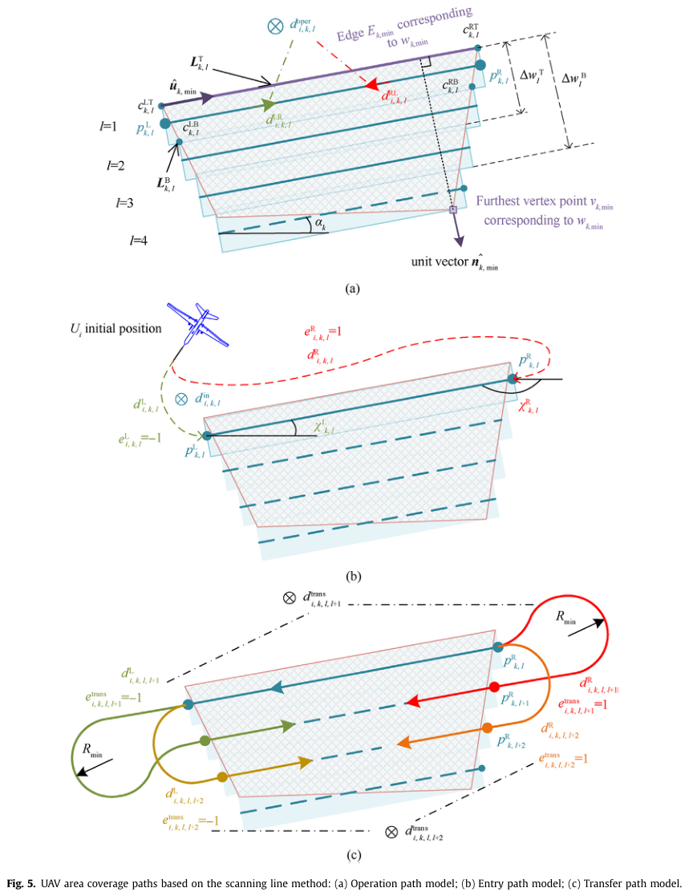

# Wang, Zhang, Li, Zhang 2025 · Lập đường phủ 3D phối hợp cho nhiều UAV cánh bằng ở vùng phức tạp

## Tóm tắt một dòng
Mô hình DCCPP (phủ kín động) cho nhiều UAV cánh bằng: lồi hoá vùng, chia đường thành đường thao tác (quét), đường vào và đường chuyển vùng (nối bằng Dubins), phân vùng cho UAV bằng tham lam theo chỉ số phân bổ, tối ưu tổ hợp bằng quy hoạch động cải tiến (IDP), rồi nâng lên 3D theo địa hình bằng hạ độ cao; kiểm chứng mô phỏng và bán vật lý thực tế hỗn hợp.

## Vì sao đọc
Chỉ để biết: ví dụ hệ thống phủ vùng nhiều UAV cánh bằng trong cứu hộ/trinh sát có sự kiện động [TOUR], bối cảnh [ĐV].

## Bài toán và mô hình
- **[GĐ]** Nhiều UAV cánh bằng, địa hình 3D lưới rời rạc, vùng phức tạp được xấp xỉ lồi; trường nhìn (FOV) camera quyết định bề rộng dải (tr. 1–5).
- **[GĐ]** Sự kiện động trong nhiệm vụ (UAV rời đi, vùng mới…) kích hoạt lập lại kế hoạch (tr. 14).

## Định nghĩa và ký hiệu
| Ký hiệu | Nghĩa |
|---|---|
| DCCPP | dynamic complete coverage path planning |
| IDP | improved dynamic programming |
| đường thao tác / vào / chuyển | ba loại đoạn đường theo trạng thái FOV (Fig. 5) |

## Kết quả chính
- **[KQ]** Đường phủ sinh ra giảm đáng kể cả thời gian tính và độ dài đường so với phương pháp so sánh (tr. 1, 17–18).

## Thuật toán
- **[TT]** Mô hình → phân bổ vùng tham lam → IDP tối ưu tổ hợp ba loại đường → hạ độ cao theo địa hình cho đường 3D (Fig. 6).

## Thực nghiệm và số liệu
Không đọc (mức abstract).

## Hình tiêu biểu

*Đọc hình:* mỗi lần đổi dải UAV phải vòng ra ngoài vùng với bán kính quay R_min.

## Trích nguyên văn
- **[TRÍCH]** "Complex multi-area collaborative coverage path planning in dynamic environments poses a significant challenge for multi-fixed-wing UAVs" (tr. 1)

## Liên hệ SigDrop
- **[NX]** Ít liên quan trực tiếp (phủ vùng cho camera, không phải phát dữ liệu); chỉ dẫn khi nói bối cảnh nhiều UAV cánh bằng trong SAR.

## Hạn chế và câu hỏi mở
- Chỉ đọc abstract, mở đầu, kết luận.
