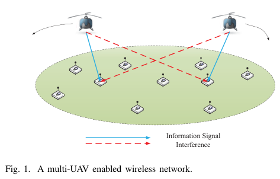
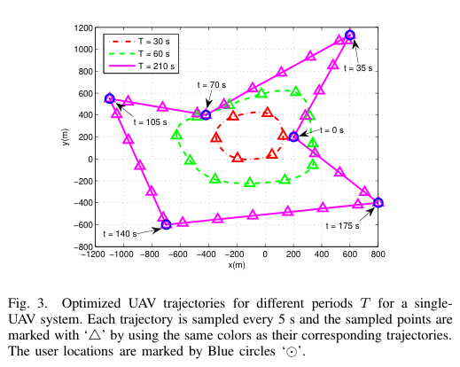
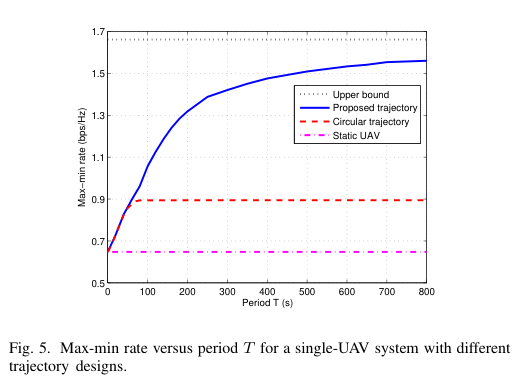

# Wu, Zeng, Zhang 2018 · Joint trajectory and communication design for multi-UAV enabled wireless networks

## Tóm tắt một dòng
M UAV phát xuống K người dùng chung một băng tần; tối đa tốc độ trung bình nhỏ nhất bằng cách chọn chung lịch và gán người dùng (nhị phân), quỹ đạo và công suất; nới lỏng biến nhị phân rồi giải luân phiên ba khối (LP cho lịch, tối ưu lồi kế tiếp cho quỹ đạo và công suất), có chứng minh hội tụ.

## Vì sao đọc
Mẫu phát biểu bài toán quen thuộc nhất của mảng tối ưu UAV, dùng làm khuôn viết (P1) của J1 (chatlog mục 400,
`paper/j1/FORMULATION-EXAMPLES-vi.md`).

## Bài toán và mô hình
- **[GĐ]** M UAV phục vụ K người dùng mặt đất ở vị trí đã biết; UAV bay độ cao cố định H, tốc độ ≤ V_max, quay về điểm đầu sau mỗi
  chu kỳ T (1)–(3); khoảng cách giữa hai UAV ≥ d_min (tr. 3).
- **[GĐ]** Chu kỳ chia N khe đủ nhỏ để vị trí UAV coi như không đổi trong khe; ràng buộc quỹ đạo rời rạc (4)–(6); số khe tối thiểu
  theo độ chính xác (7) (tr. 3).
- **[GĐ]** Kênh LoS thuần, suy hao tự do h = ρ₀/(H² + ‖q − w‖²) (9); bỏ qua Doppler (tr. 3).
- **[GĐ]** Mỗi khe một UAV phục vụ tối đa một người dùng và mỗi người dùng tối đa một UAV (10)–(12); nhiễu đồng kênh giữa các UAV
  trong SINR (13) (tr. 4).
- **[GĐ]** Mục tiêu: tối đa tốc độ trung bình nhỏ nhất qua mọi người dùng, bài (15) (tr. 4).

## Định nghĩa và ký hiệu
| Ký hiệu | Nghĩa |
|---|---|
| A = {α_k,m[n]} | lịch và gán: người dùng k được UAV m phục vụ ở khe n (nhị phân) |
| Q = {q_m[n]} | quỹ đạo rời rạc của UAV m |
| P = {p_m[n]} | công suất phát của UAV m, 0 ≤ p ≤ P_max |
| η | biến phụ: tốc độ trung bình nhỏ nhất (epigraph) |
| S_max = V_max·δt | quãng tối đa mỗi khe |
| R̄_k | tốc độ trung bình của người dùng k qua N khe |

- **[ĐN]** Bài (15): max_{η,A,Q,P} η s.t. (15b) (1/N)Σ_n Σ_m α_k,m[n] log₂(1 + γ_k,m[n]) ≥ η ∀k; (15c)–(15e) ràng buộc lịch nhị phân;
  (15f)–(15h) quỹ đạo; (15i) công suất (tr. 4).

## Kết quả chính
- **[KQ]** (15) là bài nguyên hỗn hợp không lồi vì hai lý do: biến lịch nhị phân, và (15b), (15h) không lồi theo quỹ đạo và công suất
  ngay cả khi lịch cố định (tr. 4).
- **[KQ]** Với Q, P cố định, bài lịch (17) là LP; ở nghiệm tối ưu (17c), (17d) xảy ra dấu bằng (tr. 4–5).
- **[KQ]** Bài công suất (29) NP-khó với N tổng quát (tr. 6).
- **[KQ] Hội tụ** (tr. 7). Mỗi bước của Algorithm 1 không làm giảm η: bước lịch giải đúng (35); bước quỹ đạo và công suất giải bài
  xấp xỉ có chặn dưới chặt tại điểm hiện tại (36), (37); nên η không giảm (38) và hội tụ vì bị chặn trên.
- **[KQ]** Một UAV, T và V_max đủ lớn: tốc độ max-min bị chặn trên bởi R_ub = (1/K) log₂(1 + Pρ₀/(H²σ²)) = 1,6612 bps/Hz (41), chặt khi
  thời gian bay giữa người dùng không đáng kể (tr. 9).

## Thuật toán
- **[TT] Algorithm 1, BCD** (tr. 7). Lặp: giải LP (17) cho A; giải bài lồi (28) cho Q (chặn dưới bậc nhất (23), (26), (27) của các hàm
  không lồi); giải bài lồi (34) cho P (chặn trên bậc nhất (32)); dừng khi mức tăng tương đối dưới ε.
- **[TT] Khởi tạo** (tr. 7–8). Quỹ đạo tròn, tâm từ bài xếp đường tròn (circle packing) cho M vòng trong đường tròn nhỏ nhất phủ mọi
  người dùng, bán kính min(r_max, r_cp/2) với r_max = V_max T/(2π) (39), (40).
- **[TT] Khôi phục nghiệm nhị phân** (tr. 8). Chia mỗi khe thành τ khe con, gán ⌊τα⌉ khe con; τ càng lớn khoảng cách càng nhỏ, nghiệm
  luôn khả thi cho bài với N′ = τN khe.

## Thực nghiệm và số liệu
- **[TS]** K = 6 người dùng rải đều trong 2 × 2 km², một lần rút; H = 100 m; σ² = −110 dBm; ρ₀ = −60 dB; P_max = 0,1 W; V_max = 50 m/s;
  d_min = 100 m; τ = 100; ε = 10⁻⁴ (tr. 8).
- **[SỐ]** Một UAV: T càng lớn thì quỹ đạo càng tới gần từng người dùng; ở T = 210 s UAV dừng trên từng người dùng (tốc độ 0)
  (Fig. 3, 4, tr. 9).
- **[SỐ]** Hai UAV, T = 90 s: Algorithm 1 hội tụ sau khoảng 40 vòng (Fig. 7, tr. 10); max-min 1,5947 bps/Hz khi không chỉnh công suất
  và 1,8434 bps/Hz khi có (Fig. 9, tr. 11).
- **[SỐ]** Để đạt khoảng 1,60 bps/Hz, một UAV cần T > 800 s, hai UAV chỉ cần khoảng 70 s (tr. 10).

## Hình tiêu biểu

*Đọc hình:* hai UAV phát cùng băng; mỗi người dùng nhận tín hiệu từ UAV của mình (xanh) và nhiễu từ UAV kia (đỏ đứt).

*Đọc hình:* T ngắn thì vòng nhỏ quanh tâm; T = 210 s thì quỹ đạo thành tour qua đúng trên các người dùng, điểm mẫu dày gần người dùng.

*Đọc hình:* quỹ đạo tối ưu tiến dần tới chặn trên (41) khi T tăng; quỹ đạo tròn bão hoà sớm, UAV đứng yên không đổi.

## Trích nguyên văn
- **[TRÍCH]** "Problem (15) is challenging to solve due to the following two main reasons. First, the optimization variables A for
  user scheduling and association are binary […]. Second, even with fixed user scheduling and association, (15b) and (15h) are
  still non-convex constraints" (tr. 4)

## Liên hệ SigDrop
- **[NX] [TOUR]** Khuôn cho (P1) của J1 (`paper/j1/archive/urban-v1/PROBLEMS-vi.md`): ba khối biến Q (quỹ đạo), S (lịch phát), F (luồng mặt đất); biến
  phụ θ cho makespan; đoạn "vì sao khó" nêu hai lý do; chia khối giải luân phiên. Bước "Q cố định thì A là LP" ứng với "q cố định thì
  F nới lỏng thành LP tải lớn nhất" (`uav-coop2/tools/river_lb.py --lp`).
- **[NX]** Chặn trên (41) khi bỏ thời gian bay là cùng kiểu với chặn của SigDrop khi UAV treo tại chỗ (Định lý 2 của bản thảo J1).
- **[NX]** Khác SigDrop: kênh LoS tất định (không có xác suất nhận gói), UAV cánh quay (không có ràng buộc độ cong), không có hợp tác
  mặt đất, mục tiêu là tốc độ chứ không phải thời gian hoàn tất.

## Hạn chế và câu hỏi mở
- Kết quả trên một lần rút vị trí người dùng; chỉ có nghiệm cục bộ, không có khoảng cách tới tối ưu.
- Cánh bằng cần thêm ràng buộc tốc độ tối thiểu (bài nói xử lý được với sửa nhỏ, chú thích 1, tr. 3) nhưng không có ràng buộc độ cong.
