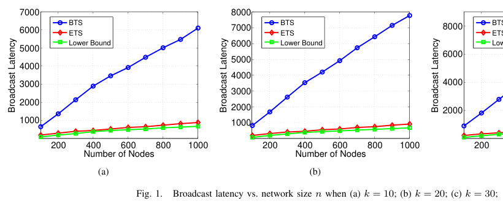

# You, Yuan, Tang, Chen 2013 · Minimum latency broadcast scheduling in single-radio multi-channel WANETs

## Tóm tắt một dòng
Lập lịch quảng bá trễ nhỏ nhất (MLBS) từ một nguồn trên đồ thị đĩa đơn vị khi mỗi node có một radio và kênh nhận cố định trong k kênh; chứng minh NP-khó bằng thu hẹp về MLBS một kênh, thuật toán BTS tỉ số 4k + 12 và ETS tỉ số k + 23, chặn dưới là độ sâu cây đường đi ngắn nhất.

## Vì sao đọc
Mẫu phát biểu và nguồn độ khó cho phần mặt đất của (P1) trong J1: bài viết ở dạng quyết định, chứng minh NP-khó bằng thu hẹp, có chặn
dưới đơn giản (chatlog mục 400).

## Bài toán và mô hình
- **[GĐ]** Mạng mô hình bằng đồ thị đĩa đơn vị G = (V, E); thời gian chia khe đều, mỗi khe đủ một lần phát và nhận; biên khe đồng bộ
  (tr. 2).
- **[GĐ]** Nhận không lỗi nếu không va chạm (tr. 2).
- **[GĐ]** k kênh trực giao; mỗi node một radio, không phát và nghe cùng lúc; kênh nhận A(v) cố định từ lúc khởi tạo, kênh phát đổi được;
  biết trước kênh nhận của hàng xóm (tr. 2).
- **[GĐ]** Quảng bá một nguồn s, bắt đầu ở khe 1, xong khi mọi node nhận được thông điệp (tr. 2).

## Định nghĩa và ký hiệu
| Ký hiệu | Nghĩa |
|---|---|
| G = (V, E), n = \|V\| | đồ thị đĩa đơn vị |
| C = {1, …, k}, A(v) | tập kênh, kênh nhận của node v |
| S = {S₁, …, S_T} | lịch: S_i là tập (node, kênh) phát ở khe i |
| T | độ dài lịch |
| l | độ sâu cây đường đi ngắn nhất (SPT) gốc s |

- **[ĐN] MLBS-SRMC (bản quyết định)** (tr. 2): cho G, A và số nguyên T, có cách gán khe và kênh phát cho các node sao cho lịch không
  va chạm và dài không quá T không.

## Kết quả chính
- **[KQ] Định lý 1** (tr. 2). MLBS-SRMC NP-khó. *Chứng minh:* thu hẹp A về một kênh thì được đúng MLBS một kênh, đã biết là NP-khó
  (Gandhi và cộng sự).
- **[KQ]** Chặn dưới T ≥ l, độ sâu của SPT (tr. 2).
- **[KQ]** BTS cho trễ tối đa (4k + 12)·l, tức tỉ số xấp xỉ 4k + 12 (tr. 4).
- **[KQ]** ETS: mỗi tầng thêm tối đa k + 23 khe, tỉ số xấp xỉ k + 23 (tr. 4–5).

## Thuật toán
- **[TT] BTS** (Algorithm 1, tr. 3–4). Dựng SPT gốc s, chia node theo tầng và theo kênh nhận; mỗi tầng và mỗi kênh chọn một tập độc
  lập cực đại (dominator, cũng là tập trội của tầng) cùng các node cha nối tới (connector); lập lịch từng kênh một, tô màu khoảng cách 2
  để tránh va chạm.
- **[TT] ETS** (tr. 4–5). Như BTS nhưng tận dụng phát song song trên các kênh khác nhau.

## Thực nghiệm và số liệu
- **[SỐ]** ETS tốt hơn BTS và tiến gần chặn dưới khi tăng số node (200–1 000) và số kênh (k = 10, 20, 30) (Fig. 1, 2, tr. 6).

## Hình tiêu biểu

*Đọc hình:* BTS tăng gần tuyến tính theo số node; ETS bám sát chặn dưới độ sâu SPT.

## Trích nguyên văn
- **[TRÍCH]** "Given a UDG G(V, E) with channel assignment function A, and positive integer T, is there an assignment of time slots and
  transmission channels to nodes v ∈ V, such that the broadcast scheduling is collision-free and the schedule length is no more
  than T?" (tr. 2)

## Liên hệ SigDrop
- **[NX] [D]** Phần F (luồng mặt đất) của (P1) trong `paper/j1/PROBLEMS-vi.md`: cho quỹ đạo cố định, một gói và một cell nguồn, bài gần
  với MLBS, nên có thể chứng minh NP-khó bằng thu hẹp như Định lý 1 của bài này. Cần kiểm mô hình va chạm: bài dùng va chạm theo đồ thị
  đĩa đơn vị, SigDrop dùng môi trường (cell, cặp gateway) một máy phát mỗi khe.
- **[NX]** Chặn T ≥ độ sâu SPT ứng với chặn một radio (Mệnh đề 2 của bản thảo J1): cả hai là chặn hiển nhiên mà thuật toán được so cùng.
- **[NX]** Mô hình một radio, kênh nhận cố định và đổi kênh khi phát gần với lịch kênh của SigDrop (7 màu cell, kênh cặp gateway, K1d).

## Hạn chế và câu hỏi mở
- Nhận không lỗi, không có mất gói; mô hình đĩa đơn vị.
- Một nguồn, một thông điệp; SigDrop có nhiều cell giữ các gói khác nhau sau lượt bay.
