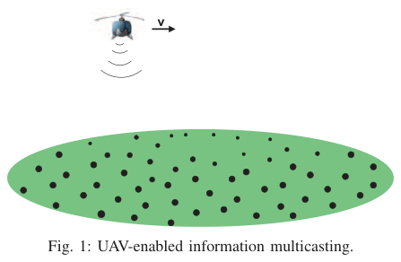
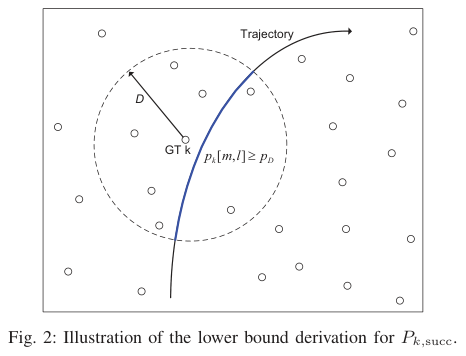
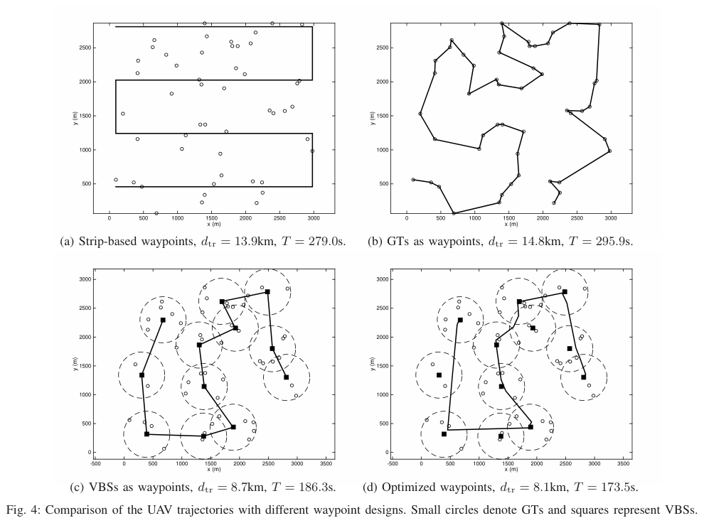
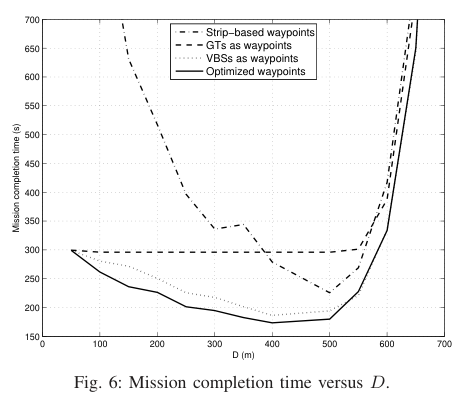

# Zeng, Xu, Zhang 2018 · Trajectory design for completion time minimization in UAV-enabled multicasting

## Tóm tắt một dòng
UAV phát một file chung (RLNC) cho K trạm mặt đất; chặn dưới xác suất giải được đưa ràng buộc về "thời gian kết nối tối thiểu trong bán kính D", quỹ đạo tối ưu gồm các đoạn thẳng, waypoint chọn qua đặt trạm ảo (VBS) + TSP + tối ưu lồi, tốc độ qua LP.

## Vì sao đọc
Đây gần như là baseline FC của SigDrop ở bản một chặng, UAV cánh quay, không hợp tác mặt đất. Bài cung cấp dạng chặn
dưới có biên Gauss cho số gói cần nhận, và có câu nêu pha chia sẻ D2D sau multicast là hướng mở; cả hai dùng trực tiếp
cho định lý A và cho phần định vị đóng góp.

## Bài toán và mô hình
- **[GĐ]** K trạm mặt đất (GT) ở vị trí wₖ đã biết; UAV bay độ cao H cố định, tốc độ ≤ V_max (tr. 3).
- **[GĐ]** File W bit chia N′ = W/R_p gói gốc, mã RLNC thành N > N′ gói; GT giải được khi nhận bất kỳ N′ gói; chỉ cần gắn
  seed hệ số mã nên chi phí mã không đáng kể (tr. 3).
- **[GĐ]** Tốc độ phát R cố định; mỗi gói T_p = R_p/R; thời gian nhiệm vụ T = N·T_p (1) (tr. 3).
- **[GĐ]** Kênh: suy hao β₀d^(−α) theo khoảng cách xiên d = √(H² + ‖q − wₖ‖²) (5); fading nhỏ gₖ[m, l] độc lập cùng phân
  bố theo GT, slot, gói; tựa tĩnh trong một gói (6) (tr. 3–4).
- **[GĐ]** Gói nhận được khi B log₂(1 + P|h|²/(σ²Γ)) ≥ R, nên pₖ = F(γ_th/γ̄₀ · (H² + ‖q − wₖ‖²)^(α/2)) với F là ccdf của
  |g|² (8) (tr. 4).
- **[GĐ]** Thời gian rời rạc thành slot δt, khoảng cách coi như không đổi trong slot; L = δt/T_p gói mỗi slot (tr. 3–4).
- **[GĐ]** Mục tiêu: cực tiểu T sao cho mọi GT giải được với xác suất ≥ P̄ (P1, (12)) (tr. 5).
- **[GĐ]** Bài chỉ xét pha multicast; pha chia sẻ D2D sau đó được nêu như hướng nghiên cứu (tr. 3).

## Định nghĩa và ký hiệu
| Ký hiệu | Nghĩa |
|---|---|
| N′, N | số gói gốc, số gói mã đã phát |
| Nₖ | số gói GT k nhận được; tổng Bernoulli độc lập khác xác suất (Poisson binomial) (10) |
| P_k,succ = Pr(Nₖ ≥ N′) | xác suất GT k giải được file (11) |
| D | bán kính phụ: chỉ đếm các slot UAV cách GT ≤ D theo phương ngang |
| p_D | xác suất nhận gói ở khoảng cách ngang D (14) |
| M_k,D | tập slot có ‖q[m] − wₖ‖ ≤ D ("kết nối"); \|M_k,D\| là số slot kết nối (15) |
| D* | khoảng cách mà SNR trung bình bằng ngưỡng: D* = √((γ̄₀/γ_th)^(2/α) − H²) (9) |
| M_min, T_min | số slot và thời gian kết nối tối thiểu (25), (30) |
| VBS | trạm gốc ảo: điểm đặt sao cho mỗi GT cách ít nhất một VBS ≤ D |

## Kết quả chính
- **[KQ] Bổ đề 1** (tr. 5). Tổng X của các Bernoulli(pₙ) độc lập và nhị thức X̂ ~ B(N, p̂) với p̂ ≤ pₙ với mọi n thì
  Pr(X ≥ x) ≥ Pr(X̂ ≥ x) với mọi x.
- **[KQ] Định lý 1** (tr. 5). Với mọi D ≥ 0, P_k,succ ≥ P_k,lb = Pr(N̂ₖ ≥ N′), trong đó N̂ₖ ~ B(|M_k,D|·L, p_D).
  *Ý chứng minh:* bỏ các slot ngoài bán kính D (chỉ làm giảm số gói nhận), rồi áp Bổ đề 1 với p_D ≤ pₖ trong bán kính (tr. 6).
- **[KQ] Ràng buộc thời gian kết nối** (tr. 6). Xấp xỉ Gauss cho nhị thức:
  P_k,lb ≈ Q((N′ − |M|Lp_D)/√(|M|Lp_D(1 − p_D))) (24). Ràng buộc P_k,lb ≥ P̄ tương đương |M_k,D| ≥ M_min = A²/L (25), với
  A = (1/(2√p_D))·(√(4N′ + (1 − p_D)(Q⁻¹(P̄))²) − Q⁻¹(P̄)√(1 − p_D)) (26).
  Trường hợp biên: p_D → 1 cho M_min = N′/L; p_D → 0 cho M_min ∝ 1/p_D.
- **[KQ] Định lý 2** (tr. 6). Không mất tối ưu, quỹ đạo của (P3) có thể giả sử chỉ gồm các đoạn thẳng nối nhau, nên bài
  toán thành chọn waypoint có thứ tự và tốc độ dọc đường.
- **[KQ]** Khi D = 0, (P3) là thăm lần lượt mọi GT và dừng trên mỗi GT ít nhất T_min, tức TSP không quay về (tr. 7). Khi
  D > 0, bài toán giống TSP với lân cận nhưng có thêm ràng buộc thời gian kết nối tối thiểu, nên thuật toán TSPN có sẵn
  không áp trực tiếp được (tr. 7).

## Thuật toán
- **[TT] Phương án 1 (benchmark): GT làm waypoint** (tr. 7). TSP qua mọi GT (thêm nút giả để không phải quay về).
- **[TT] Phương án 2: VBS làm waypoint** (tr. 7). Đặt số ít nhất VBS bán kính D phủ mọi GT (thuật toán đặt trạm xoắn ốc),
  rồi TSP qua G ≤ K VBS.
- **[TT] Phương án 3: tối ưu lồi trên VBS** (tr. 7–8). Với mỗi nhóm Sg, vùng Cg = giao các đĩa bán kính D quanh các GT của
  nhóm (lồi). Chọn điểm vào sg và ra fg trong Cg để cực tiểu Σ max{‖fg − sg‖/V_max, T_min} + Σ ‖s(g+1) − fg‖/V_max (P4),
  là bài toán lồi (giải bằng CVX).
- **[TT] Tối ưu tốc độ** (tr. 8). Rời rạc đường theo quãng δd, biến τⱼ là thời gian giữa hai điểm; cực tiểu Στⱼ với
  Σⱼ Iₖⱼτⱼ ≥ T_min và τⱼ ≥ δd/V_max (P5), là LP.
- **[TT] Benchmark quét dải** (tr. 9). Hình chữ nhật nhỏ nhất chứa mọi GT chia thành dải rộng 2D, bay dọc tâm các dải.

## Thực nghiệm và số liệu
- **[TS]** Bảng II (tr. 8): H = 100 m; V_max = 50 m/s; P = 10 dBm; B = 1 MHz; σ² = −109 dBm; Γ = 10 dB; W = 2 Mbit;
  R_p = 10⁴ bit/gói; N′ = 200; R = 1 Mbit/s; T_p = 0,01 s; δt = 0,1 s; L = 10; β₀ = −40 dB; α = 2,6; Rician K_c = 2;
  P̄ = 0,9.
- **[TS]** GT phân bố đều trong hình vuông cạnh 3 000 m; fading Rician, ccdf qua hàm Marcum-Q (39); TSP giải bằng mã
  Matlab có sẵn (tr. 8–9).
- **[SỐ]** K = 50, D = 400 m (Fig. 4, tr. 9): quét dải 13,9 km / 279,0 s; GT làm waypoint 14,8 km / 295,9 s; VBS 8,7 km /
  186,3 s; tối ưu waypoint 8,1 km / 173,5 s.
- **[SỐ]** Chặn dưới được kiểm bằng Monte Carlo 10⁴ lần: với quỹ đạo tối ưu, xác suất thật gần 1 dù chặn dưới vừa chạm
  P̄ = 0,9 ở vài GT, tức chặn khá bảo thủ (Fig. 5, tr. 9–10).
- **[SỐ]** T theo D có dạng chữ U: D lớn làm p_D giảm (cần kết nối lâu hơn) nhưng phủ nhiều GT cùng lúc (bay ngắn hơn).
  D* = 430,3 m gần tối ưu (Fig. 6, tr. 10).
- **[SỐ]** K = 80: hai phương án đề xuất giảm khoảng 50 % thời gian so với GT làm waypoint và khoảng 30 % so với quét
  dải (Fig. 7, tr. 10).
- **[SỐ]** Trạm phát cố định ở tâm, K = 100: sau 10⁴ s chỉ 23 GT đạt P̄; UAV có quỹ đạo tối ưu cần khoảng 210 s cho cả
  100 GT (Fig. 8, tr. 11).

## Hình tiêu biểu

*Đọc hình:* một UAV, nhiều GT rải rác; không có liên kết giữa các GT.

*Đọc hình:* phần quỹ đạo trong đĩa bán kính D quanh GT là "thời gian kết nối"; phần ngoài bị bỏ qua khi chặn.

*Đọc hình:* (c) và (d) chỉ ghé các vùng phủ (đường đứt) thay vì từng GT; (d) cắt góc trong vùng giao nên ngắn nhất.

*Đọc hình:* dạng chữ U, đáy gần D* = 430 m; quá 550 m thì mọi phương án đều tăng vọt vì p_D quá nhỏ.

## Trích nguyên văn
- **[TRÍCH]** "a subsequent device-to-device (D2D) packet sharing phase could be employed, so that those GTs who fail to recover the file will receive additional packets from their peers until they can also successfully recover the file" (tr. 3)
- **[TRÍCH]** "a joint investigation of the UAV multicasting and D2D file sharing would be an interesting problem for future research." (tr. 3)
- **[TRÍCH]** "if D is chosen to be large such that p_D → 0 ... the minimum number of connection time slots M_min increases inversely proportional with p_D." (tr. 6)

## Liên hệ SigDrop
- **[NX] [ĐV]** Câu trích ở tr. 3 cho thấy Zeng et al. coi pha chia sẻ mặt đất sau multicast là hướng mở. SigDrop đi đúng
  vào khoảng trống này nhưng ở dạng nhiều chặng, theo kế hoạch tính sẵn, với UAV cánh bằng. Nên trích câu này ở phần
  related work. Rủi ro: Wang 2020 (IoT-J) có thể đã làm bản một chặng của hướng này; cần đọc.
- **[NX] [FC] [A]** Baseline FC của SigDrop dùng biên an toàn 3√((1 + ε)K) mỗi file; Zeng dùng biên Gauss với Q⁻¹(P̄) ở
  (25)–(26). Hai cách cùng bản chất. Định lý A có thể phát biểu chặn dưới của T_FC theo "thời gian kết nối tối thiểu"
  T_min(p_D) như (30), và trích Định lý 1 cùng (25). Tính chất M_min ∝ 1/p_D khi p_D nhỏ chính là cơ chế làm FC thua khi
  kênh xấu (r100), đúng điều định lý A muốn nói.
- **[NX] [KÊNH]** Nhiều tham số của Bảng II trùng với SigDrop: H = 100 m, V_max = 50 m/s, P = 10 dBm, T_p = 10 ms, Rician
  K = 2. SigDrop dùng α = 3 ngoài 100 m, Zeng dùng α = 2,6. Nếu tham số SigDrop bắt nguồn từ bài này thì phải trích.
- **[NX] [TOUR]** Khác biệt chính với SigDrop: UAV cánh quay được dừng và đổi hướng tự do (quỹ đạo đoạn thẳng, Định lý 2);
  UAV cánh bằng không làm được, nên phải dùng Dubins (Le Ny 2012, Isaacs 2011). Bài cũng nói TSPN có ràng buộc thời gian
  kết nối không giải được bằng thuật toán TSPN có sẵn, điều này đúng cả với bài toán lượn của FC.
- **[NX] [GIÓ]** Bài không xét lệch quỹ đạo.

## Hạn chế và câu hỏi mở
- Một chặng, không hợp tác mặt đất (chỉ nêu D2D như hướng mở).
- UAV cánh quay, được dừng; không có ràng buộc bán kính quay.
- D chọn theo kinh nghiệm (D*), không có lời giải tối ưu cho D.
- Fading độc lập giữa các gói (giống giả định A1 của SigDrop).
