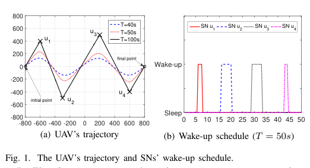
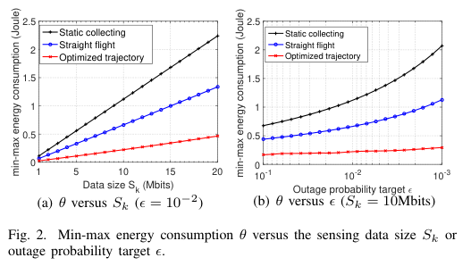

# Zhan, Zeng, Zhang 2018 · Energy-efficient data collection in UAV enabled WSN

## Tóm tắt một dòng
Một UAV bay từ q₀ tới q_F trong thời gian T thu dữ liệu của K cảm biến; chọn chung lịch đánh thức (mỗi khe tối đa một cảm biến) và quỹ đạo để tối thiểu năng lượng lớn nhất của các cảm biến, với độ tin cậy đưa vào qua xác suất mất gói ε; nới lỏng nhị phân, giải luân phiên LP và QCQP.

## Vì sao đọc
Bài (P1) ngắn, sáu nhóm ràng buộc, có đúng dạng ràng buộc "mỗi khe một máy phát" và cách đưa độ tin cậy vào tham số kênh; dùng làm
mẫu cho (P1) của J1 (chatlog mục 400).

## Bài toán và mô hình
- **[GĐ]** K cảm biến ở vị trí w_k đã biết, mỗi cảm biến có S_k bit; UAV bay độ cao H, tốc độ ≤ V_max, điểm đầu q₀ và cuối q_F cố định
  trong thời gian T; thời gian chia M khe δt (tr. 2).
- **[GĐ]** Cơ chế ngủ và đánh thức: mỗi khe tối đa một cảm biến được đánh thức, x_k[m] ∈ {0, 1}, Σ_k x_k[m] ≤ 1 (tr. 2).
- **[GĐ]** Kênh fading khối tựa tĩnh, mỗi khe gồm L ≫ 1 khối fading; UAV chỉ biết vị trí cảm biến và phân bố kênh (tr. 2).
- **[GĐ]** Tốc độ R_k[m] chọn sao cho xác suất mất gói bằng ε: R_k[m] = log₂(1 + F⁻¹(ε)P_kβ₀/(σ²Γ(H² + ‖q[m] − w_k‖²)^(α/2))) (4)
  (tr. 2).
- **[GĐ]** Mục tiêu: tối thiểu năng lượng lớn nhất của các cảm biến, đủ dữ liệu từ mỗi cảm biến với độ tin cậy 1 − ε (tr. 2).

## Định nghĩa và ký hiệu
| Ký hiệu | Nghĩa |
|---|---|
| X = {x_k[m]} | lịch đánh thức (nhị phân) |
| Q = {q[m]} | quỹ đạo rời rạc |
| θ | biến phụ: năng lượng lớn nhất của các cảm biến |
| E_k = δt·P_k | năng lượng một khe phát của cảm biến k |
| r_k = S_k/(Bδt) | lượng dữ liệu cần, quy theo bps/Hz mỗi khe |
| D_max = δt·V_max | quãng tối đa mỗi khe |
| ε | xác suất mất gói tối đa cho phép |

- **[ĐN]** (P1): min_{X,Q,θ} θ s.t. (5) Σ_m x_k[m]E_k ≤ θ ∀k; (6) Σ_m x_k[m]R_k[m] ≥ r_k ∀k; (7) Σ_k x_k[m] ≤ 1 ∀m; (8) nhị phân;
  (9) ‖q[m] − q[m − 1]‖ ≤ D_max; (10) q[1] = q₀, q[M] = q_F (tr. 2).

## Kết quả chính
- **[KQ]** (P1) là bài nguyên hỗn hợp không lồi (tr. 3).
- **[KQ]** Nới lỏng x_k[m] ∈ [0, 1] không mất tối ưu khi L đủ lớn: phân ⌊Lx_k[m]⌉ khối fading cho cảm biến k (ví dụ x = 0,25 và 0,75
  với L = 100 cho 25 và 75 khối) (tr. 3).
- **[KQ]** Với Q cố định, bài lịch (P2) là LP; với X cố định, bài quỹ đạo (P3) (max-min thông lượng có trọng số 1/r_k) giải bằng chuỗi
  QCQP lồi (P4) dựa trên chặn dưới bậc nhất (13)–(16) (tr. 3).
- **[KQ]** Algorithm 2 hội tụ: θ không tăng qua mỗi vòng, chứng minh qua chuỗi (18) (tr. 3–4).

## Thuật toán
- **[TT] Algorithm 1** (tr. 3). Tối ưu lồi kế tiếp cho (P3): giải QCQP (P4) tại điểm hiện tại, cập nhật, dừng khi mức tăng dưới κ.
- **[TT] Algorithm 2** (tr. 3). Luân phiên: (P2) cho X với Q cố định, (P3) qua Algorithm 1 cho Q với X cố định; khởi tạo bằng đường
  thẳng q₀ → q_F.

## Thực nghiệm và số liệu
- **[TS]** K = 4 cảm biến trong 1,6 × 1,6 km², một lần rút; q₀ = [−800, 0], q_F = [800, 0] m; H = 100 m; V_max = 50 m/s; δt = 0,5 s;
  B = 1 MHz; β₀ = −60 dB; σ² = −110 dBm; Γ = 7 dB; Rician K_c = 10; α = 2; P_k = 0,1 W (tr. 4).
- **[SỐ]** T càng lớn thì UAV càng lại gần các cảm biến; ở T = 50 s các cảm biến ngủ gần hết thời gian, chỉ thức khi UAV ở gần (Fig. 1,
  tr. 4).
- **[SỐ]** Quỹ đạo tối ưu tốn ít năng lượng hơn bay thẳng và thu tĩnh ở tâm, khoảng cách càng lớn khi S_k tăng hoặc ε giảm (Fig. 2,
  T = 100 s, tr. 4).

## Hình tiêu biểu

*Đọc hình:* T = 100 s thì quỹ đạo đi qua đúng trên bốn cảm biến; mỗi cảm biến chỉ thức một quãng ngắn khi UAV ở gần.

*Đọc hình:* quỹ đạo tối ưu (đỏ) thấp nhất; khoảng cách với bay thẳng và thu tĩnh tăng theo S_k và khi ε nhỏ đi.

## Trích nguyên văn
- **[TRÍCH]** "Note that θ is a slack variable that represents the maximum energy consumption among all SNs, and the constraints (6)
  ensure that the target amount of data from each SN is collected reliably." (tr. 2)

## Liên hệ SigDrop
- **[NX] [TOUR]** Ràng buộc (7) Σ_k x_k[m] ≤ 1 là đúng dạng ràng buộc môi trường của (P1) trong `paper/j1/PROBLEMS-vi.md`: mỗi cell hoặc
  cặp gateway một máy phát mỗi khe.
- **[NX]** Độ tin cậy đưa vào qua F⁻¹(ε) ở tham số kênh, không thành ràng buộc xác suất; SigDrop có thể làm tương tự khi lập kế hoạch
  trên bản đồ nhận dự báo (ngưỡng θ cho P_c).
- **[NX]** Mẫu cho bài thư ngắn: phát biểu, nới lỏng, chia khối, hội tụ, một hình kết quả.

## Hạn chế và câu hỏi mở
- Một lần rút vị trí, bốn cảm biến; không có khoảng cách tới tối ưu.
- Mỗi khe chỉ một cảm biến, không có truyền đồng thời hay chuyển tiếp giữa cảm biến.
