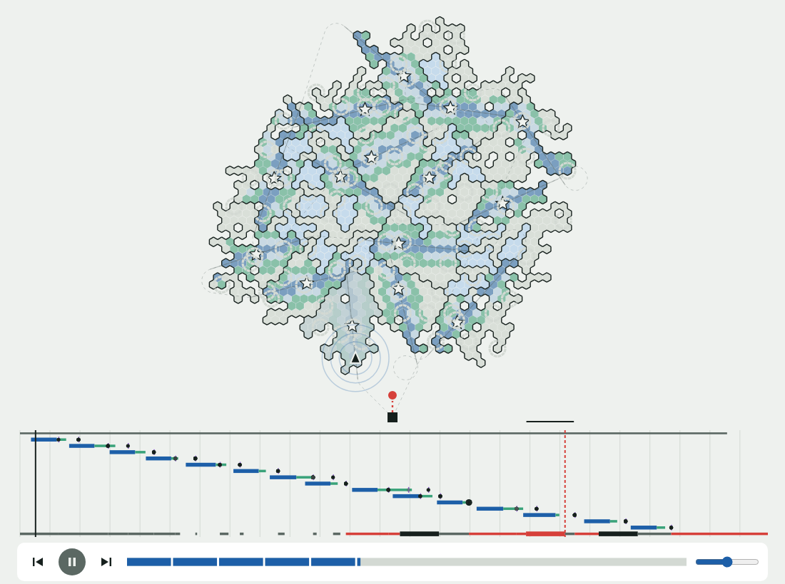
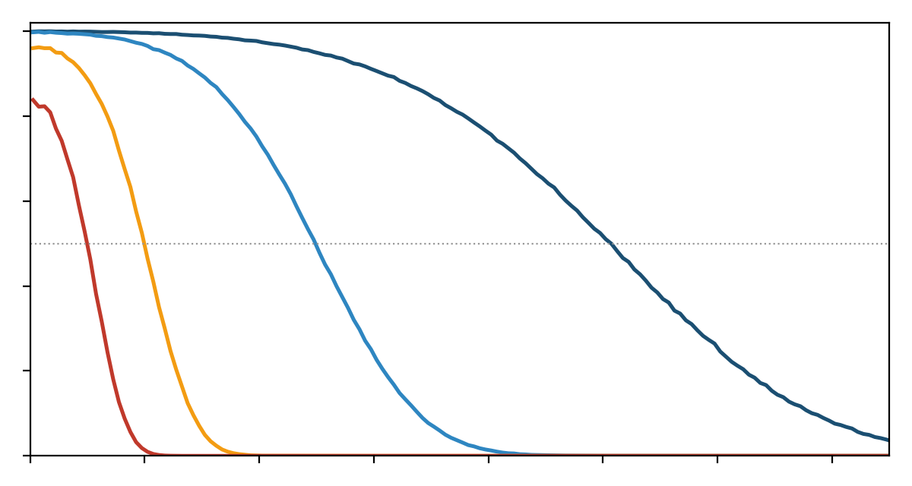
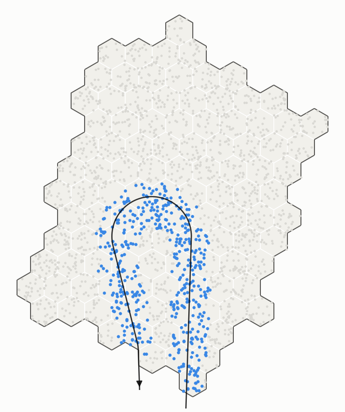
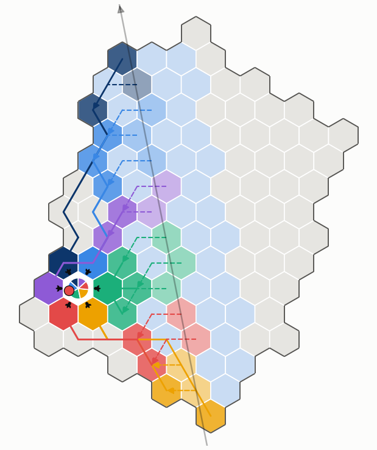
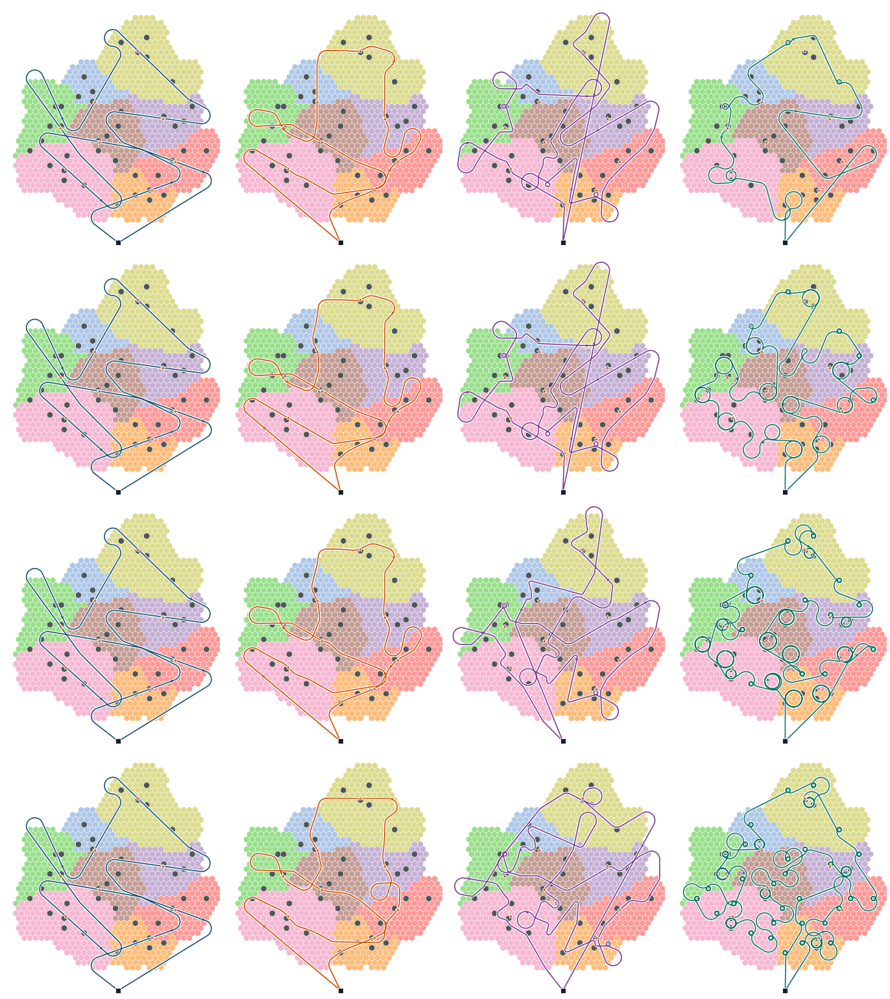
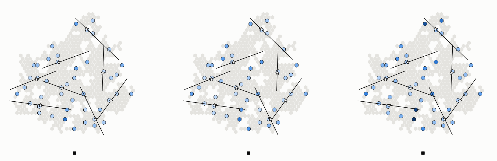
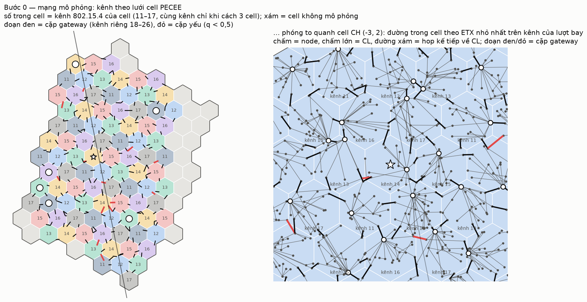
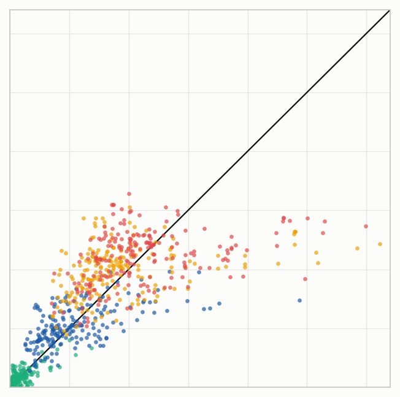

# Đề cương nghiên cứu SigDrop (bản nháp)

Đưa truy vấn nhận dạng xuống mạng camera IoT bằng UAV: tổ chức mạng theo lưới cell, lập quỹ đạo và phân phối dữ liệu
dưới mặt đất có kế hoạch.

Bản nháp viết theo khung người dùng đưa ngày 2026-11-06 (`docs/chatlog/2026-11.md`, mục 276–279). Số liệu ở mục 4 lấy
từ `docs/EXPERIMENTS-INDEX.md`. Chỗ ghi **[cần chốt]** là chỗ người dùng cần quyết định. Hình dùng lại ảnh đã có trong
repo; ảnh cũ còn chữ tiếng Việt, bản cuối sẽ vẽ lại không chữ.

---

## 1. Tóm tắt

Sau một sự việc như trẻ đi lạc hay cần truy vết một đối tượng, hàng nghìn camera IoT trong khu vực có thể đã ghi lại
mục tiêu, nhưng không thiết bị nào biết mình đang phải tìm ai. Tải dữ liệu thô về trạm gốc thường không khả thi. Ở
vùng hoang dã, đường truyền tầm xa như LoRa hay vệ tinh chỉ chuyển được vài trăm byte mỗi giờ; ở đô thị, dữ liệu thô
vướng ràng buộc pháp lý. SigDrop đi theo hướng ngược lại: đưa **truy vấn** xuống node biên thay vì kéo dữ liệu lên.
Truy vấn là một bộ ảnh tham chiếu khoảng 400 KB. Mỗi node tự đối sánh với kho ảnh của mình và chỉ gửi về một điểm số
vài byte.

Giải pháp gồm ba pha:
- **Pha 0** tổ chức mạng một lần theo lưới cell lục giác.
- **Pha 1** dùng một UAV cánh bằng bay một lượt qua mỗi cụm để phát truy vấn. Cơ chế **River** phân phối dữ liệu dưới
  mặt đất theo kế hoạch trạm gốc tính sẵn trước khi cất cánh.
- **Pha 2** dùng UAV cánh quay đến xác minh các cell nghi vấn.

Kết quả bước đầu trên ns-3 cho thấy hai điều. Tổ hợp LM-Tour + River nhanh nhất trong các phương án thực tế. Ở kênh
xấu, River rút ngắn 49–72 % thời gian so với cách dùng fountain code không hợp tác. Giai đoạn tiếp theo nhằm bốn việc:
- chứng minh chặt chẽ hơn bằng mô hình và cận dưới;
- làm giao thức bền vững trước các sai lệch thực tế;
- mở rộng quy mô đánh giá;
- kiểm chứng trên phần cứng.

*Hình 1. Một nhiệm vụ trên bản đồ 15 cụm (92 critical cell), chụp từ trang replay của mô phỏng.*

## 2. Đặt vấn đề và tính cấp thiết

### 2.1 Bối cảnh

Đô thị ngày nay có mật độ camera rất cao, nhưng chúng thuộc nhiều chủ sở hữu và phục vụ nhiều mục đích khác nhau:
camera an ninh, chuông cửa, máy bán hàng tự động, camera hành trình. Năng lực tính toán, bộ nhớ và đường truyền của
từng thiết bị rất khác nhau. Điểm chung là chúng ghi hình liên tục và ghi đè dữ liệu cũ sau vài ngày. Khi cần tìm một
người hay một phương tiện, dữ liệu có thể đã nằm sẵn trong mạng; cái còn thiếu là một mô tả cô đọng về đối tượng,
được đặt vào từng node trước khi bằng chứng bị ghi đè. UAV là phương tiện tự nhiên để mang một khối dữ liệu như vậy
tới một vùng rộng trong thời gian ngắn, nhất là ở nơi không có hạ tầng mạng.

### 2.2 Vấn đề cụ thể và khó khăn kỹ thuật

Bài toán là giao một tập Q gói (khoảng 400 KB) tới mọi **critical cell**, tức các cell có node đủ mạnh để đối sánh,
từ một UAV cánh bằng bay một lượt, sao cho thời gian hoàn thành nhiệm vụ T\* nhỏ nhất. Có bốn khó khăn.

- **Kênh A2G với radio IEEE 802.15.4.** Tầm phát hiệu quả chỉ từ khoảng 100 m tới 1 km tuỳ môi trường (Hình 2).
  Fading thay đổi theo từng gói, nên node càng xa đường bay càng mất nhiều gói.
- **Động học của UAV cánh bằng.** UAV không hover được, phải giữ tốc độ trên ngưỡng thất tốc và có bán kính quay tối
  thiểu khoảng 64 m ở 25 m/s. Vì vậy mỗi cụm chỉ nên được bay qua một lần.
- **Liên kết đất–đất (G2G).** Liên kết này yếu hơn A2G nhiều do có nhiều đường NLoS và thông lượng thấp. Khi nhiều cell
  trao đổi cùng lúc, chúng tranh chấp kênh với nhau.
- **Miền triển khai không lồi.** Có hồ, sông, khu cấm bay, và các cụm có hình dạng bất kỳ.

*Hình 2. Xác suất nhận gói theo khoảng cách ngang tới UAV, độ cao 100 m, ở bốn mức môi trường (R50 ≈ 1 km, 500 m,
200 m, 100 m).*

### 2.3 Khoảng trống của các cách hiện có

Các giao thức phổ tán trong WSN như Deluge và Trickle tìm dữ liệu thiếu lúc chạy bằng quảng bá và yêu cầu. Cách này
tốn nhiều frame, buộc radio phải luôn nghe, và không biết node nào thực sự cần dữ liệu. Cách dùng fountain code không
hợp tác buộc UAV phải bay vòng hoặc giảm tốc ở từng critical cell; khi kênh xấu, tour trở nên rất dài. Phần lớn nghiên
cứu UAV–WSN lại xét chiều thu dữ liệu từ node lên UAV, hoặc giả định UAV hover được. Chúng tôi chưa thấy nghiên cứu nào
xét việc phân phối dữ liệu xuống bằng UAV cánh bằng, có lập kế hoạch phối hợp với mạng mặt đất. Mục 3 trình bày chi tiết.

### 2.4 Nhận xét then chốt

Trong bài toán này, việc **gói nào rơi xuống đâu là đoán trước được**. Đường bay và chỉ số gói đã biết trước, nên trạm
gốc tính được trước khi cất cánh cell nào sẽ nghe được đoạn dữ liệu nào. Nếu pha 0 đã tổ chức sẵn lưới cell, cặp
gateway và lịch kênh, trạm gốc có thể giao cho từng cell một vai trò và một đoạn dữ liệu cụ thể. Khi đó phân phối dưới
mặt đất trở thành **thực thi một kế hoạch** thay vì khám phá. Vì vậy quỹ đạo và phân phối mặt đất phải được thiết kế
cùng nhau: lượt bay quyết định SPINE nằm ở đâu và River dài bao nhiêu, còn River quyết định critical cell nào cần UAV
bay gần.

### 2.5 Vì sao cấp thiết

Bằng chứng trong camera bị ghi đè sau vài ngày, nên thời gian hoàn thành nhiệm vụ quyết định việc có tìm được mục tiêu
hay không. Cách tiếp cận đưa truy vấn xuống còn giải quyết được vấn đề quyền riêng tư: chỉ có điểm số rời khỏi thiết
bị, dữ liệu thô không ra ngoài. Ở các vùng không có hạ tầng như rừng, khu bảo tồn hay vùng thiên tai, đây gần như là
cách duy nhất để khai thác các camera sẵn có trong thời gian ngắn.

## 3. Tổng quan nghiên cứu

**Phổ tán dữ liệu trong WSN.**
- Deluge (Hui & Culler, 2004) và MNP phát lại mã hoặc dữ liệu lớn bằng cơ chế quảng bá, yêu cầu theo page.
- Trickle (Levis 2004, RFC 6206) điều tiết tần suất quảng bá để tiết kiệm năng lượng.
- Đặc điểm chung: không có kế hoạch, mọi node đều phải nhận đủ, và nút thắt là năng lượng nghe kênh.

**Mã hoá.**
- Fountain code (LT, Raptor) bỏ được yêu cầu nhận đúng từng gói, nên hợp với kênh quảng bá có mất gói.
- Network coding được dùng để tăng hiệu quả phổ tán.
- Chúng tôi dùng fountain code làm baseline mạnh nhất cho trường hợp không hợp tác.

**UAV multicast và phân phối dữ liệu bằng UAV.**
- UAV làm trạm phát hoặc trạm chuyển tiếp đã được nghiên cứu rộng, phần lớn xét tối ưu công suất và quỹ đạo cho thông
  lượng.
- Hướng data ferrying và DTN (message ferrying, Zhao 2004) dùng phương tiện di động để mang dữ liệu giữa các vùng mất
  kết nối.
- Điểm khác ở đây: UAV phát một lần, còn mạng mặt đất hoàn tất việc phân phối.

**Lập quỹ đạo UAV.**
- Bài toán thăm các vùng tròn quanh mục tiêu với ràng buộc Dubins là DTSP-N, một bài toán NP-khó. Đã có nhiều thuật
  toán xấp xỉ.
- CHORD và LM-Tour kế thừa hướng này. Khác biệt là chúng tối ưu cho thời gian hoàn thành ở mặt đất, không chỉ cho độ dài
  đường bay.

**Kênh A2G.**
- Mô hình xác suất LoS theo góc ngẩng (Al-Hourani 2014).
- Suy hao hai đoạn và fading Rician/Nakagami theo đo đạc ở độ cao thấp (Qiu 2017) là cơ sở cho bốn mức môi trường dùng
  trong mô phỏng.

**Tổ chức mạng và lập lịch.**
- Phân cụm phân cấp (LEACH, HEED) và lưới địa lý (GAF) là nền của việc chia mạng thành cell.
- Lập lịch theo khe và kênh (TSCH, 6TiSCH theo RFC 9030) cùng tô màu kênh là nền cho lịch các cặp gateway.
- PECEE (elastic clustering) là nguồn gốc trực tiếp của lưới cell trong đề tài.

**Tìm kiếm tại node biên (lớp 1).**
- Re-ID trong kịch bản mở (open-world, ví dụ trên Market-1501) cho điểm vận hành để đánh đổi giữa bỏ sót và báo nhầm.
- Đề tài không giải bài toán nhận dạng, chỉ dùng mô hình điểm khớp trích từ các công bố này (`research_notes/l1-*`).

**Học máy cho lập quỹ đạo.**
- Hướng dùng mô hình dự đoán (surrogate) học từ mô phỏng để thay thế phép đánh giá tốn kém trong vòng lặp tối ưu.
  LM-Tour thuộc hướng này. **[cần khảo sát thêm]**

Bảng dưới định vị đề tài so với các nhóm trên (bản nháp, cần rà lại sau khi khảo sát đầy đủ).

| Nhóm | Biết trước nội dung và đích | Đơn vị kế hoạch là cell | UAV cánh bằng một lượt | Hợp tác mặt đất có lịch | Đánh giá packet-level |
|---|---|---|---|---|---|
| Deluge, Trickle | không | không | — | không | có |
| Fountain code từ UAV | một phần | không | thường hover | không | ít |
| UAV thu dữ liệu WSN | — | đôi khi | thường hover | không | ít |
| DTSP-N | có (vị trí) | không | có | không | không |
| **SigDrop** | **có** | **có** | **có** | **có** | **có (ns-3)** |

## 4. Kết quả bước đầu

### 4.1 Bài ICC 2027

Bài SigDrop gửi IEEE ICC 2027 (bản v5.3, LaTeX ở `paper/icc-v5/`) trình bày ba đóng góp:
- cơ chế River;
- hai thiết kế quỹ đạo là CHORD (đường thẳng qua CH) và LM-Tour (tour DTSP-N qua các CH, uốn về các landmark trọng số
  cao nhờ một bộ dự đoán thời gian River);
- đánh giá trên ns-3.46 với lớp lr-wpan đầy đủ (MAC 802.15.4, CSMA/ACK) và lịch kênh 7 màu cho các cặp gateway.

*Hình 3. River trên một cụm: các cell đậm dưới đường bay là SPINE, nhận trực tiếp phần lớn dữ liệu; các cell nhạt dần
ra hai bên là Bank và vùng phục vụ.*

*Hình 4. Ring: các cell quanh một critical cell, mỗi cell đảm nhận một phần dữ liệu còn thiếu, lấy từ Bank theo đường
cell đã lập sẵn.*

### 4.2 Kết quả chính

| Thí nghiệm | Thiết lập | Kết quả |
|---|---|---|
| C4 | 3 bản đồ (8/12/15 cụm) × 4 kênh × tới 10 seed | LM-Tour + River nhanh nhất trong các phương án thực tế: nhanh hơn CHORD + River 1–11 %, DTSP-N + River 10–26 %, FC + DTSP-N 10–72 %. Ở r200/r100, các phương án có River nhanh hơn FC + DTSP-N 49–72 % |
| LMT, T3S | 812 critical cell của C4 | Bộ dự đoán thời gian River dạng cây có sai số 26,2 s, so với 45,9 s của công thức tuyến tính |
| DLG | cùng lượt CHORD, k8, r100, 5 seed | So với Deluge: sẵn sàng 117 so với 149–156 s, ít frame hơn 1,9–2,5 lần, ít năng lượng radio hơn 6,5–8,8 lần khi ngủ theo lịch; T\* nhanh hơn 36–43 s, thắng 5/5 seed |
| WND, TKO | gió σ = 50/100/200 m, 3 seed | Ở σ = 100 m (lệch ngang tới 346 m), River không sửa lỗi chỉ xong 106/135 cell, T\* +294 s. Có takeover tuần tự: 135/135 cell, sẵn sàng 112–118 s, T\* bằng danh nghĩa trong phạm vi nhiễu (−22 ± 184 s) |

*Hình 5. Đường bay pha 1 trên bản đồ 8 cụm. Hàng là mức kênh (open, r500, r200, r100); cột là phương án (CHORD + River,
LM-Tour + River, DTSP-N + River, FC + DTSP-N). Khi kênh xấu đi, FC + DTSP-N phải bay vòng ngày càng nhiều quanh các
critical cell.*

*Hình 6. Ba cách phân phối dưới mặt đất trên cùng một lượt bay: River, kéo trực tiếp và Trickle.*

### 4.3 Giới hạn còn lại

- **Chiến dịch C4 chưa đủ.** C4 dừng ở 290/360 job, mỗi ô có 6–10 seed, và còn một lỗi segfault tất định ở một ô.
- **Takeover còn dựa vào oracle.** Cell giữ gói được xác định nhờ đọc bit nhận thật trong mô phỏng. Đường báo cáo dựa
  trên tọa độ UAV ghi trong header gói chưa được mô phỏng. Mức lệch σ = 200 m mới có một seed, và đường bay khi đó có lúc
  vượt gia tốc 1 g.
- **Đối chứng với Deluge chưa trọn.** So sánh với Deluge-lite trên LM-Tour mới chạy được một phần.
- **Năng lượng UAV chưa kiểm hệ số.** Mô hình Zeng–Zhang chưa đối chiếu c₁, c₂ với bài gốc.
- **Pha 0 và lớp 1 chỉ ở mức mô hình.** Pha 0 được tính sẵn chứ chưa mô phỏng bằng frame. Lớp 1 chỉ là mô hình điểm khớp.

Các giới hạn này là lý do cho các nội dung ở mục 7.

## 5. Mục tiêu và câu hỏi nghiên cứu

### 5.1 Mục tiêu tổng quát

Xây dựng và kiểm chứng một kiến trúc phân phối truy vấn bằng UAV cho mạng camera IoT, với ba yêu cầu: đạt thời gian
hoàn thành gần cận dưới lý thuyết, bền vững trước sai lệch thực tế, và chạy được trên phần cứng 802.15.4.

### 5.2 Mục tiêu cụ thể

- **MT1:** mô hình hoá bài toán chung, chứng minh độ khó và tìm cận dưới của T\*.
- **MT2:** hoàn thiện River và cơ chế takeover thành giao thức không dựa vào thông tin oracle.
- **MT3:** phát triển cách lập quỹ đạo dùng bộ dự đoán học từ mô phỏng, có đánh giá khả năng tổng quát hoá.
- **MT4:** đánh giá ở quy mô lớn, trên nhiều bản đồ và nhiều kịch bản lỗi.
- **MT5:** kiểm chứng trên testbed, và trên thực địa nếu có điều kiện.

### 5.3 Câu hỏi nghiên cứu

- **RQ0 (ND0):** dựng và duy trì lưới cell tốn bao nhiêu frame, thời gian và năng lượng, và chi phí đó tăng thế nào
  theo mật độ node?
- **RQ1 (ND1):** cận dưới của T\* là bao nhiêu, và River cùng LM-Tour cách cận đó bao xa?
- **RQ2 (ND2):** lập kế hoạch trước có lợi hơn khám phá lúc chạy đến đâu, và trong điều kiện kênh, mật độ nào?
- **RQ3 (ND2, ND4):** River còn đứng vững tới mức sai lệch đường bay, tỉ lệ node hỏng và độ xấu kênh nào?
- **RQ4 (ND3):** bộ dự đoán giúp quỹ đạo tốt hơn CHORD bao nhiêu, và có dùng được trên bản đồ chưa thấy không?
- **RQ5 (ND5):** kết quả mô phỏng còn giữ được bao nhiêu trên phần cứng thật?

### 5.4 Đóng góp dự kiến

1. Kiến trúc ba pha, trong đó phân phối dưới mặt đất được lập kế hoạch trước nhờ tổ chức lưới cell.
2. Giao thức River kèm takeover, tự thích ứng khi đường bay lệch khỏi kế hoạch.
3. Cách lập quỹ đạo có bộ dự đoán (LM-Tour).
4. Mô hình và cận dưới cho bài toán.
5. Bộ mô phỏng ns-3 và bộ dữ liệu công khai.

## 6. Đối tượng và phạm vi

### 6.1 Đối tượng nghiên cứu

Đối tượng là mạng camera IoT không đồng nhất dùng radio IEEE 802.15.4, tổ chức theo lưới cell lục giác. Pha 1 dùng UAV
cánh bằng để phát truy vấn, pha 2 dùng UAV cánh quay để xác minh. Truy vấn là một bộ ảnh tham chiếu khoảng 400 KB,
chia thành các gói 802.15.4.

### 6.2 Phạm vi

**Trong phạm vi:**
- pha 0 (tổ chức mạng theo lưới cell);
- pha 1, gồm lớp 2 (quỹ đạo) và lớp 3 (River);
- thời gian của pha 2, ở mức mô hình;
- kênh A2G và G2G, MAC 802.15.4, năng lượng radio và năng lượng UAV;
- miền không lồi có vật cản mềm (hồ, sông: bay qua được nhưng không có node).

**Ngoài phạm vi:**
- Thuật toán nhận dạng ảnh. Lớp 1 chỉ dùng mô hình điểm khớp đã chốt, có nguồn công bố.
- Bảo mật và quyền sở hữu thiết bị: chỉ nêu ở phần hướng mở.
- Vật cản cứng và khu cấm bay. **[cần chốt]** Có thể đưa vào ND4 nếu còn thời gian.

### 6.3 Giả định chính

- Pha 0 hoàn tất trước nhiệm vụ. Trong suốt nhiệm vụ, lưới cell, CL, cặp gateway, bảng định tuyến và lịch kênh không
  đổi, và trạm gốc biết toàn bộ.
- Node đứng yên. UAV biết vị trí của mình nhờ GPS và có thể ghi tọa độ vào header của mỗi gói.
- Các ảnh tham chiếu không thay thế được cho nhau, nên mỗi critical cell cần đủ Q gói.
- Báo cáo điểm số về trạm gốc đi qua LoRa hoặc vệ tinh, với độ trễ do giới hạn chu kỳ phát.

### 6.4 Chỉ số đánh giá

- **T\*** (chỉ số chính): thời gian hoàn thành nhiệm vụ. Lấy trung bình trên 100 lượt bốc lớp 1 ghép cặp mỗi seed.
- **Thời điểm sẵn sàng**: thời điểm critical cell cuối cùng của mỗi cụm nhận đủ dữ liệu, tính từ khi UAV rời cụm, rồi
  lấy trung bình qua các cụm.
- **Tỉ lệ critical cell nhận đủ.**
- **Số frame phát dưới mặt đất.**
- **Năng lượng radio**: tổng toàn mạng và node tốn nhất, tính cho hai chip CC2420 và EFR32.
- **Năng lượng UAV**: theo mô hình có số hạng gia tốc.

## 7. Nội dung và phương pháp nghiên cứu

### 7.0 Phương pháp chung

**Công cụ.**
- Mô phỏng chính chạy trên ns-3.46 với lớp lr-wpan.
- Mỗi chiến dịch dùng một bộ binary đóng băng, ghi sha256 trong log.
- Lập quỹ đạo và mô hình lớp 1 viết bằng Python.
- Mọi tham số tập trung trong `params.yaml`.

**Thống kê.**
- So sánh luôn ghép cặp: các phương án chạy trên cùng lượt bay, cùng kênh và cùng seed.
- Báo cáo khoảng tin cậy 95 % theo seed, kèm số seed mà phương án đề xuất thắng.
- Kết luận chính cần ít nhất 5 seed; không kết luận từ một seed.

**Baseline.**
- Deluge/Trickle, chạy trên hai phạm vi: các cell của River và các cell trên đường kéo.
- Kéo trực tiếp.
- FC + DTSP-N.
- DTSP-N + River.
- CHORD.

**Tái lập.**
- Mỗi lần chạy có một thư mục log kèm README.
- Mỗi thí nghiệm có mã riêng trong `docs/EXPERIMENTS-INDEX.md`.

### 7.1 ND0. Tổ chức mạng theo lưới cell (pha 0)

Pha 0 là nền móng cho mọi cơ chế phía sau. Hiện tại nó được tính sẵn như sau:
- **Lưới và vai trò.** Mạng được chia thành lưới lục giác có R = 100 m. Mỗi cell chọn một CL (node có năng lực tốt
  nhất), và mỗi cặp cell kề nhau có đúng một cặp gateway.
- **Định tuyến.** Mỗi node giữ bảng định tuyến PECEE: next hop tới CL của cell mình và tới từng cell kề.
- **Lịch kênh.** Các cặp gateway được xếp lịch theo lưới 7 màu, sao cho hai cell dùng chung kênh cách nhau ít nhất 3 cell.
- **Cụm và vai trò của BS.** Cụm có tối đa 80 cell. Trạm gốc chọn CH và các critical cell.

*Hình 7. Pha 0 trong mô phỏng hiện tại. Trái: kênh của mỗi cell theo lưới 7 màu và các cặp gateway (đoạn đen; đoạn đỏ
là cặp yếu). Phải: phóng to quanh CH, mỗi node nối về CL theo đường có ETX nhỏ nhất.*

ND0 sẽ mô phỏng việc dựng pha 0 bằng frame thật: bầu CL, chọn gateway theo chất lượng liên kết, phát bảng định tuyến.
Từ đó đo chi phí theo số node và mật độ. Nội dung này cũng xét cách duy trì cấu trúc khi node hỏng hoặc khi có node mới.
Kích thước cell so với tầm phát và số màu kênh sẽ được quét để tìm điểm cân bằng giữa thông lượng và nhiễu. Cuối cùng,
ND0 nối với các thử nghiệm tái cấu trúc cụm theo quỹ đạo trước đây (LANE, MEANDER): đánh giá lại chúng khi chi phí dựng
pha 0 đã được tính vào.

### 7.2 ND1. Mô hình hoá bài toán và cận dưới

ND1 phát biểu bài toán tối ưu chung với ba biến cùng lúc: tour của UAV, cách phân công đoạn dữ liệu (Seg) cho các SPINE
cell, và lịch truyền của River. Từ đó chứng minh bài toán là NP-khó bằng cách quy về DTSP-N.

Cận dưới của T\* được dựng từ hai phần:
- **Phần bay:** tour Dubins ngắn nhất đi qua vùng lân cận các CH.
- **Phần mặt đất:** dòng cực đại trên đồ thị cell, với dung lượng mỗi cạnh lấy theo thông lượng thực đo của cặp gateway.

Song song, một mô hình giải tích cho thời điểm sẵn sàng của River sẽ được xây dựng và đối chiếu với bộ dự đoán học từ
mô phỏng. Mô hình giải tích giải thích được vì sao bộ dự đoán đúng, còn bộ dự đoán cho biết mô hình bỏ sót điều gì.

### 7.3 ND2. Giao thức River và takeover

Trọng tâm đầu tiên là đưa takeover về dạng triển khai được. Mỗi gói do UAV phát mang tọa độ thật của UAV trong header.
Sau khi gom nội cell, cell nào nhận được gói phát ngay trên mình nhưng thuộc đoạn của một SPINE cell khác sẽ gửi một báo
cáo ngắn cho SPINE cell đó. SPINE cell sau đó kéo phần còn thiếu thẳng từ cell này; bước hỏi lan chỉ để dự phòng. Khi bay
đúng kế hoạch, cơ chế này không phát frame nào. Nó sẽ được so sánh với cách SPINE cell tự hỏi lan và với oracle.

Các câu hỏi phụ đã ghi nhận trong quá trình làm cũng thuộc ND2:
- độ rộng River tối ưu;
- cách ghép các Ring khi hai critical cell nằm cạnh nhau;
- cách dựng Bank theo pháp tuyến cục bộ khi SPINE bị cong.

ND2 cũng thay phép tính năng lượng sau khi chạy bằng mô phỏng node thật sự tắt radio theo lịch. Cuối cùng, nó hoàn tất
so sánh với Deluge-lite (page không theo thứ tự, NACK theo bitmap) trên LM-Tour.

### 7.4 ND3. Thiết kế quỹ đạo và surrogate

**Bộ dự đoán thời gian River.**
- Mở rộng thêm đặc trưng về hình dạng cụm và chất lượng kênh G2G.
- Kiểm định chéo theo từng bản đồ để đo khả năng tổng quát hoá sang bản đồ chưa thấy.

**LM-Tour.**
- Chọn bán kính đĩa ξ theo môi trường.
- Làm rõ điều kiện dừng khi lợi ích uốn về landmark đã bão hoà.
- Đưa ràng buộc gia tốc 1 g và năng lượng UAV vào hàm mục tiêu.

**Nhiều UAV ở pha 1.** Mở rộng bài toán sang trường hợp này, kèm cách chia cụm cho từng UAV.

*Hình 8. Bộ dự đoán thời gian River: mỗi chấm là một critical cell (812 cell, 3 bản đồ × 4 kênh). Trục ngang là thời
gian ns-3 đo được, trục dọc là thời gian dự đoán.*

### 7.5 ND4. Đánh giá mô phỏng quy mô lớn

ND4 có ba phần việc.
- **Hoàn tất chiến dịch C4 và mở rộng:** mỗi cỡ bản đồ chạy 10 bản đồ, đủ 10 seed.
- **Đánh giá độ bền vững** trước bốn loại sai lệch:
  - gió lệch quỹ đạo σ từ 50 tới 200 m, đủ seed;
  - 5–20 % node hỏng ngẫu nhiên sau khi lập kế hoạch;
  - kênh thực tế khác với mô hình dùng để lập kế hoạch;
  - vật cản, nếu đưa vào phạm vi.
- **Khả năng mở rộng của ns-3:** cụm tới khoảng 2 000 node; nếu cần thì dùng mô phỏng song song.

### 7.6 ND5. Kiểm chứng thực địa (nếu có điều kiện)

Kiểm chứng đi theo ba bậc, chi phí tăng dần.
- **Bậc 1:** testbed 802.15.4 thật (FIT IoT-LAB, hoặc 20–50 node nRF52840 trong phòng thí nghiệm). Chạy River với lịch
  thật; một node phát di động đóng vai UAV. Mục tiêu là đo PER thật để hiệu chỉnh mô hình kênh G2G.
- **Bậc 2:** ghép PX4 SITL với ns-3 để kiểm quỹ đạo và động học bay.
- **Bậc 3:** bay thật trên một cụm khoảng 30 node, chỉ khi có giấy phép bay.

Bậc 1 và 2 đã đủ để trả lời RQ5 ở mức chấp nhận được cho bài tạp chí.

## 8. Kết quả dự kiến và sản phẩm

### 8.1 Bài báo

| Bài | Nội dung | Nơi gửi | Thời điểm |
|---|---|---|---|
| B0 | Bài SigDrop (đã nộp) | IEEE ICC 2027 | kết quả khoảng 01/2027 |
| B1 | Bản mở rộng: mô hình và cận dưới (ND1), River và takeover hoàn chỉnh (ND2), đánh giá quy mô lớn (ND4) | IEEE TWC hoặc IEEE IoT-J **[cần chốt]** | khoảng 06/2027 |
| B2 | Pha 0 và takeover trên testbed (ND0, ND5) | SECON, IPSN hoặc INFOCOM **[cần chốt]** | khoảng 09/2027 |
| B3 | Lập quỹ đạo có bộ dự đoán và nhiều UAV (ND3) | tạp chí như IEEE TMC **[cần chốt]** | khoảng cuối 2027 |

### 8.2 Mã nguồn và dữ liệu

Bộ mô phỏng ns-3 (`uav-coop/`, `uav-coop2/`) và công cụ lập quỹ đạo (`uav-l2/tools/`) sẽ được công khai khi bài tạp chí
đầu tiên được chấp nhận. Kèm theo là bộ dữ liệu bản đồ, lượt bay, bit nhận và kết quả các chiến dịch dưới dạng CSV,
cùng tệp tham số `params.yaml`, để người khác tái lập được mọi bảng và hình.

## 9. Kế hoạch thực hiện **[cần chốt]**

### 9.1 Các giai đoạn

Kế hoạch tính từ tháng 12/2026, sau khi bài ICC đã nộp.

- **Giai đoạn 1 (12/2026–02/2027):** tập trung vào ND1 (mô hình và cận dưới) và hoàn tất chiến dịch C4. Đây cũng là lúc
  trả lời phản biện của ICC.
- **Giai đoạn 2 (01–04/2027):** dành cho ND2: takeover theo tọa độ header, so sánh với Deluge-lite, và năng lượng có
  lịch ngủ thật.
- **Giai đoạn 3 (03–06/2027):** chạy đánh giá quy mô lớn và độ bền vững (ND4), viết và nộp B1.
- **Giai đoạn 4 (04–08/2027):** mô phỏng pha 0 bằng frame (ND0) và dựng testbed bậc 1–2 (ND5).
- **Giai đoạn 5 (07–12/2027):** ND3 (bộ dự đoán tổng quát hoá, nhiều UAV), thử bay bậc 3 nếu có điều kiện, viết B2 và B3.

Các giai đoạn gối nhau có chủ đích. Phần mô phỏng chạy trong lúc viết phân tích, nhờ cách chạy song song nhiều phiên đã
dùng ở chiến dịch C4.

### 9.2 Mốc kiểm tra

- **Cuối giai đoạn 1:** có cận dưới của T\* và khoảng cách từ LM-Tour tới cận đó trên ba bản đồ. Mục tiêu ban đầu là
  LM-Tour cách cận dưới không quá 30 %; con số sẽ chốt lại khi có cận.
- **Cuối giai đoạn 2:** takeover không dùng oracle đưa 100 % critical cell tới sẵn sàng ở σ = 100 m với 5 seed, và
  không chậm hơn danh nghĩa quá 10 %. Cũng ở mốc này, River phải nhanh hơn Deluge-lite ít nhất 15 % ở r100, hoặc ít
  frame hơn ít nhất 2 lần nếu thời gian ngang nhau.
- **Cuối giai đoạn 3:** có bảng độ bền vững đủ 10 seed và đã nộp B1.
- **Cuối giai đoạn 4:** có chi phí pha 0 theo mật độ, và River đã chạy trên testbed.

## 10. Rủi ro và phương án dự phòng

- **ns-3 không chạy nổi các cụm lớn hoặc nhiều bản đồ trong thời gian cho phép.** Cách đã dùng là mô phỏng từng cụm độc
  lập, chạy song song nhiều phiên cloud, và chỉ chạy lại các cụm bị ảnh hưởng. Nếu vẫn chưa đủ, có thể giản lược mô hình
  MAC cho những phần không nằm trên đường găng.
- **Lợi thế so với Deluge-lite nhỏ hơn mong đợi.** Khi đó kết luận đóng khung theo số frame và năng lượng: cùng thời
  gian, ít frame hơn, không cần khám phá lúc chạy. Cách đóng khung này đúng như reviewer đã góp ý.
- **Giả định ở lớp 1 bị phản biện.** Phân tích độ nhạy của T\* theo các tham số điểm khớp cho thấy kết luận về mạng
  không phụ thuộc vào một điểm vận hành cụ thể. Về lâu dài, có thể hợp tác với nhóm thị giác máy.
- **Không có điều kiện bay thật.** Testbed bậc 1 và 2 vẫn đủ cho bài tạp chí.
- **Thiếu quota tính toán hoặc thời gian.** Ưu tiên các ô quyết định kết luận, như r100 với nhiều seed. Dùng thiết kế
  ghép cặp để cần ít seed hơn.
- **Mô hình kênh lệch xa thực tế.** Quét độ nhạy theo số mũ suy hao và tham số Nakagami; khi có testbed thì hiệu chỉnh
  bằng PER đo thật.

## Phụ lục

- **Tham số:** bảng tham số sinh từ `params.yaml` bằng `python3 tools/params.py`.
- **Tài liệu tham khảo:** **[cần lập]** từ mục 3 và danh mục của bài ICC; mọi trích dẫn ở mục 3 cần kiểm tra lại.
- **Nguồn lực:** máy chạy mô phỏng (cloud), thiết bị testbed **[cần chốt]**, UAV và giấy phép bay nếu làm ND5 bậc 3.
