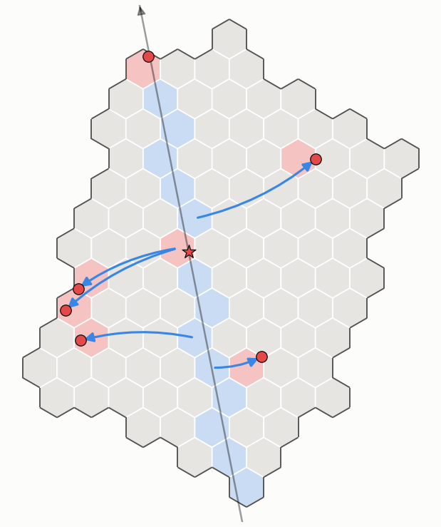

# Lớp 3: định tuyến trên mặt đất sau lượt bay (River)

Mô tả gốc của người dùng: CLAUDE.md §8, mục 38–47. Phạm vi: Pha 1, một cụm, đường bay
thẳng, đơn vị là cell. Kế hoạch thử nghiệm: [TRIAL-vi.md](TRIAL-vi.md).

## 1. Bài toán

UAV bay qua cụm **một lần** theo đường bay $\gamma$ và phát liên tục: gói $s$ được phát tại toạ
độ đường bay $d_s=d_0+s\Delta$, với $\Delta=v\tau$ (0,5 m mỗi gói ở 50 m/s, 10 ms). Mỗi node
nhận gói $s$ với xác suất $1-p(\rho)$, trong đó $\rho$ là khoảng cách ngang tới $\gamma(d_s)$ và
$p(\cdot)$ là đường PER đo từ ns-3. Vì $\gamma$, $d_s$ và $p$ đều biết trước, **kế hoạch được lập
trước giờ bay**.

Sau lượt bay, CL của mọi critical cell phải giữ đủ $\mathcal{D}=\bigcup_a\mathrm{Seg}(a)$, tức
mọi gói được phát trong cụm, với thời gian hoàn tất nhỏ nhất. Ràng buộc:
- radio bán song công;
- giữa hai cell kề nhau chỉ đi qua một gateway;
- dữ liệu chỉ đi theo cell path đã định.

Gói phát ngoài cụm không được giao cho ai, nhưng cell nào nhận được thì vẫn lưu lại và gửi khi
được hỏi.

| ký hiệu | nghĩa |
|---|---|
| $\mathrm{Cells}$, $z(c)$, $\mathrm{Neig}(c)$ | các cell của cụm; tâm của cell $c$; các cell kề $c$ trong cụm |
| $\mathrm{Ring}_r(c)$ | các cell cách $c$ đúng $r$ bước; $\mathrm{Ring}_1=\mathrm{Neig}$ |
| $\mathrm{score}(c)$ | điểm năng lực của CL của cell $c$ (quan sát × tính toán × giao tiếp) |
| $\mathrm{Holder}(c)$ | node giữ và phục vụ dữ liệu của cell $c$: là $\mathrm{CL}(c)$ |
| $\mathrm{Axe}=(a_1,\dots,a_n)$ | các cell mà $\gamma$ cắt qua, theo thứ tự bay |
| $\mathrm{Seg}(a)$ | đoạn dữ liệu của cell Axe $a$: các gói phát khi UAV ở trên $a$ |
| $u$, $\omega$ | hướng của Axe; nửa bề rộng River, chọn để River rộng 3–4 cell, tức $p(\omega)\approx1\,\%$ |
| $\mathrm{Bank}_{\pm}(a)$, $\mathrm{Path}_{\pm}(a)$ | hai Bank mà $a$ phục vụ, và cell path từ $a$ tới mỗi Bank |
| $\mathrm{River}$ | hợp các $\mathrm{Path}$ |
| $\mathrm{Crit}$ | critical cells: cell của CH và các cell có CL vượt trội |
| $\mathrm{Circ}(k)$ | Circle của critical cell $k$: các cell phục vụ $k$, mỗi cell giữ sẵn một phần dữ liệu |
| $\mathrm{Lack}(c)$ | các gói của $\mathcal{D}$ mà $\mathrm{Holder}(c)$ chưa có |

## 2. Quy ước thực thi

Ba quy ước dưới đây áp dụng chung cho mọi thuật toán.

1. **Mỗi cell giữ dữ liệu tại $\mathrm{Holder}(c)=\mathrm{CL}(c)$.** Ngay khi UAV rời đi, các node
   trong cell gom phần mình có về CL bằng cơ chế tóm tắt nội cell
   ([SUMMARY-vi.md](../../uav-coop/docs/SUMMARY-vi.md)), có bổ sung thêm phần gửi dữ liệu.
   Như vậy "cell $c$ có gói $s$" nghĩa là $\mathrm{CL}(c)$ có gói đó.
2. **Một cell path $(c_0,\dots,c_h)$ được chạy thành đường node**: CL của $c_0$ → gateway
   $\mathrm{gw}(c_0,c_1)$ → … → CL của $c_h$. Các đoạn dùng bảng tuyến đã có sẵn: tới CL, tới từng
   cell kề ([ROUTING-vi.md](../../uav-coop/docs/ROUTING-vi.md)). Mỗi chặng có xác nhận và gửi lại.
3. **Yêu cầu là một manifest "có"** gồm tập gói mà bên yêu cầu đang có, mã hoá gọn trong các khung
   ≤ 100 B ([manifest.h](../../uav-coop/models/common/manifest.h)). Bên được hỏi gửi lại phần
   giao giữa tập mình có và phần bên kia thiếu.

## 3. Mã giả ngắn

```text
Algorithm 1  AXETABLE                                   ▷ BS, before the flight
1: Axe ← cells crossed by γ, in flight order
2: for each a ∈ Axe do  Seg(a) ← { s : γ(d0 + sΔ) ∈ a }
3: send { (a, Seg(a)) } and u to CH; CH gives every Axe cell its row
```

```text
Algorithm 2  RIVERSETUP(a)                              ▷ each Axe cell a, before the flight
1: n ← u rotated by 90°
2: for σ ∈ {+1, −1} do
3:     Path_σ(a) ← cells on the segment z(a) → z(a) + σ·ω·n, cut at the cluster edge
4:     Bank_σ(a) ← last cell of Path_σ(a)
```

```text
Algorithm 3  CRITICAL                                   ▷ CH, before the flight
1: μ, σ ← mean, std of score(c) over Cells
2: Crit ← {cell of CH}
3:     ∪ { c : score(c) > μ + κ_g·σ }                           ▷ outstanding in the cluster
4:     ∪ { c : score(c) > μ + κ_l·σ and score(c) = max over c and its r-ring }   ▷ … in its area
```

```text
Algorithm 4  CIRCLE(k)                                  ▷ CH, before the flight, every k ∈ Crit
1: Circ(k) ← Neig(k), ordered along u
2: split Axe into |Circ(k)| consecutive groups; neighbour m_j takes group G_j
3: for each a ∈ G_j: m_j will fetch Seg(a) from a's Bank on the side nearer m_j
```

```text
Algorithm 5  BANKFILL                                   ▷ after the pass, each Bank b of Axe a
1: b sends a "have" manifest of Seg(a) to a along Path(a → b)
2: a returns what b lacks of Seg(a)
```

```text
Algorithm 6  CIRCLEFILL                                 ▷ after the pass, each Circle cell m_j of k
1: for each a ∈ G_j: ask Bank(a) for Seg(a) \ have(m_j); keep what comes back
2: on a request X from k: send X ∩ have(m_j), the rest as it arrives
```

```text
Algorithm 7  CRITPULL                                   ▷ after the pass, each k ∈ Crit
1: for each m_j ∈ Circ(k): send m_j the part of Lack(k) in ⋃_{a ∈ G_j} Seg(a)
2: done when Lack(k) = ∅
```

Bộ tham số dùng trong các hình: $W=3{,}5$ ($\omega=303$ m), $\kappa_g=2$, $\kappa_l=1$, $r=2$.

## 4. Mã giả đầy đủ

### Thuật toán 1: bảng Axe (tại BS, trước giờ bay)

```text
Algorithm 1  AXETABLE(γ, d0, Δ, N)
1: Axe ← ()                                         ▷ ordered list
2: for s ← 0 to N−1 do
3:     c ← cell containing γ(d0 + sΔ)
4:     if c ∉ Cells then continue                   ▷ sent outside the cluster: no owner
5:     if c ∉ Axe then append c to Axe; Seg(c) ← ∅
6:     Seg(c) ← Seg(c) ∪ {s}                        ▷ straight path: an interval [first, last]
7: u ← unit( z(a_n) − z(a_1) )                      ▷ the Axe's sum vector
8: send header (d0, Δ, N, u, ω) and rows { (a_i, first(Seg(a_i)), last(Seg(a_i))) } to CH
9: CH forwards row i to Axe cell a_i
```

### Thuật toán 2: thiết lập River (tại mỗi cell Axe, trước giờ bay)


Cách đọc hình:
- mũi tên đỏ sẫm: vector tổng $u$ của Axe;
- chấm trắng: cell trung tâm;
- đường liền: đường vuông góc qua cell trung tâm, với hai chấm đen nằm cách nó $\omega$;
- hai cell xanh lá đậm và cam đậm: hai Bank của cell trung tâm;
- đường đứt: các đường song song qua những cell Axe khác;
- xanh lá nhạt và vàng: các Bank còn lại;
- xanh nhạt: River.

```text
Algorithm 2  RIVERSETUP(a, u, ω)
1: n ← (−u_y, u_x)                                  ▷ the same normal for every a: parallel lines
2: for σ ∈ {+1, −1} do
3:     Path_σ(a) ← (a)
4:     for t ← 0 to ω step w/20 do                  ▷ w: cell width
5:         c ← cell containing z(a) + σ·t·n
6:         if c ∉ Cells then break                  ▷ River reaching the edge: the edge is the Bank
7:         if c ≠ last(Path_σ(a)) then append c to Path_σ(a)
8:     Bank_σ(a) ← last(Path_σ(a))
9:     tell Bank_σ(a): "you are a's Bank, for Seg(a), via Path_σ(a)"
10: River ← ⋃_{a ∈ Axe, σ} Path_σ(a)
```

Trên đường bay thẳng của cụm thử:
- Axe có 15 cell, River 58 cell, Banks 26 cell (12 / 14 hai bên);
- 6 trong 30 Bank là cell biên cụm.

Một Bank có thể nhận hai đoạn Seg liền nhau nếu hai đường song song rơi vào cùng một cell.

### Thuật toán 3: node vượt trội và critical cells (tại CH, trước giờ bay)



```text
Algorithm 3  CRITICAL(Cells, score, κ_g, κ_l, r)
1: μ ← mean_{c ∈ Cells} score(c);  σ ← std_{c ∈ Cells} score(c)
2: Crit ← { cell of CH }                            ▷ always critical
3: for each c ∈ Cells do
4:     if score(c) > μ + κ_g·σ then                 ▷ far above the whole cluster
5:         Crit ← Crit ∪ {c}
6:     else if score(c) > μ + κ_l·σ and
7:             score(c) ≥ max { score(c') : c' ∈ Ring_1(c) ∪ … ∪ Ring_r(c) } then
8:         Crit ← Crit ∪ {c}                        ▷ the best of its area, and well above average
9: return Crit
```

Trong cụm thử có 7 critical cell:
- cell của CH, CL của nó cũng vượt trội toàn cụm;
- 4 cell khác vượt trội toàn cụm;
- 2 cell chỉ vượt trội trong khu vực của mình.

### Thuật toán 4: Circle (tại CH, trước giờ bay, cho mỗi critical cell)


Cách đọc hình:
- nét đứt: Axe bổ sung cho Bank (Thuật toán 5);
- nét liền: hàng xóm kéo từng đoạn Seg từ Bank của đoạn đó về (Thuật toán 6);
- nét chấm: hàng xóm giao cho critical cell khi được yêu cầu (Thuật toán 7);
- hình tròn chia màu ở giữa: phần dữ liệu của từng hàng xóm.

```text
Algorithm 4  CIRCLE(k, Axe, Seg, Bank)
1: Circ(k) ← Neig(k)                                ▷ 6 cells; fewer at the cluster edge
2: order Circ(k) = (m_1..m_q) by ⟨z(m_j), u⟩         ▷ further along the flight → later data
3: split (a_1..a_n) into q consecutive groups G_1..G_q of near-equal size
4: for j ← 1 to q do
5:     for each a ∈ G_j do
6:         σ ← side with the fewer hops from Bank_σ(a) to m_j
7:         src_j(a) ← Bank_σ(a);  P_j(a) ← shortest cell path src_j(a) → m_j avoiding k
8:     send m_j its task { (a, src_j(a), P_j(a)) : a ∈ G_j };  send k the list (m_j, G_j)
```

Một critical cell nằm trong River (ví dụ cell của CH, nằm trên Axe) vẫn dựng Circle như mọi
critical cell khác, vì nó cũng chỉ nhận được một đoạn dữ liệu. Một cell có thể cùng lúc là
critical cell và là thành viên Circle của một critical cell khác.

### Thuật toán 5: Axe bổ sung cho Bank (sau lượt bay)

```text
Algorithm 5  BANKFILL(b, a)                          ▷ b = Bank_σ(a); starts when the UAV leaves
1: wait until Holder(b) has gathered its cell's packets (convention 1)
2: H ← Seg(a) ∩ have(b)
3: send manifest(H) to a along Path_σ(a)
4: at a: wait until Holder(a) has gathered Seg(a); send Seg(a) \ H to b along Path_σ(a) reversed
5: at b: store; Seg(a) ⊆ have(b) now, apart from packets no Axe node received
```

Ở $W=3{,}5$, một node của Bank thiếu khoảng 1 % của $\mathrm{Seg}(a)$, tức khoảng 4/346 gói; cả cell
Bank gộp lại còn thiếu ít hơn nữa. Vì vậy Thuật toán 5 chở rất ít dữ liệu.

### Thuật toán 6: Circle chuẩn bị và giao dữ liệu (sau lượt bay)

```text
Algorithm 6  CIRCLEFILL(m_j, task_j, k)
1: wait until Holder(m_j) has gathered its cell's packets
2: for each (a, src, P) ∈ task_j do                ▷ in parallel over the sources
3:     wait until src has finished BANKFILL for Seg(a)
4:     send manifest(Seg(a) ∩ have(m_j)) to src along P
5:     store what src returns
6: on request X from k:                            ▷ may arrive before line 5 finishes
7:     send X ∩ have(m_j) now; send the rest of X as it arrives
```

### Thuật toán 7: critical cell yêu cầu (sau lượt bay)

```text
Algorithm 7  CRITPULL(k)
1: wait until Holder(k) has gathered its cell's packets
2: Lack(k) ← D \ have(k)
3: for each (m_j, G_j) ∈ Circ(k) do
4:     send manifest(have(k) ∩ ⋃_{a ∈ G_j} Seg(a)) to m_j     ▷ "I have these, send the rest"
5: on receipt of packets: store; Lack(k) ← Lack(k) \ received
6: done when Lack(k) = ∅                            ▷ or only packets no node received remain
```

**Cận dưới thời gian.** CL của $k$ có một radio, nên nhận nhiều nhất một gói mỗi khe:
$T_k\ \ge\ |\mathrm{Lack}(k)|\cdot\tau_{\mathrm{slot}}$. Ví dụ: với $|\mathcal{D}|\approx4\,600$ gói
trên đường thẳng và khe 10 ms, một critical cell xa River (gần như thiếu hết) cần ít nhất khoảng
46 s, dù Circle lớn đến đâu.

Circle không làm cận này nhỏ đi. Việc của nó là chuẩn bị sẵn dữ liệu cạnh $k$, để đường vào
$k$ không phải chờ.
