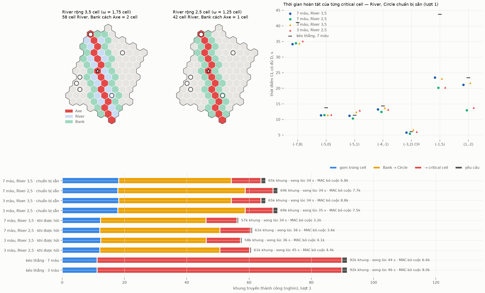
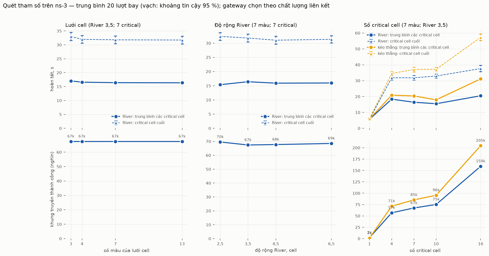

# River trên ns-3 — từng bước của một lượt bay

Lời gốc: CLAUDE.md §8 mục 50–54. Thuật toán: [`L3-vi.md`](L3-vi.md) (Thuật toán 1–7).

Trang này cho thấy từng bước của **một** lượt bay (lượt 1) trên ns-3, so ba biến thể. Đây chưa
phải kết quả thống kê: chiến dịch 120 lượt còn chờ chốt.

| Biến thể | Viết tắt | Khác nhau ở |
|---|---|---|
| River, Circle chuẩn bị sẵn | `river --prep=full` | thành viên Circle lấy cả phần được giao từ Bank ngay khi gom xong |
| River, Circle chỉ lấy khi được hỏi | `river --prep=ondemand` | thành viên Circle chỉ đi lấy những gói critical cell hỏi, sau khi nó hỏi |
| Kéo thẳng (so sánh) | `direct` | critical cell hỏi thẳng từng cell Axe phần nó thiếu |

**Cách dựng lớp truyền.**
- MAC 802.15.4 đầy đủ của ns-3 (lr-wpan): CSMA/CA, ACK, gửi lại.
- Kênh theo lưới cell PECEE:
  - mỗi cell một kênh, 11 + (q + 3r) mod 7, nên cùng kênh chỉ lặp lại ở cell cách 3 ô;
  - mỗi cặp gateway có radio và kênh riêng, 18–26.
- Lịch: mỗi cell và mỗi cặp gateway chỉ có **một máy phát tại một thời điểm**, xoay vòng giữa các radio có gói chờ.
- Kênh G2G: n = 3,5, che khuất 7,8 dB cố định theo từng cặp node, Rayleigh theo khối 100 ms.
  Một mô hình suy hao dùng chung cho mọi kênh, nên che khuất và fading thuộc về cặp node chứ
  không phụ thuộc kênh: đổi kế hoạch kênh không làm đổi liên kết nào yếu.
- Đường trong cell: ETX nhỏ nhất trên kênh của lượt đó. Liên cell vẫn đi đúng cặp gateway duy nhất.

Chạy lại:
```
uav-coop2-river --nodes=… --routes=… --gateways=… --plan=docs/data/river-plan.txt \
    --bits=BITS/p1-bits --runs=1 --scheme=river --prep=full --out=T/rf --trace=T/rf
python3 tools/river_ns3_figures.py --deploy ../uav-coop/docs/data --path docs/data/path-a180.csv \
    --plan docs/data/river-plan.txt --bits BITS/p1-bits-r1.bin --trace "T/{s}" --figs docs/figures
```

## Bước 0 — mạng mô phỏng


- 91 cell, 1 945 node được mô phỏng: những cell có mặt trong kế hoạch.
- 235 cặp gateway. 150 cặp phải dùng chung kênh với một cặp khác trong vòng 300 m, vì chỉ có 9 kênh.
- 20 cặp yếu, q < 0,5 (đoạn đỏ), do che khuất cố định của chính cặp đó. Đường liên cell bắt buộc đi qua chúng.
- Trong cell, ETX nhỏ nhất làm cây đường về CL có dạng ngôi sao: 57 % node gửi thẳng tới CL.

## Bước 1 — ngay sau lượt bay


- Bitmap thu thật của pass ns-3 trên đường bay thẳng, lượt 1: |D| = 4 607 gói.
- CL một mình chỉ có khoảng 40–80 % D.
- Gộp cả cell thì gần đủ ở giữa River, thưa dần ra biên.

## Bước 2 — gom trong cell về CL


- Chỉ những cell có vai trò mới gom: Axe, Bank, thành viên Circle, critical cell.
- Mỗi cell gom đúng phần nó cần.
- Khung gom cuối cùng tới CL lúc 17,0 s. Lâu nhất là các critical cell, vì chúng gom toàn bộ D.

## Bước 3 — sau khi gom: Bank → Circle → critical cell


- **Axe → Bank: 0 khung.** Với River rộng 3,5 cell, Bank đã có đủ phần của Axe ngay sau khi gom.
- **River:** dữ liệu chảy dọc River từ Bank tới các thành viên Circle (vàng), rồi chặng cuối ngắn vào critical cell (đỏ).
- **Kéo thẳng:** mọi gói đi suốt từ Axe tới critical cell. Các đường đỏ dài chồng lên nhau ở giữa cụm.


Phần D mà CL của mỗi cell có tại t = 0, 5, 10, 20 s và lúc kết thúc. Critical cell sẫm dần tới đủ.
Các cell khác chỉ thay đổi khi chúng gom hoặc có gói đi qua để giữ lại.

## Bước 4 — critical cell đủ dữ liệu


Thời điểm critical cell nhận đủ D, tính bằng giây sau khi UAV rời cụm (lượt 1):

| Critical cell | River (chuẩn bị sẵn) | River (khi được hỏi) | Kéo thẳng |
|---|---|---|---|
| CH (−3,2) | 5,8 | 5,6 | 6,1 |
| (−5,0) | 11,3 | 11,3 | 13,8 |
| (−5,1) | 11,2 | 11,2 | 11,4 |
| (−4,−1) | 13,2 | 12,9 | 14,4 |
| (1,−2) | 21,1 | 14,8 | 23,4 |
| (−1,5) | 23,5 | 34,2 | 43,7 |
| (−7,8) | 34,2 | 34,5 | 41,1 |


**Khung truyền thành công:**
- River chuẩn bị sẵn: 65 k, trong đó Bank → Circle 36 k.
- River khi được hỏi: 57 k.
- Kéo thẳng: 92 k.

MAC bỏ cuộc 3–7 k lần tuỳ biến thể. Khung bị bỏ cuộc được giữ lại và gửi lại ở lượt sau của radio, nên cuối cùng không gói nào bị mất.

**Đọc sơ bộ (một lượt, chưa phải kết luận):**
- Trên lượt này, River (chuẩn bị sẵn) xong trước kéo thẳng ở cả 7/7 critical cell, và dùng ít hơn khoảng 29 % khung.
- Lấy khi được hỏi tiết kiệm khoảng 13 % khung so với chuẩn bị sẵn. Thời gian lẫn lộn: 4 cell gần như bằng nhau, (1,−2) nhanh hơn 6 s, (−1,5) chậm hơn 11 s. Critical cell thiếu gần hết, nên Circle vẫn phải lấy gần như toàn bộ.
- Ô xa nhất (−7,8) xong muộn nhất ở cả ba biến thể (34–41 s).

Bản trước của trang này dùng một mô hình suy hao riêng cho mỗi kênh, nên che khuất bị bốc lại theo
kênh. Mọi số và hình ở đây đã chạy lại với mô hình dùng chung.

## Biến thể: lưới 3 màu và River hẹp hơn (CLAUDE.md §8 mục 53)

> **Đã thay thế** bởi mục "Kiểm chứng" bên dưới. Lần thử này dùng gateway hình học và mô hình
> kênh cũ, nên che khuất của cùng một cặp node vẫn khác nhau giữa các cấu hình.



**Hai thay đổi được thử:**
- **Lưới 3 màu** (`--colours=3`):
  - cell (q, r) dùng kênh 11 + (q − r) mod 3, nên hai cell cùng kênh chỉ cách nhau 1 cell;
  - đổi lại, cặp gateway có 13 kênh (14–26) thay vì 9;
  - số cặp phải dùng chung kênh với một cặp trong vòng 300 m giảm từ 150 xuống khoảng 60.
- **River hẹp hơn** (`river_export.py --width 2.5`, file `docs/data/river-plan-w2.5.txt`):
  - trên lưới lục giác, độ rộng chỉ đổi theo bậc: 3,0 cho đúng kế hoạch của 3,5, và 2,0 cho đúng kế hoạch của 2,5;
  - vì vậy "hẹp hơn một chút" là W = 2,5: Bank cách Axe 1 cell thay vì 2, River còn 42 cell thay vì 58.

**Kết quả lượt 1** (số liệu: `docs/data/pilot53/`):

| Cấu hình | Critical cell cuối xong | Khung | Bank → Circle | MAC bỏ cuộc | Thời gian chạy thật |
|---|---|---|---|---|---|
| 7 màu, River 3,5, chuẩn bị sẵn | 34,2 s | 65,4 k | 36,2 k | 6,8 k | 96 s |
| 7 màu, River 2,5, chuẩn bị sẵn | 34,5 s | 69,3 k | 40,9 k | 7,7 k | 93 s |
| 3 màu, River 3,5, chuẩn bị sẵn | 34,5 s | 65,4 k | 36,2 k | 8,8 k | 233 s |
| 3 màu, River 2,5, chuẩn bị sẵn | 35,2 s | 69,3 k | 40,9 k | 7,5 k | 236 s |
| 7 màu, River 3,5, khi được hỏi | 34,5 s | 56,7 k | 33,9 k | 3,2 k | 71 s |
| 7 màu, River 2,5, khi được hỏi | 38,0 s | 61,1 k | 38,6 k | 3,6 k | 73 s |
| 3 màu, River 3,5, khi được hỏi | 35,9 s | 57,8 k | 33,9 k | 4,1 k | 191 s |
| 3 màu, River 2,5, khi được hỏi | 44,6 s | 60,8 k | 38,6 k | 4,4 k | 182 s |
| Kéo thẳng, 7 màu | 43,7 s | 91,6 k | — | 6,6 k | 118 s |
| Kéo thẳng, 3 màu | 46,2 s | 91,6 k | — | 8,0 k | 312 s |

**Đọc sơ bộ (một lượt, chưa phải kết luận):**
- **3 màu không nhanh hơn.** Ở mọi cấu hình, critical cell cuối xong bằng hoặc chậm hơn 7 màu (0,3–6,6 s), và MAC bỏ cuộc nhiều hơn ở 4/5 cặp so sánh. Cách giải thích hợp lý (chưa đo trực tiếp): node của hai cell cùng kênh chỉ cách nhau khoảng 100–350 m, vẫn trong tầm nghe. Khi đó lịch "một máy phát mỗi cell" không còn ngăn được va chạm giữa hai cell. Thời gian chạy thật tăng khoảng 2,5 lần cũng cho thấy mỗi khung tới được nhiều máy thu hơn. Thêm 4 kênh cho cặp gateway không bù được phần này.
- **River hẹp hơn tốn thêm khoảng 6–8 % khung, do Bank → Circle tăng khoảng 13 %.** Khi Bank sát Axe, Bank xa các critical cell hơn nên đường Bank → Circle dài hơn. Axe → Bank vẫn là 0 khung, vì Bank đã có đủ ngay sau khi gom, cả khi cách 1 cell lẫn 2 cell.
- Thời gian của từng critical cell lúc nhanh lúc chậm theo độ rộng. Ví dụ với 7 màu: (1,−2) mất 12,9 s ở W = 2,5 so với 21,1 s ở W = 3,5, nhưng ô cuối xong như nhau. Một lượt chưa đủ để tách tác động của độ rộng khỏi nhiễu.


## Kiểm chứng: số màu, độ rộng River, số critical cell (CLAUDE.md §8 mục 54)



### Hai sửa đổi trước khi so sánh

1. **Kênh không phụ thuộc cấu hình.**
   - Trước đây che khuất được bốc từ một luồng ngẫu nhiên theo thứ tự liên kết được dùng lần đầu. Hai cấu hình mô phỏng tập cell khác nhau thì cùng một cặp node có che khuất khác nhau.
   - Nay che khuất và fading lấy từ hash của (lượt bay, cặp id node, khối fading). Đã kiểm tra: 140/140 cặp chung giữa hai kế hoạch có cùng q.
   - Thống kê vẫn đúng: che khuất có độ lệch chuẩn 7,82 dB; fading có công suất trung bình 1,000 và P(< −10 dB) = 0,096 so với 0,095 của Rayleigh.
2. **Gateway chọn theo chất lượng liên kết** (`--gwSelect=quality`).
   - Gateway của `uav-coop` chọn theo hình học. Lượt 1 có 4 cặp gần như chết (q = 0; 0; 0,003; 0,013), và mọi lần chạy bị kẹt đều do đường đi qua một trong các cặp đó.
   - BS đã tính trước toàn bộ định tuyến (§8 mục 15) và che khuất là tĩnh, nên BS chọn cho mỗi cặp cell **một** cặp gateway có liên kết tốt nhất. Ràng buộc một gateway cho mỗi cặp cell vẫn giữ nguyên.
   - Kết quả: 0 cặp yếu thay vì 22, và mọi cấu hình đều xong.
   - Chế độ cũ (`deploy`) vẫn là mặc định và cho lại đúng số trước đây.

### Kết quả lượt 1

Gateway theo chất lượng; River, Circle chuẩn bị sẵn. Số liệu: `docs/data/pilot54/`.

| Tham số | Giá trị | TB critical cell | Critical cell cuối | Khung |
|---|---|---|---|---|
| Số màu | 3 / 4 / 7 / 13 | 16,7 / 16,1 / 16,0 / 15,8 s | 33,1 / 31,2 / 31,3 / 31,0 s | 68,4 k (như nhau) |
| Độ rộng River | 2,5 / 3,5 / 4,5 / 6,5 | 15,1 / 16,0 / 15,3 / 15,6 s | 31,4 / 31,3 / 30,6 / 32,1 s | 72,4 / 68,4 / 69,0 / 69,6 k |
| Số critical, River | 1 / 4 / 7 / 10 / 16 | 5,7 / 16,6 / 16,0 / 14,5 / 19,4 s | 5,7 / 31,3 / 31,3 / 31,8 / 32,3 s | 1,9 / 58 / 68 / 76 / 161 k |
| Số critical, kéo thẳng | 1 / 4 / 7 / 10 / 16 | 6,0 / 19,8 / 20,6 / 18,0 / 30,2 s | 6,0 / 31,9 / 35,7 / 36,1 / 56,2 s | 1,2 / 76 / 90 / 101 / 215 k |

### Đọc sơ bộ (một lượt; khác biệt khoảng 1 s chưa tách được khỏi nhiễu)

- **Nhiều màu hơn 7 không cải thiện rõ.**
  - 3 → 4 màu: critical cell cuối nhanh hơn khoảng 2 s.
  - 4, 7, 13 màu: cách nhau dưới 0,3 s.
  - Số khung như nhau ở mọi số màu, vì lịch đi đường không đổi.
  - Tăng số màu tách cell cùng kênh xa hơn, nhưng lấy bớt kênh của cặp gateway: 13 màu chỉ còn 3 kênh cho 235 cặp. Hai hiệu ứng gần như triệt tiêu nhau.
- **River rộng hơn không nhanh hơn.**
  - Thời gian không đổi theo một chiều nào.
  - Hẹp nhất (2,5) tốn nhiều khung nhất (+6 % so với 3,5), vì Bank sát Axe nên đường Bank → Circle dài hơn.
  - Từ 3,5 trở lên, số khung gần như phẳng (68–70 k).
  - Axe → Bank luôn là 0 khung, nên trên đường bay thẳng này độ rộng chỉ đổi đường Bank → Circle.
- **Số critical cell: lợi thế của River tăng theo số critical cell.**
  - Với 1 critical cell (chỉ CH, nằm trên Axe), kéo thẳng rẻ hơn: 1,2 k so với 1,9 k khung, thời gian như nhau.
  - Từ 4 critical cell trở lên, River dùng ít hơn 23–25 % khung.
  - Critical cell cuối của River giữ khoảng 31–32 s bất kể 4 hay 16 critical cell. Kéo thẳng tăng từ 32 lên 56 s.
  - Với 16 critical cell, trung bình là 19 s so với 30 s.
- **Critical cell cuối luôn là (−7,8)**, ô sát biên xa CH. Nó gom xong trong cell lúc 8,6 s, phần còn lại là đường Circle → nó. Chỉ số "critical cell cuối" vì thế gần như chỉ đo ô này. Nên đọc kèm trung bình các critical cell.

### Kết quả 20 lượt bay (CLAUDE.md §8 mục 55)

- **Thiết lập:** 16 cấu hình × lượt 1–20 = 320 lần chạy, cùng một binary đóng băng, gateway chọn theo chất lượng liên kết.
- **Hoàn tất:** mọi critical cell xong ở mọi lần chạy, giới hạn 900 s chưa lần nào chạm tới.
- **Số liệu:** `docs/data/camp54/`, mỗi cấu hình một cặp file `-crit.csv` / `-runs.csv`. Hình `ns3-sweeps.png` ở trên đã vẽ lại từ 20 lượt này.

Cùng một lượt bay, mọi cấu hình thấy cùng một kênh, nên so sánh **ghép cặp theo lượt** là phép
đo đúng. Nó loại phần chênh lệch giữa các lượt (vạch 95 % trên hình rộng là vì phần này). Bảng
dưới ghi B − A, trung bình ± khoảng tin cậy 95 %, kèm số lượt B tốt hơn A:

| So sánh (A → B) | TB critical cell | Critical cell cuối | Khung |
|---|---|---|---|
| 7 màu → 3 màu | +0,6 ± 0,1 s (0/20) | +1,2 ± 0,3 s (0/20) | 0 |
| 7 màu → 4 màu | +0,2 ± 0,1 s (1/20) | +0,2 ± 0,1 s (5/20) | 0 |
| 7 màu → 13 màu | −0,04 s (15/20) | −0,1 ± 0,1 s (13/20) | 0 |
| River 3,5 → 2,5 | −1,0 ± 0,1 s (20/20) | +0,6 ± 0,3 s (5/20) | +2,2 ± 0,6 k (+3 %) |
| River 3,5 → 4,5 | −0,5 ± 0,0 s (20/20) | −0,8 ± 0,2 s (20/20) | +0,3 ± 0,2 k |
| River 3,5 → 6,5 | −0,4 ± 0,1 s (20/20) | −0,5 ± 0,5 s (13/20) | +1,1 ± 0,2 k |
| Kéo thẳng → River, 1 critical | −0,3 ± 0,1 s | −0,3 ± 0,1 s | +0,8 k (River tốn hơn) |
| Kéo thẳng → River, 4 critical | −2,5 ± 0,8 s (19/20) | −2,7 ± 1,6 s (16/20) | −14,5 ± 0,9 k (−20 %, 20/20) |
| Kéo thẳng → River, 7 critical | −4,0 ± 0,5 s (20/20) | −5,2 ± 1,4 s (19/20) | −17,8 ± 0,9 k (−21 %, 20/20) |
| Kéo thẳng → River, 10 critical | −2,5 ± 0,4 s (20/20) | −4,2 ± 1,3 s (19/20) | −20,3 ± 1,0 k (−21 %, 20/20) |
| Kéo thẳng → River, 16 critical | −10,6 ± 0,9 s (20/20) | −19,7 ± 2,9 s (20/20) | −45,4 ± 2,1 k (−22 %, 20/20) |

Giá trị tuyệt đối (River, 7 màu, rộng 3,5, 7 critical): TB critical cell 16,4 ± 0,3 s, critical
cell cuối 31,8 ± 1,4 s, 67,4 ± 0,9 k khung.

**Kết luận cho ba câu hỏi:**
1. **Lưới nhiều màu hơn 7 có tốt hơn không? Không.**
   - 13 màu và 7 màu như nhau (chênh 0,04 s).
   - Ít màu hơn thì chậm hơn một cách nhất quán: 4 màu chậm 0,2 s, 3 màu chậm 0,6–1,2 s, chậm ở cả 20/20 lượt.
   - Số khung không đổi theo số màu, vì đường đi không phụ thuộc kênh.
   - Từ 7 màu trở lên, lợi ích của việc tách xa cell cùng kênh bị triệt tiêu vì còn ít kênh cho cặp gateway.
2. **River càng rộng càng tốt không? Không.**
   - Độ rộng 3,5 tốn ít khung nhất nhưng có thời gian trung bình chậm nhất.
   - Mọi độ rộng khác đều nhanh hơn một chút: 2,5 nhanh 1,0 s, 4,5 nhanh 0,5 s, 6,5 nhanh 0,4 s. Không có xu hướng một chiều.
   - River hẹp (2,5) tốn thêm 3 % khung và critical cell cuối chậm hơn.
   - Mọi khác biệt ở đây đều nhỏ, dưới 1 s và dưới 3 % khung. Trên đường bay thẳng, độ rộng gần như không quan trọng, vì Axe → Bank luôn là 0 khung.
3. **Số critical cell: lợi thế của River tăng theo số critical cell.**
   - Với 1 critical cell (CH nằm trên Axe), kéo thẳng tốn ít khung hơn.
   - Từ 4 critical cell trở lên, River thắng về khung ở cả 20/20 lượt (−20 đến −22 %) và về thời gian ở 19–20/20 lượt.
   - Khoảng cách thời gian lớn nhất ở 16 critical cell: TB −10,6 s, critical cell cuối −19,7 s.

**Lưu ý:** đây là 20 lượt. Quy tắc của dự án (§6) là N ≥ 120 cho kết quả công bố. Khoảng tin
cậy ghép cặp đã hẹp, nhưng số cho bài báo nên chạy lại với 120 lượt ở cấu hình được chọn.
