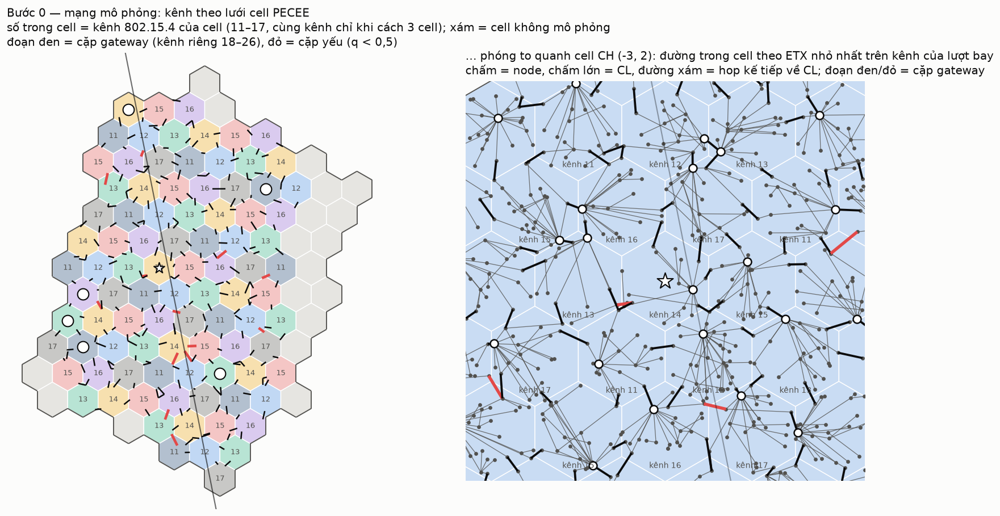
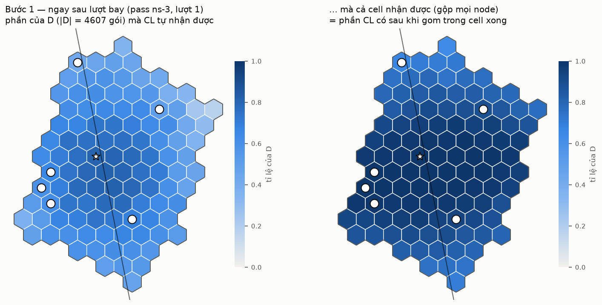
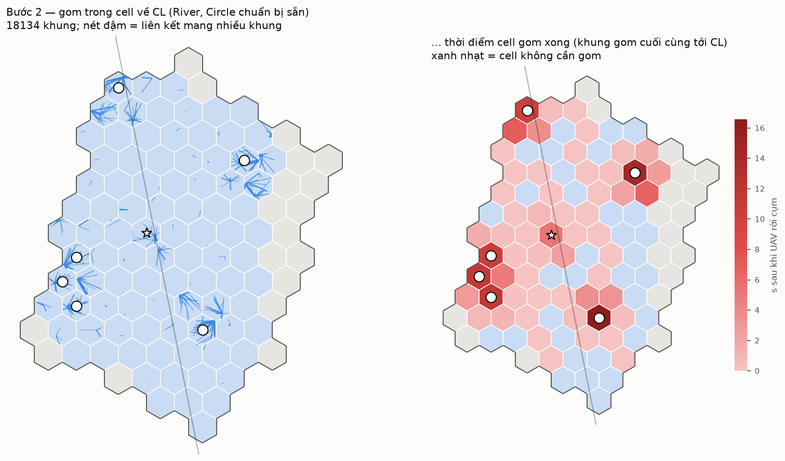
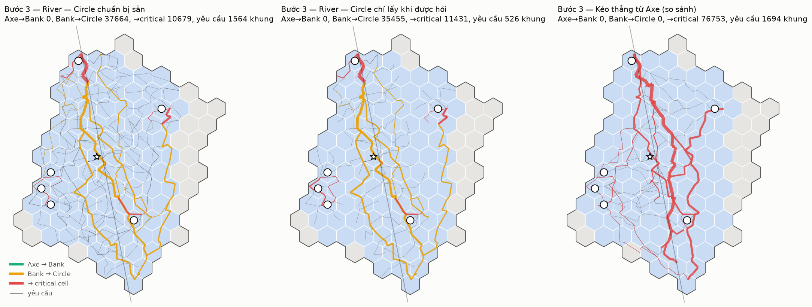
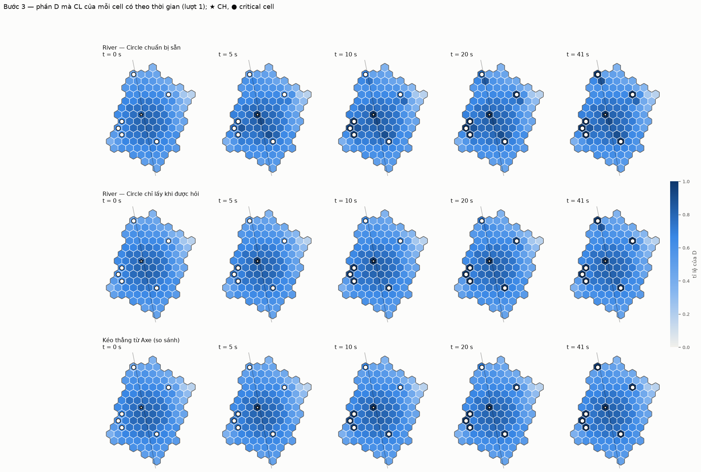
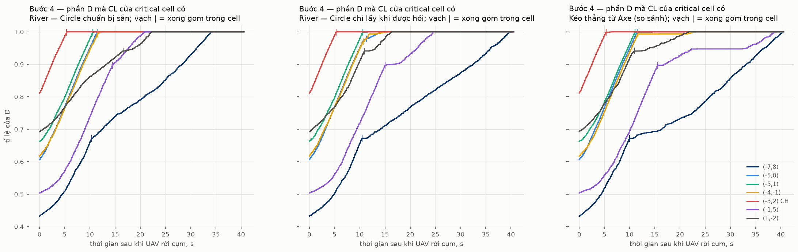
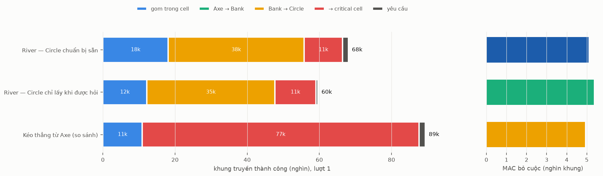

# River trên ns-3 — từng bước của một lượt bay

Lời gốc: CLAUDE.md §8 mục 50–52. Thuật toán: [`L3-vi.md`](L3-vi.md) (Thuật toán 1–7).

Trang này cho thấy từng bước của **một** lượt bay (lượt 1) trên ns-3, so ba biến thể. Đây chưa
phải kết quả thống kê: chiến dịch 120 lượt còn chờ chốt.

| Biến thể | Viết tắt | Khác nhau ở |
|---|---|---|
| River, Circle chuẩn bị sẵn | `river --prep=full` | thành viên Circle lấy cả phần được giao từ Bank ngay khi gom xong |
| River, Circle chỉ lấy khi được hỏi | `river --prep=ondemand` | thành viên Circle chỉ đi lấy những gói critical cell hỏi, sau khi nó hỏi |
| Kéo thẳng (so sánh) | `direct` | critical cell hỏi thẳng từng cell Axe phần nó thiếu |

**Cách dựng lớp truyền.**
- MAC 802.15.4 đầy đủ của ns-3 (lr-wpan): CSMA/CA, ACK, gửi lại.
- Kênh theo lưới cell PECEE:
  - mỗi cell một kênh, 11 + (q + 3r) mod 7, nên cùng kênh chỉ lặp lại ở cell cách 3 ô;
  - mỗi cặp gateway có radio và kênh riêng, 18–26.
- Lịch: mỗi cell và mỗi cặp gateway chỉ có **một máy phát tại một thời điểm**, xoay vòng giữa các radio có gói chờ.
- Kênh G2G: n = 3,5, che khuất 7,8 dB cố định theo từng cặp, Rayleigh theo khối 100 ms.
- Đường trong cell: ETX nhỏ nhất trên kênh của lượt đó. Liên cell vẫn đi đúng cặp gateway duy nhất.

Chạy lại:
```
uav-coop2-river --nodes=… --routes=… --gateways=… --plan=docs/data/river-plan.txt \
    --bits=BITS/p1-bits --runs=1 --scheme=river --prep=full --out=T/rf --trace=T/rf
python3 tools/river_ns3_figures.py --deploy ../uav-coop/docs/data --path docs/data/path-a180.csv \
    --plan docs/data/river-plan.txt --bits BITS/p1-bits-r1.bin --trace "T/{s}" --figs docs/figures
```

## Bước 0 — mạng mô phỏng



- 91 cell, 1 945 node được mô phỏng: những cell có mặt trong kế hoạch.
- 235 cặp gateway. 150 cặp phải dùng chung kênh với một cặp khác trong vòng 300 m, vì chỉ có 9 kênh.
- 13 cặp yếu, q < 0,5 (đoạn đỏ), do che khuất cố định của chính cặp đó. Đường liên cell bắt buộc đi qua chúng.
- Trong cell, ETX nhỏ nhất làm cây đường về CL có dạng ngôi sao: khoảng 36 % node gửi thẳng tới CL.

## Bước 1 — ngay sau lượt bay



- Bitmap thu thật của pass ns-3 trên đường bay thẳng, lượt 1: |D| = 4 607 gói.
- CL một mình chỉ có khoảng 40–80 % D.
- Gộp cả cell thì gần đủ ở giữa River, thưa dần ra biên.

## Bước 2 — gom trong cell về CL



- Chỉ những cell có vai trò mới gom: Axe, Bank, thành viên Circle, critical cell.
- Mỗi cell gom đúng phần nó cần.
- Khung gom cuối cùng tới CL lúc 16,6 s. Lâu nhất là các critical cell, vì chúng gom toàn bộ D.

## Bước 3 — sau khi gom: Bank → Circle → critical cell



- **Axe → Bank: 0 khung.** Với River rộng 3,5 cell, Bank đã có đủ phần của Axe ngay sau khi gom.
- **River:** dữ liệu chảy dọc River từ Bank tới các thành viên Circle (vàng), rồi chặng cuối ngắn vào critical cell (đỏ).
- **Kéo thẳng:** mọi gói đi suốt từ Axe tới critical cell. Các đường đỏ dài chồng lên nhau ở giữa cụm.



Phần D mà CL của mỗi cell có tại t = 0, 5, 10, 20 s và lúc kết thúc. Critical cell sẫm dần tới đủ.
Các cell khác chỉ thay đổi khi chúng gom hoặc có gói đi qua để giữ lại.

## Bước 4 — critical cell đủ dữ liệu



Thời điểm critical cell nhận đủ D, tính bằng giây sau khi UAV rời cụm (lượt 1):

| Critical cell | River (chuẩn bị sẵn) | River (khi được hỏi) | Kéo thẳng |
|---|---|---|---|
| CH (−3,2) | 5,5 | 5,4 | 6,5 |
| (−5,0) | 11,5 | 14,4 | 13,6 |
| (−5,1) | 11,0 | 11,5 | 14,5 |
| (−4,−1) | 12,5 | 15,3 | 23,1 |
| (1,−2) | 22,2 | 16,2 | 21,7 |
| (−1,5) | 20,8 | 24,7 | 38,8 |
| (−7,8) | 34,1 | 40,3 | 40,6 |



**Khung truyền thành công:**
- River chuẩn bị sẵn: 68 k, trong đó Bank → Circle 38 k.
- River khi được hỏi: 60 k.
- Kéo thẳng: 89 k.

MAC bỏ cuộc khoảng 5 k lần ở cả ba biến thể. Khung bị bỏ cuộc được giữ lại và gửi lại ở lượt sau của radio, nên cuối cùng không gói nào bị mất.

**Đọc sơ bộ (một lượt, chưa phải kết luận):**
- Trên lượt này, River (chuẩn bị sẵn) xong trước kéo thẳng ở 6/7 critical cell, và dùng ít hơn khoảng 24 % khung. Riêng (1,−2) chậm hơn 0,5 s.
- Lấy khi được hỏi tiết kiệm khoảng 12 % khung so với chuẩn bị sẵn, nhưng chậm hơn ở 5/7 critical cell. Critical cell thiếu gần hết, nên Circle vẫn phải lấy gần như toàn bộ, chỉ là bắt đầu muộn hơn.
- Ô xa nhất (−7,8) bị chặn bởi chặng cuối dài và các cặp gateway yếu trên đường đi, ở cả ba biến thể.
