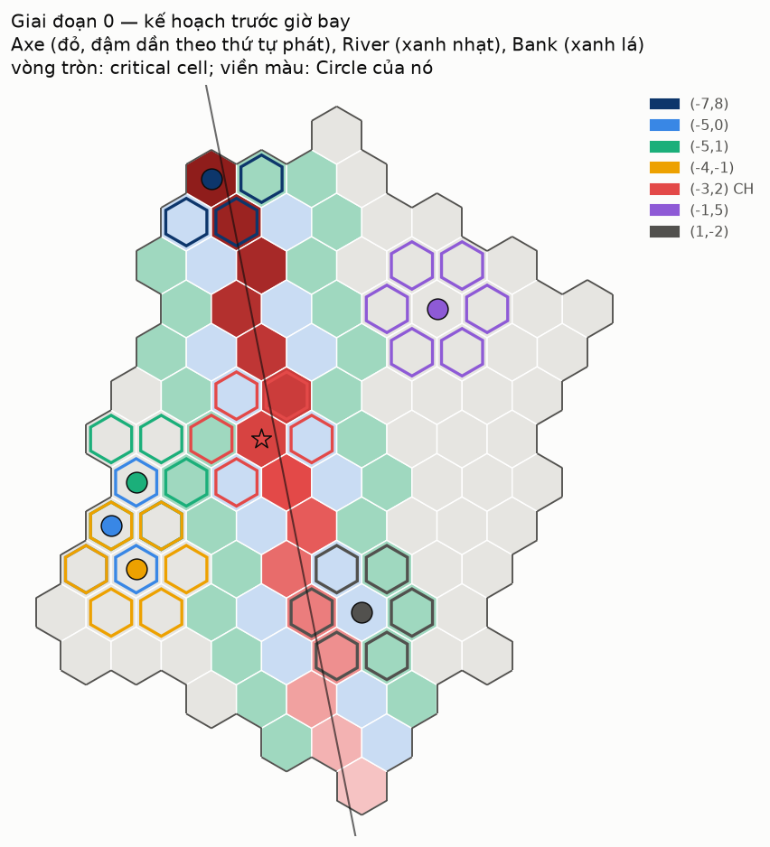
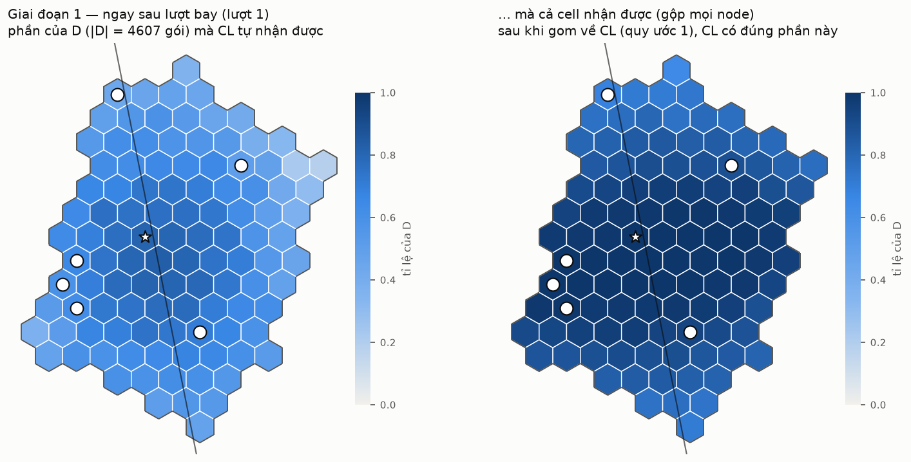
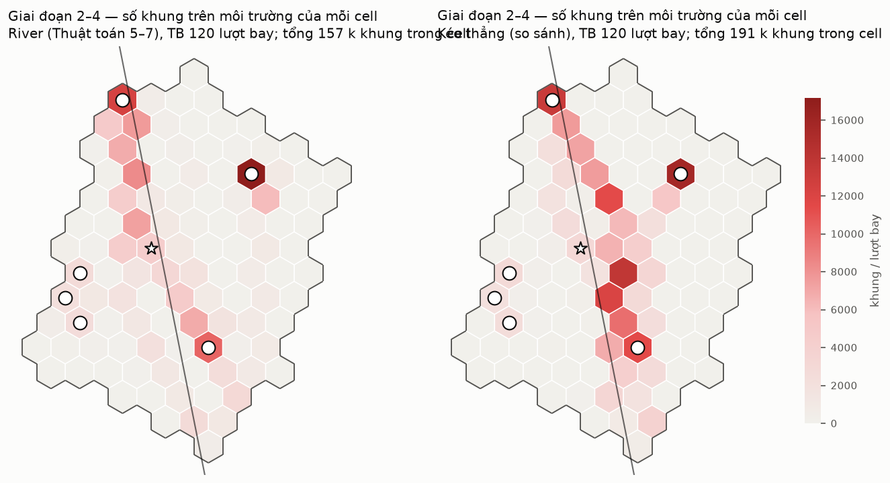
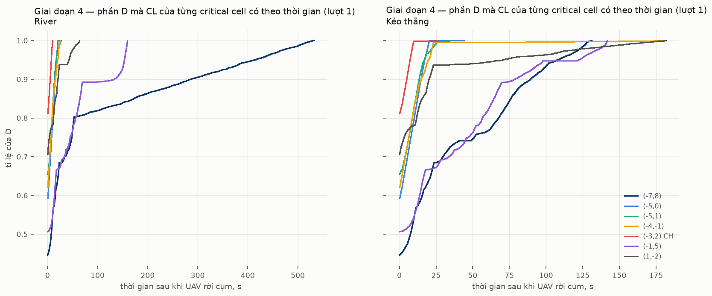
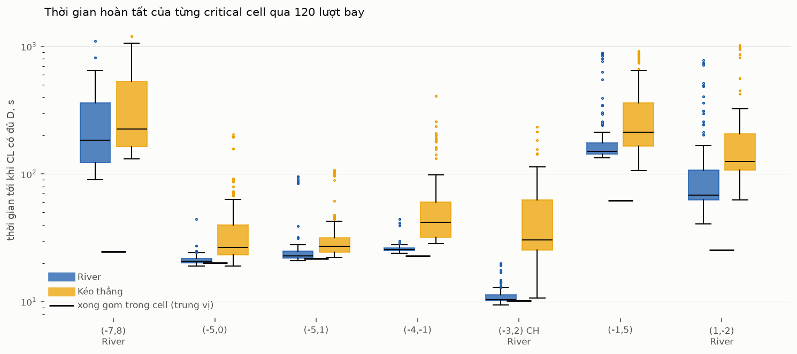

# Chạy thử cơ chế River (lớp 3, mức logic)

Cơ chế: [L3-vi.md](L3-vi.md), Thuật toán 1–7. Kế hoạch: [TRIAL-vi.md](TRIAL-vi.md).
Mô tả gốc: CLAUDE.md §8, mục 38–48. Kết quả gồm **120 lượt bay độc lập** trên đường bay thẳng.

## 1. Quy trình

```text
triển khai (uav-coop)  ─┐
đường bay thẳng a180   ─┼─► river_plan.py  ─► kế hoạch: Axe, Seg, River, Bank, critical cell, Circle
PER theo khoảng cách   ─┘        │
                                 ▼
                          river_sim.py, mỗi lượt bay:
                          1. lượt bay: node v nhận gói s với xác suất 1 − p(ρ)
                          2. chất lượng liên kết G2G: che khuất tĩnh theo cặp, Rayleigh
                          3. mô phỏng theo khe 10 ms: River (TT 5–7) và Kéo thẳng
                                 │
                                 ▼
                          river_figures.py ─► hình theo giai đoạn, bảng số liệu
```

| file | vai trò |
|---|---|
| `tools/river_plan.py` | Thuật toán 1–4 (BS, các cell Axe, CH), đúng như mã giả |
| `tools/river_sim.py` | Thuật toán 5–7, ba quy ước thực thi, và phương án so sánh Kéo thẳng |
| `tools/river_figures.py` | gộp kết quả, vẽ hình, in bảng |
| `docs/data/river-*.csv` | kết quả: từng critical cell × lượt × phương án; từng lượt; tải từng cell; lượt 1 chi tiết |

Lệnh chạy (4 tiến trình × 30 lượt bay, khoảng 4 phút):

```bash
for i in 0 1 2 3; do python3 tools/river_sim.py --deploy ../uav-coop/docs/data --data docs/data \
    --path docs/data/path-a180.csv --first $((i*30+1)) --runs 30 --out OUT/p$i & done; wait
python3 tools/river_figures.py --deploy ../uav-coop/docs/data --path docs/data/path-a180.csv \
    --sim "OUT/p?" --r1 OUT/p0 --data docs/data --figs docs/figures
```

## 2. Logic mô phỏng

**Lượt bay.** UAV đi theo đường bay thẳng, phát mỗi 0,5 m một gói, tổng 5 625 gói.
- Tập cần giao $\mathcal{D}$ gồm 4 607 gói, là các gói phát khi UAV ở trong cụm.
- Node $v$ nhận gói $s$ với xác suất $1-p(\rho)$, trong đó $p$ là đường PER theo khoảng cách
  ngang, đo từ bitmap ns-3. Sự kiện nhận ở các gói và các node là độc lập, như trong mô hình ns-3.

**Mặt đất, theo khe 10 ms:**
- Mỗi cell có một môi trường riêng: mỗi khe chỉ một khung đi qua một chặng bên trong cell đó.
  Mỗi cặp gateway có kênh riêng: mỗi khe một khung.
- Mỗi chặng thành công với xác suất $q=\exp(-\mathrm{thr}/\bar P)$, trong đó $\bar P$ tính theo
  suy hao n = 3,5 từ 1 m, che khuất tĩnh σ = 7,8 dB cho mỗi cặp node (bốc lại mỗi lượt bay), và
  Rayleigh. Chặng thất bại thì gửi lại ở khe sau.
- Dữ liệu của mỗi cell nằm ở CL của nó (quy ước 1).
  - Trong một cell, khung đi theo đường có ETX nhỏ nhất, coi như chất lượng liên kết đã biết từ
    Pha 0.
  - Giữa hai cell, khung đi qua đúng liên kết gateway đã định của cặp đó, dù liên kết tốt hay xấu.
- Mỗi yêu cầu là một khung điều khiển đi cùng đường với dữ liệu (quy ước 3).

**Hai phương án.** Cả hai đều bắt đầu bằng việc mỗi cell liên quan gom về CL những gói nó cần.
- **River:**
  - Thuật toán 5: Bank báo cho Axe những gì mình có; Axe gửi phần còn thiếu.
  - Thuật toán 6: mỗi hàng xóm trong Circle lấy từng đoạn Seg từ Bank của đoạn đó.
  - Thuật toán 7: critical cell xin mỗi hàng xóm phần mình còn thiếu.
- **Kéo thẳng:** critical cell xin trực tiếp từng cell Axe, theo cell path ngắn nhất.

Gói chỉ được chuyển khi bên gửi đã có nó, nên các giai đoạn chạy nối đuôi nhau tự nhiên theo
từng gói.

**Kiểm tra:** ở cả 120 lượt bay và cả hai phương án, mọi critical cell cuối cùng đều có đủ
$\mathcal{D}$: còn thiếu 0 gói.

**Khác với kế hoạch trong TRIAL-vi.md:**
- Bản thử viết bằng Python thay vì C++.
- Việc nhận gói được sinh từ đường PER đo từ ns-3, thay vì từ bitmap chạy lại cho đường bay
  thẳng. Hai cách tương đương về thống kê, vì mô hình ns-3 cũng bốc fading độc lập cho từng gói
  và từng node, và không bật che khuất.
- Phương án Manifest của `uav-coop` chưa được chạy so sánh.

## 3. Các giai đoạn

### Giai đoạn 0: kế hoạch trước giờ bay



Kế hoạch gồm Axe 15 cell, River 58 cell và 7 critical cell, mỗi critical cell có Circle 3–6
hàng xóm. Ví dụ, critical cell (−7,8) ở đỉnh bắc nằm trên Axe và sát biên cụm, nên Circle của
nó chỉ có 3 cell.

### Giai đoạn 1: ngay sau lượt bay



- Mỗi CL tự nhận được **45–80 %** của $\mathcal{D}$; trung vị qua các critical cell thiếu 38 %.
- **Gộp mọi node trong cell lại thì phần lớn cell gần như đủ.** Chỉ các cell ở hai đầu đường bay
  và ở mép xa mới còn thiếu nhiều.
- Phần critical cell còn thiếu sau khi gom trong cell (trung vị qua 120 lượt bay) là: 1, 5, 8 và
  34 gói ở bốn cell gần River; 286 gói ở (1,−2); 506 gói ở (−1,5); 1 471 gói ở (−7,8).

### Giai đoạn 2: gom trong cell về CL

Đây là bước tốn thời gian đầu tiên. Critical cell gom được khoảng 1 000–2 000 gói từ chính các
node của mình, mất **10–25 s** (trung vị); riêng (−1,5) mất 62 s.

### Giai đoạn 3: Axe bổ sung cho Bank (Thuật toán 5)

**Không phải chuyển gói nào ở cả 120 lượt bay.** Sau khi gom trong cell, mọi Bank đã có đủ
đoạn Seg của Axe tương ứng. Ở W = 3,5, một node của Bank chỉ thiếu khoảng 1 %, và hơn 20 node
trong cell gộp lại thì lấp kín phần thiếu đó.

### Giai đoạn 4: Circle chuẩn bị dữ liệu và critical cell yêu cầu





- Tải nặng nhất của River dồn vào các Circle ở xa: quanh (−1,5) ở đông bắc và (−7,8) ở đỉnh
  bắc. Tải của Kéo thẳng dồn dọc Axe, vì mọi critical cell cùng kéo từ đó.
- Ở lượt 1, River hoàn tất nhanh hơn ở 6/7 critical cell. Riêng (−7,8) chậm hơn (530 s so với
  130 s): Circle của nó chỉ có 3 cell và cùng nằm ở đỉnh bắc, nên mỗi hàng xóm phải chở một
  phần rất lớn.

## 4. Kết quả qua 120 lượt bay



Trung vị (p90) thời gian tới khi CL có đủ $\mathcal{D}$, tính bằng giây từ lúc UAV rời cụm:

| critical cell | trong River | thiếu sau khi gom | xong gom trong cell | **River** | **Kéo thẳng** | River nhanh hơn |
|---|---|---|---|---|---|---|
| (−7,8) | có | 1 471 | 24,7 | **184 (533)** | 226 (819) | 87/120 |
| (−5,0) | | 1 | 20,2 | **20,7 (23,9)** | 26,6 (68,7) | 97/120 |
| (−5,1) | | 8 | 21,7 | **22,9 (27,7)** | 27,1 (44,4) | 119/120 |
| (−4,−1) | | 34 | 22,9 | **25,6 (27,1)** | 41,9 (164) | 118/120 |
| (−3,2) CH | có | 5 | 10,2 | **10,4 (13,0)** | 30,3 (107) | 119/120 |
| (−1,5) | | 506 | 62,2 | **150 (307)** | 212 (787) | 91/120 |
| (1,−2) | có | 286 | 25,3 | **68 (262)** | 126 (277) | 105/120 |

Số khung mỗi lượt bay (trung bình):

| | tổng | gom trong cell | Axe → Bank | Circle chuẩn bị | critical cell yêu cầu | điều khiển |
|---|---|---|---|---|---|---|
| River | **184 k** | 39 k | 0 | **107 k** | 34 k | 4,5 k |
| Kéo thẳng | 234 k | 27 k | — | — | 202 k | 4,8 k |

Critical cell nào xong muộn nhất trong mỗi lượt: River trung vị 250 s, Kéo thẳng 320 s.

## 5. Nhận xét

1. **River nhanh hơn Kéo thẳng ở cả 7 critical cell** (theo trung vị), và tốn ít hơn **21 %** số
   khung.
   - Với các critical cell gần River, gần như chỉ còn bước gom trong cell: River xong chỉ
     0,2–3 s sau khi gom xong.
   - Kéo thẳng chậm hơn vì mọi critical cell cùng kéo dọc Axe, làm các cell Axe nghẽn.
2. **Giai đoạn gom trong cell quyết định phần lớn thời gian** ở các cell gần River, và là cận dưới
   thực tế cho mọi phương án. Mỗi CL chỉ tự nhận được 45–80 % của $\mathcal{D}$, nhưng cả cell
   gộp lại thì gần đủ.
3. **Thuật toán 5 không phải làm gì ở W = 3,5.** Bank đã đủ ngay sau khi gom. Như vậy River có
   thể rộng hơn (Bank xa hơn, gần critical cell hơn) mà vẫn không cần Axe bổ sung. Đây là dữ liệu
   cho câu hỏi phụ về độ rộng River tối ưu.
4. **Circle chuẩn bị dữ liệu tốn nhiều nhất: 58 % số khung.**
   - Hàng xóm chuẩn bị toàn bộ đoạn mình phụ trách, trong khi critical cell chỉ cần trung bình
     khoảng 2 300 gói mỗi lượt từ bên ngoài (cộng cả 7 critical cell).
   - Nếu hàng xóm chỉ chuẩn bị đúng phần critical cell thiếu (biết được sau khi critical cell
     gom xong), số khung sẽ giảm mạnh. Đổi lại, phần chuẩn bị không còn làm trước được.
5. **Thời gian bị kéo dài ở đuôi phân bố (p90 đến hàng trăm giây) do các liên kết gateway yếu.**
   - Mỗi cặp cell chỉ có một gateway cố định. Khi che khuất làm liên kết đó xấu, mọi dữ liệu qua
     cặp cell đó phải gửi lại nhiều lần.
   - (−7,8) và (−1,5) chịu nặng nhất vì nằm xa, và Circle của (−7,8) chỉ có 3 cell.

## 6. Giới hạn của bản thử

- Đây là **cận lạc quan**:
  - không mô phỏng va chạm giữa các cell kề nhau, ngoài quy tắc mỗi cell một khung mỗi khe;
  - gateway được phát và nhận cùng một khe trên hai kênh khác nhau;
  - fading của mỗi khung độc lập, chưa theo khối 100 ms.
- Việc nhận gói từ UAV dùng mô hình độc lập từng gói, từng node. Ngoài thực tế che khuất làm các
  node gần nhau mất gói cùng lúc, nên "cả cell gộp lại gần đủ" có thể quá lạc quan.
- Kết quả chỉ cho một cụm, một đường bay thẳng, W = 3,5.
