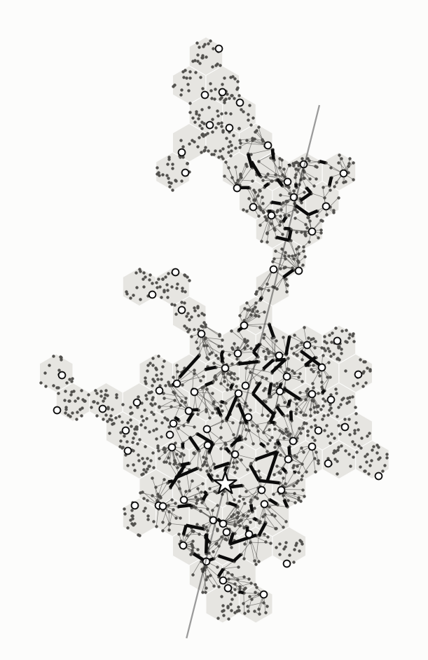

# C3 (cluster vàng) — River từng bước, lượt 1

Lời gốc: CLAUDE.md §8 mục 64–65. Thuật toán: [`../../uav-coop2/docs/L3-vi.md`](../../uav-coop2/docs/L3-vi.md).
C3 bay thẳng qua CH theo hướng 76° (đoạn bay trong cluster dài nhất, xem
[`CLUSTER-RIVER-vi.md`](CLUSTER-RIVER-vi.md)).

**Thiết lập:**
- ns-3 với MAC 802.15.4 đầy đủ, 7 màu, gateway theo chất lượng liên kết, lượt bay 1.
- Ba biến thể: River chuẩn bị sẵn, River khi được hỏi, kéo thẳng.
- Hình không có chữ (§8 mục 63); số liệu do `tools/cluster_steps.py` in ra.

**Ký hiệu chung trên các hình:**
- ★: CH. ○: critical cell khác.
- Đường mảnh: đường bay.
- Màu của bốn critical cell, dùng chung ở bước 4, 5 và 8:
  - (4,6) xanh dương;
  - CH (8,−5) xanh lá;
  - (8,−2) vàng;
  - (9,−7) đỏ.

## Bước 0 — pha 0: vai trò và đường truyền



- **Trên hình:**
  - chấm nhỏ là node, chấm trắng là CL;
  - đường xám mảnh là cây đường trong cell về CL (ETX nhỏ nhất);
  - đoạn đen đậm là cặp gateway giữa hai cell kề nhau.
- **Số liệu:**
  - 80 cell, 1 725 node.
  - CH là node #1193 ở cell (8,−5).
  - 80 CL, mỗi cell một CL.
  - 113 cặp gateway, cặp yếu nhất có q = 0,89. BS chọn gateway theo chất lượng, nên không còn liên kết chết.
  - 57 % node gửi thẳng tới CL của mình trong 1 hop.

## Bước 1 — ngay sau lượt bay


- **Trên hình:** màu đậm hơn nghĩa là có nhiều dữ liệu hơn (tỉ lệ của D). Trái: cả cell (gộp mọi node). Phải: riêng CL.
- **Số liệu:**
  - UAV phát 5 703 gói trên cả đường bay, trong đó 4 685 gói khi đang ở trên cluster.
  - Cả 4 685 gói đều được ít nhất một node nhận, nên |D| = 4 685.
  - Cả cell: trung vị 92 % D, thấp nhất 43 % (nhánh trên cùng, xa đường bay).
  - Riêng CL: trung vị 63 %, thấp nhất 18 %.
- **Critical cell** (cả cell / riêng CL):
  - (8,−2): 100 % / 80 %;
  - CH: 86 % / 67 %;
  - (9,−7): 76 % / 57 %;
  - (4,6): 72 % / 49 %.

## Bước 2 — Thuật toán 1: Axe và đoạn dữ liệu (Seg)


- **Trên hình:** cell Axe, càng đậm càng về sau theo hướng bay.
- **Số liệu:**
  - 17 cell Axe.
  - Seg (số gói phát trên mỗi cell Axe) lần lượt: 361, 255, 285, 361, 317, 170, 71, 343, 360, 260, 281, 360, 322, 151, 90, 338, 360.
  - Trung bình 276 gói, tức 2,8 s phát trên mỗi cell.
- **Nhận xét:** các Seg nhỏ (71, 90, 151, 170 gói) là chỗ đường bay chỉ cắt qua góc cell.

## Bước 3 — Thuật toán 2: River và Bank


- **Trên hình:** xanh đậm là Axe, xanh lá là Bank, xanh nhạt là phần còn lại của River. Đường đen nối mỗi cell Axe tới Bank của nó.
- **Số liệu:**
  - River gồm 51/80 cell, có 24 Bank khác nhau, ω = 1,75 bề rộng cell.
  - Trong 34 đường Axe → Bank: 20 đường dài 2 cell, 5 dài 1 cell, 9 dài 0 cell (cell Axe nằm sát biên nên chính nó là Bank).
  - 14/34 Bank bị biên cluster cắt ngắn.
- **Nhận xét:** C3 hẹp, nhất là nhánh trên, nên River chạm biên ở nhiều chỗ.

## Bước 4 — Thuật toán 3: critical cell


- **Trên hình:** màu là độ mạnh của CL (nhạt → đậm). Vòng tròn là critical cell.
- **Ngưỡng:** điểm CL trung bình 0,531, độ lệch chuẩn 0,154.
  - Vượt trội toàn cụm khi điểm > 0,840.
  - Vượt trội cục bộ khi điểm > 0,685 và mạnh nhất trong bán kính 2 vòng cell.
- **Critical cell:**
  - (8,−2): 0,907 (+2,4σ), toàn cụm.
  - (9,−7): 0,850 (+2,1σ), toàn cụm.
  - (4,6): 0,803 (+1,8σ), cục bộ.
  - CH (8,−5): 0,740 (+1,4σ). CH được chọn với ràng buộc cách biên ≥ 300 m, nên không phải node mạnh nhất cụm.

## Bước 5 — Thuật toán 4: Circle


- **Trên hình:** viền màu là thành viên Circle của từng critical cell. Đường màu là đường Bank → thành viên, mỗi thành viên lấy phần Seg được giao từ Bank.
- **Số liệu:** mỗi critical cell có 5–6 thành viên Circle, cùng chia nhau 17 Seg (mỗi thành viên khoảng 3 Seg). Đường Bank → thành viên:
  - (8,−2): trung bình 3,5 cell, dài nhất 7;
  - CH: trung bình 4,8, dài nhất 10;
  - (9,−7): trung bình 6,1, dài nhất 12;
  - (4,6): trung bình 6,1, dài nhất 13.
- **Nhận xét:** hai critical cell ở hai đầu cluster, (4,6) trên cùng và (9,−7) dưới cùng, phải lấy Seg từ tận đầu kia của River, nên đường đi dài nhất.

## Bước 6 — gom trong cell về CL (River chuẩn bị sẵn)


- **Trên hình:** liên kết dùng để gom, nét càng đậm càng nhiều khung.
- **Số liệu:**
  - 9 105 khung gom về 41 CL (chỉ những cell có vai trò mới gom).
  - Khung gom cuối cùng lúc 9,8 s.
  - Critical cell gom xong: (8,−2) lúc 7,4 s, CH 8,0 s, (4,6) 9,0 s, (9,−7) 9,8 s.

## Bước 7 — sau khi gom: dòng dữ liệu


- **Ba ô, từ trái sang:** River chuẩn bị sẵn, River khi được hỏi, kéo thẳng.
- **Màu:** vàng là Bank → Circle, đỏ là → critical cell, xám mảnh là yêu cầu. Nét càng đậm càng nhiều khung.

| | River chuẩn bị sẵn | River khi được hỏi | Kéo thẳng |
|---|---|---|---|
| Gom trong cell | 9 105 | 5 484 | 4 165 |
| Axe → Bank | 0 | 0 | — |
| Bank → Circle | 66 684 | 61 639 | — |
| → critical cell | 12 622 | 12 622 | 96 994 |
| Yêu cầu | 1 255 | 638 | 1 029 |
| **Tổng** | **89 666** | **80 383** | **102 188** |
| MAC bỏ cuộc | 3 171 | 2 758 | 3 722 |

## Bước 8 — critical cell nhận đủ dữ liệu


- **Trên hình:** trục ngang là thời gian, 0–50 s, vạch lưới mỗi 10 s. Trục dọc là tỉ lệ D mà CL của critical cell có, 0–1.
- **Ba ô:** như bước 7. Vạch đứng trên mỗi đường là lúc cell đó gom xong trong cell.

| Critical cell | CL thiếu / cả cell thiếu (gói) | Chuẩn bị sẵn | Khi được hỏi | Kéo thẳng |
|---|---|---|---|---|
| (8,−2) | 930 / 1 | 7,5 s | 5,6 s | 6,0 s |
| (9,−7) | 2 029 / 1 127 | 32,9 s | 38,1 s | 39,8 s |
| CH (8,−5) | 1 564 / 636 | 35,8 s | 41,4 s | 48,0 s |
| (4,6) | 2 377 / 1 313 | 37,2 s | 44,2 s | 50,3 s |

## Đọc kết quả

1. **Chi phí nằm ở chặng Bank → Circle,** chiếm 74 % số khung của River chuẩn bị sẵn.
   - Mỗi thành viên Circle lấy khoảng 3 Seg từ Bank, đi qua 3,5–6,1 cell.
   - Hai critical cell ở hai đầu cluster cần dữ liệu từ đầu bên kia, đi tới 12–13 cell.
   - Đổi lại, chặng cuối vào critical cell chỉ còn 12,6 k khung, so với 97 k của kéo thẳng.
2. **Axe → Bank vẫn là 0 khung,** vì Bank nhận đủ phần của mình ngay trong lượt bay. Điều này đúng ở mọi cluster và cấu hình đã thử.
3. **Critical cell nằm ngay trên Axe, (8,−2), không cần River.** Cả cell của nó chỉ thiếu 1 gói, gom trong cell là đủ. Ở chế độ chuẩn bị sẵn nó còn chậm hơn kéo thẳng (7,5 s so với 6,0 s), vì lưu lượng chuẩn bị Circle tranh môi trường truyền với nó.
4. **Đường của CH có đoạn nằm ngang** khoảng 15–28 s (chuẩn bị sẵn) và 13–35 s (kéo thẳng). Đó là lúc chờ các Seg từ đầu xa của River.
   - Với River, các Seg này đến sớm hơn, vì Circle đã chuẩn bị sẵn.
   - Với kéo thẳng, chúng đi cả quãng dài từ Axe về.
5. **Chuẩn bị sẵn hay khi được hỏi:** khi được hỏi tiết kiệm 10 % khung (80,4 k so với 89,7 k), nhưng chậm hơn 5–7 s ở ba critical cell xa đường bay.

Dữ liệu đầu vào và kết quả: `docs/data/cap80-c3long/`. Chạy lại hình và số liệu:
```
python3 tools/cluster_steps.py --data docs/data/cap80-c3long --k 3 --bits PASS/pass3b-bits-r1.bin \
    --trace "TRACE/{s}" --figs docs/figures --name c3
```
