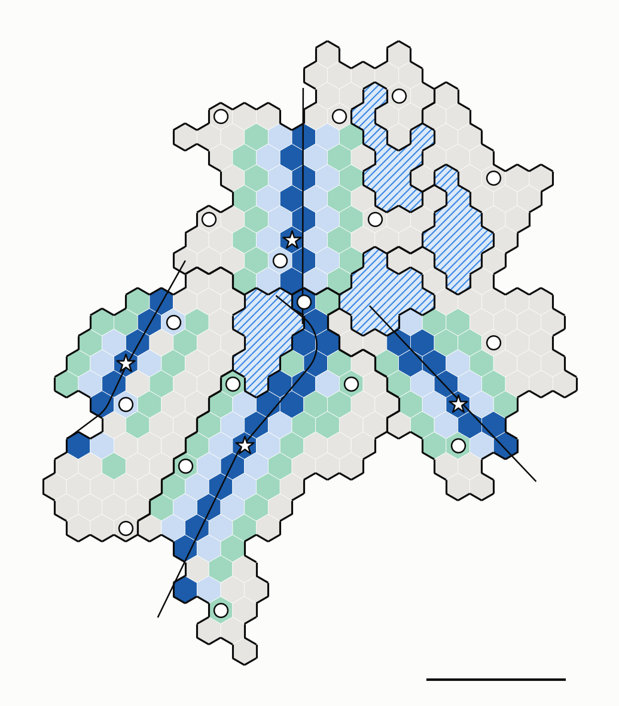

# River trên các cluster của miền có hồ — lượt 1

Lời gốc: CLAUDE.md §8 mục 61–63. Cơ chế River: [`../../uav-coop2/docs/L3-vi.md`](../../uav-coop2/docs/L3-vi.md);
cấu hình ns-3 giống [`RIVER-NS3-vi.md`](../../uav-coop2/docs/RIVER-NS3-vi.md): MAC 802.15.4 đầy đủ,
7 màu, gateway chọn theo chất lượng liên kết.

**Cách đọc hình** (hình không có chữ theo §8 mục 63):
- Xám: cell của cluster. Xanh nhạt: River. Xanh lá: Bank. Xanh đậm: Axe.
- Gạch chéo: hồ.
- Đường đậm: biên cluster. Đường mảnh: đường bay.
- ★: CH. ○: các critical cell khác.
- Thanh ngang: 1 km.

## Chuỗi xử lý

1. **Chia cluster:** chặn trên 80 cell → 4 cluster (`partition.py`, `docs/data/domain-lakes-clusters-cap80.csv`).
2. **Dựng triển khai cho mỗi cluster:** dùng `uav-coop-deploy --regionIn=ck-cells.csv --nodesIn=ck-nodesin.csv --spacings=35 --angle=180`.
   - Hai tham số mới: miền và node lấy từ ngoài thay vì sinh ngẫu nhiên.
   - Phần còn lại chạy như cũ: CH (cách biên ≥ 300 m) và CL, route PECEE, gateway, đường bay vào ở một điểm biên ngẫu nhiên, đi thẳng qua CH, ra phía đối diện.
   - Mặc định của chương trình vẫn cho đúng triển khai cũ (đã so từng file).
3. **Pass lượt 1:** cùng binary đóng băng với đợt trước. Mỗi cluster có lượt bay riêng; bỏ qua gói tràn sang cluster bên cạnh.
4. **Kế hoạch River:** độ rộng 3,5, ngưỡng critical như cũ (`river_export.py`).
5. **ns-3 lượt 1:** River (Circle chuẩn bị sẵn) và kéo thẳng.

Dữ liệu: `docs/data/cap80/` (đầu vào triển khai, kế hoạch và kết quả của từng cluster).

## Kết quả lượt 1

| Cluster | Cell / node | Đường bay trong cluster | Axe | \|D\| | Critical | River: TB / cuối | Kéo thẳng: TB / cuối | Khung River so với kéo thẳng |
|---|---|---|---|---|---|---|---|---|
| C1 | 80 / 1 682 | 1,2 km | 8 | 2 404 | 7 | 5,1 / 12,8 s | 5,2 / 13,8 s | +13 % (12,4 k so với 11,0 k) |
| C2 | 80 / 1 674 | 2,3 km | 17 | 4 266 | 6 | 17,0 / 35,8 s | 20,6 / 43,1 s | −5 % (113,8 k so với 119,3 k) |
| C3 | 80 / 1 725 | 1,2 km | 9 | 2 494 | 4 | 7,4 / 25,4 s | 8,7 / 31,4 s | +1 % |
| C4 | 65 / 1 388 | 1,0 km | 7 | 2 091 | 4 | 3,7 / 12,9 s | 4,3 / 15,3 s | −24 % |

- Mọi critical cell đều nhận đủ dữ liệu (thiếu 0 gói).
- Không còn cặp gateway yếu (q < 0,5) nào.

**Đọc sơ bộ** (một lượt, chưa phải kết luận):
- **Thời gian:** River nhanh hơn kéo thẳng ở cả 4 cluster, cả trung bình lẫn critical cell cuối.
- **Số khung:** lợi thế chỉ rõ ở C2 (Axe dài 17 cell) và C4.
  - Ở C1 và C3, đường bay trong cluster ngắn (khoảng 1,2 km, Axe 8–9 cell) và |D| chỉ khoảng 2 400 gói. Kéo thẳng tốn bằng hoặc ít khung hơn, vì đường từ Axe tới critical cell vốn đã ngắn, phần chuẩn bị Circle trở thành chi phí thêm.
  - Điều này khớp với đợt 20 lượt trên cluster gốc: River có lợi khi có nhiều critical cell nằm xa đường bay so với độ dài Axe.

## Lỗi đã sửa trong lúc làm

- **Tham chiếu treo trong `coop2-river.cc`:**
  - `arrive` giữ tham chiếu tới `jobs[j].done`. Các hàm chờ mà nó gọi có thể tạo job mới, khiến vector `jobs` cấp phát lại, và tham chiếu trỏ vào vùng nhớ đã giải phóng. Ở C2 lỗi này làm chương trình crash.
  - Đã sửa bằng cách truyền `done` theo giá trị.
  - Chạy lại 3 cấu hình × 2 lượt của đợt 20 lượt bằng binary đã sửa: kết quả giống hệt, nên số liệu cũ vẫn dùng được.
- **`river_plan.load`:** trước đây đo độ rộng cell bằng cell (0,0) và (1,0); nay dùng một cặp cell kề bất kỳ, vì lưới của cluster có thể không chứa gốc toạ độ.
- **`coop-deploy`:** với miền đưa từ ngoài vào, mảng `frontierSize` rỗng làm crash khi ghi `growth.csv`; nay điền bằng 0.
