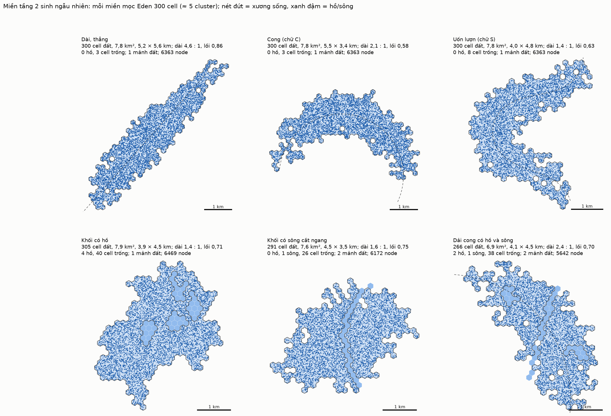
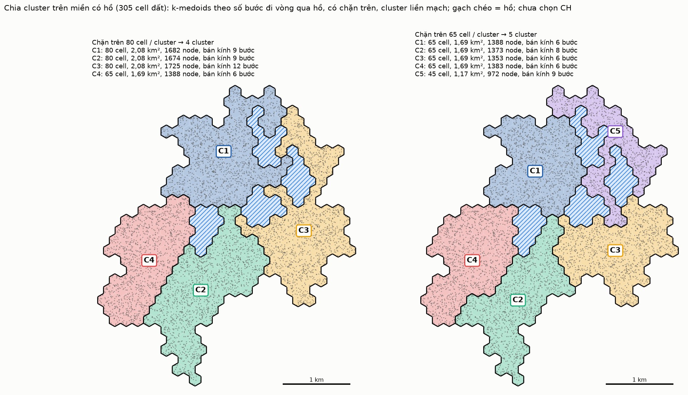

# Tầng 2 — bước 1: miền bay

Lời gốc: CLAUDE.md §8 mục 56–61.


## Cách sinh

Miền được sinh **đúng như một cluster của `uav-coop`** (`models/common/region.cc`, `deploy.h`),
chỉ to hơn:

1. **Mọc Eden** từ cell gốc tới `--cells` cell. Mỗi bước thêm một cell bốc đều từ biên (các cell chưa chọn kề vùng). Một cluster của `uav-coop` mọc 60 cell, nên mặc định 300 cell là cỡ 5 cluster. Lưới lục giác vẫn là R = 100 m.
2. **Lấp chỗ lõm** tới độ lồi `--convexity`. Các cell nằm trong bao lồi mà chưa thuộc vùng được lấp dần, ô bị bao nhiều nhất trước, hoà thì bốc ngẫu nhiên. Độ lồi = số cell / số cell của bao lồi.
3. **Node:** round(diện tích / spacing²) node (spacing 35 m), đặt đều trong miền. Mỗi node có obs, cpu ~ U[0,1) và comm ~ U(0,1]. **Chưa chọn CH và CL.**

Bộ sinh số ngẫu nhiên là của Python, nên cùng `--seed` không ra đúng miền như bản C++ của
`uav-coop`; chỉ thuật toán là giống.

## Miền seed 1 (`docs/data/map-s1-*.csv`)

| | |
|---|---|
| Mọc | 300 cell, độ lồi 0,74, 17 lỗ bên trong |
| Bao lồi | 404 cell |
| Lưu, độ lồi 0,8 | 324 cell, 8,4 km², kích thước khoảng 4,3 × 3,6 km |
| Node | 6 872 |

Seed 2–4 cho kết quả tương tự: độ lồi khi vừa mọc 0,70–0,72, 14–22 lỗ, kích thước khoảng 4 × 4–4,7 km.

**Nhận xét về độ lõm:**
- Ở cỡ 300 cell, vùng Eden mọc ra gần tròn. Độ lõm chủ yếu nằm ở mép răng cưa và các lỗ nhỏ bên trong.
- Ngược lại, cluster 60 cell có độ lồi 0,55–0,82 và có những nhánh dài.
- Nếu tầng 2 cần một miền lõm mạnh (vịnh sâu, hình chữ L, hai khối nối bằng eo hẹp), cách mọc này chưa tạo ra được, sẽ cần thêm cơ chế.

### Cách mọc này có cho miền dài, cong, có khoảng trống không? (§8 mục 59)

Đo trên 200 seed (`tools/shape_stats.py`). Các miền vừa mọc, chưa lấp:

| | 60 cell (1 cluster) | 300 cell (miền tầng 2) |
|---|---|---|
| Độ dài (trục dài / trục ngắn) | trung vị 1,40; p90 1,91; lớn nhất 2,52 | trung vị 1,23; p90 1,51; lớn nhất 2,06 |
| Độ cong (lệch lớn nhất của trục giữa / chiều dài) | trung vị 0,17; p90 0,25 | trung vị 0,12; p90 0,18 |
| Số lỗ | trung vị 2 | trung vị 13 |
| Lỗ lớn nhất | trung vị 1 cell; lớn nhất 7 | trung vị 3 cell (≈ 0,08 km²); lớn nhất 13 |

**Kết luận:** gần như không.
- Miền càng lớn càng tròn: không seed nào dài quá 2,1 : 1, và độ cong nhỏ.
- Khoảng trống chỉ là các lỗ nhỏ vài cell, và bước lấp chỗ lõm lấp chúng trước tiên.

Muốn có miền dài, cong hay có khoảng trống lớn thì phải thêm cơ chế vào cách mọc.

## Miền dài, cong, có hồ và sông (§8 mục 60)



Vẫn là mọc Eden 300 cell. Ba cơ chế mới đều sinh ngẫu nhiên và bật bằng tham số của `map_gen.py`:

- **Xương sống** (`--spine L --bend θ --wiggle φ --width w`):
  - Bốc một đường cong trơn ngẫu nhiên đi qua gốc, dài L km, tổng góc uốn θ, cộng một dao động hình sin biên độ φ.
  - Mỗi bước Eden chọn cell kề vùng với trọng số exp(−d²/2σ²) thay vì chọn đều. d là khoảng cách tới xương sống, σ = w/2.
  - Mép miền vẫn răng cưa kiểu Eden, nhưng tổng thể chạy theo xương sống.
- **Hồ** (`--lakes k --lakeCells m`): khoét k hồ.
  - Mỗi hồ mọc Eden m cell từ một cell bên trong, và chỉ đi qua các cell bên trong (cả 6 cell kề đều là đất hoặc hồ), nên hồ không bao giờ thông ra biên.
- **Sông** (`--river w --riverBend --riverWiggle`): khoét các cell cách một đường cong ngẫu nhiên qua tâm miền không quá w·173/2 m. Sông có thể cắt miền thành nhiều mảnh.
- Hồ và sông được khoét **sau** bước lấp chỗ lõm, nên không bị lấp lại.
- Khi không bật cơ chế nào, kết quả giống hệt bản cũ (đã kiểm tra trên seed 1).

| Miền (seed) | Đất | Kích thước | Dài : rộng | Độ lồi | Khoảng trống | Mảnh đất |
|---|---|---|---|---|---|---|
| Dài, thẳng (1) | 300 cell, 7,8 km² | 5,2 × 5,6 km (chéo) | 4,6 : 1 | 0,86 | 3 cell | 1 |
| Cong, chữ C (2) | 300 cell | 5,5 × 3,4 km | 2,1 : 1 | 0,58 | 3 cell | 1 |
| Uốn lượn, chữ S (3) | 300 cell | 4,0 × 4,8 km | 1,4 : 1 | 0,63 | 8 cell | 1 |
| Khối có 4 hồ × 10 cell (4) | 305 cell | 3,9 × 4,5 km | 1,4 : 1 | 0,71 | 40 cell | 1 |
| Khối có sông rộng 1 cell (5) | 291 cell | 4,5 × 3,5 km | 1,6 : 1 | 0,75 | 26 cell | 2 |
| Dải cong, 2 hồ, 1 sông (16) | 266 cell | 4,1 × 4,5 km | 2,4 : 1 | 0,70 | 38 cell | 2 |

So với miền 300 cell mọc đều (dài tối đa 2,1 : 1 trên 200 seed; lỗ lớn nhất 13 cell):
- xương sống cho miền dài tới 4,6 : 1, hoặc cong hẳn (độ lồi 0,58);
- hồ và sông tạo khoảng trống lớn, đúng chỗ, và không bị lấp.

Số liệu từng miền: `docs/data/domain-*-{cells,nodes}.csv`.
Chạy lại hình: `cd tools && python3 domain_gallery.py --data ../docs/data --figs ../docs/figures`.

Chạy lại:
```
python3 tools/map_gen.py --seed 1 --cells 300 --convexity 0.8 --out docs/data/map-s1 --figs docs/figures
```

## Chia cluster trên miền có hồ (§8 mục 61)



Pha 0 (§8 mục 38): chia node mặt đất thành các cluster có chặn trên kích thước. Làm bằng
`tools/partition.py` trên miền "khối có hồ" (`docs/data/domain-lakes-*`). Chưa chọn CH.

**Cách chia:**
- Đơn vị là cell. Khoảng cách giữa hai cell là số bước đi qua các cell đất kề nhau, nên hồ phải đi vòng chứ không cắt ngang.
- Số cluster k = ⌈số cell đất / chặn trên⌉.
- Chạy k-medoids có sức chứa:
  1. **Tâm ban đầu:** chọn bằng cách lấy điểm xa nhất dần, xuất phát từ một cell ngẫu nhiên.
  2. **Gán:** mọi cluster mọc đồng thời từ tâm của mình theo thứ tự khoảng cách. Một cell thuộc về cluster đầu tiên chạm tới nó khi cluster đó còn chỗ, nên mỗi cluster liền mạch ngay từ khi mọc.
  3. **Cân bằng tải:** cell bị các cluster đầy bao kín được nhập vào cluster kề nhỏ nhất. Sau đó, cluster nào vượt chặn thì đẩy tải dọc một chuỗi cluster kề nhau tới cluster còn chỗ, mỗi mắt xích chuyển một cell biên. Không bao giờ chuyển cell mà làm cluster cũ đứt đôi.
  4. **Cập nhật tâm:** tâm mới là cell có tổng khoảng cách tới các cell khác trong cluster nhỏ nhất. Lặp lại bước 2–4 tới khi tâm không đổi.

**Kết quả** (miền có 305 cell đất, 6 469 node):

| Chặn trên | k | Cell mỗi cluster | Node mỗi cluster | Bán kính từ tâm (bước) |
|---|---|---|---|---|
| 80 cell (2,08 km²) | 4 | 80 / 80 / 80 / 65 | 1 388 – 1 725 | 6 – 12 |
| 65 cell (1,69 km²) | 5 | 65 / 65 / 65 / 65 / 45 | 972 – 1 388 | 6 – 9 |

- Cả hai cách chia đều đúng chặn trên.
- Mọi cluster liền một mảnh.
- Các hồ rơi vào biên giữa các cluster: hồ không có node nên chính nó thành ranh giới tự nhiên.

Chạy lại: `cd tools && python3 partition.py --domain ../docs/data/domain-lakes --caps 80,65 --figs ../docs/figures`.
