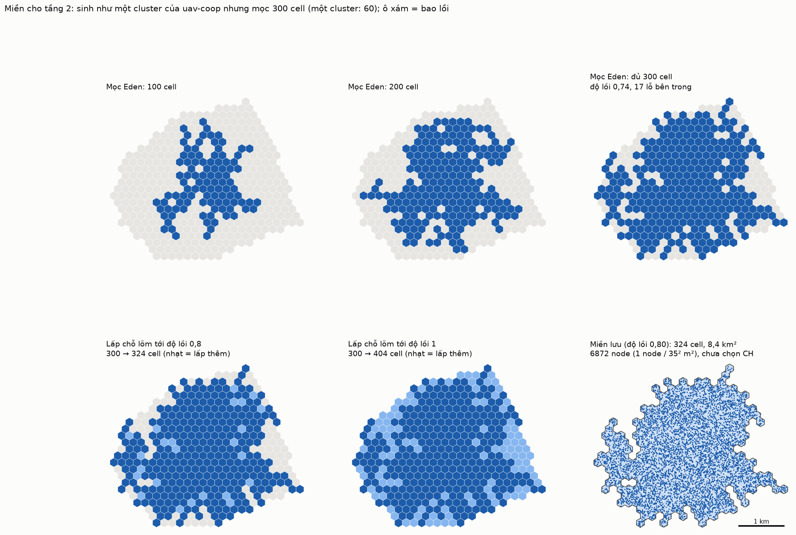

# Tầng 2 — bước 1: miền bay

Lời gốc: CLAUDE.md §8 mục 56–57.



## Cách sinh

Miền được sinh **đúng như một cluster của `uav-coop`** (`models/common/region.cc`, `deploy.h`),
chỉ to hơn:

1. **Mọc Eden** từ cell gốc tới `--cells` cell. Mỗi bước thêm một cell bốc đều từ biên (các cell chưa chọn kề vùng). Một cluster của `uav-coop` mọc 60 cell, nên mặc định 300 cell là cỡ 5 cluster. Lưới lục giác vẫn là R = 100 m.
2. **Lấp chỗ lõm** tới độ lồi `--convexity`. Các cell nằm trong bao lồi mà chưa thuộc vùng được lấp dần, ô bị bao nhiều nhất trước, hoà thì bốc ngẫu nhiên. Độ lồi = số cell / số cell của bao lồi.
3. **Node:** round(diện tích / spacing²) node (spacing 35 m), đặt đều trong miền. Mỗi node có obs, cpu ~ U[0,1) và comm ~ U(0,1]. **Chưa chọn CH và CL.**

Bộ sinh số ngẫu nhiên là của Python, nên cùng `--seed` không ra đúng miền như bản C++ của
`uav-coop`; chỉ thuật toán là giống.

## Miền seed 1 (`docs/data/map-s1-*.csv`)

| | |
|---|---|
| Mọc | 300 cell, độ lồi 0,74, 17 lỗ bên trong |
| Bao lồi | 404 cell |
| Lưu, độ lồi 0,8 | 324 cell, 8,4 km², kích thước khoảng 4,3 × 3,6 km |
| Node | 6 872 |

Seed 2–4 cho kết quả tương tự: độ lồi khi vừa mọc 0,70–0,72, 14–22 lỗ, kích thước khoảng 4 × 4–4,7 km.

**Nhận xét về độ lõm:**
- Ở cỡ 300 cell, vùng Eden mọc ra gần tròn. Độ lõm chủ yếu nằm ở mép răng cưa và các lỗ nhỏ bên trong.
- Ngược lại, cluster 60 cell có độ lồi 0,55–0,82 và có những nhánh dài.
- Nếu tầng 2 cần một miền lõm mạnh (vịnh sâu, hình chữ L, hai khối nối bằng eo hẹp), cách mọc này chưa tạo ra được, sẽ cần thêm cơ chế.

### Cách mọc này có cho miền dài, cong, có khoảng trống không? (§8 mục 59)

Đo trên 200 seed (`tools/shape_stats.py`). Các miền vừa mọc, chưa lấp:

| | 60 cell (1 cluster) | 300 cell (miền tầng 2) |
|---|---|---|
| Độ dài (trục dài / trục ngắn) | trung vị 1,40; p90 1,91; lớn nhất 2,52 | trung vị 1,23; p90 1,51; lớn nhất 2,06 |
| Độ cong (lệch lớn nhất của trục giữa / chiều dài) | trung vị 0,17; p90 0,25 | trung vị 0,12; p90 0,18 |
| Số lỗ | trung vị 2 | trung vị 13 |
| Lỗ lớn nhất | trung vị 1 cell; lớn nhất 7 | trung vị 3 cell (≈ 0,08 km²); lớn nhất 13 |

**Kết luận:** gần như không.
- Miền càng lớn càng tròn: không seed nào dài quá 2,1 : 1, và độ cong nhỏ.
- Khoảng trống chỉ là các lỗ nhỏ vài cell, và bước lấp chỗ lõm lấp chúng trước tiên.

Muốn có miền dài, cong hay có khoảng trống lớn thì phải thêm cơ chế vào cách mọc.

Chạy lại:
```
python3 tools/map_gen.py --seed 1 --cells 300 --convexity 0.8 --out docs/data/map-s1 --figs docs/figures
```
