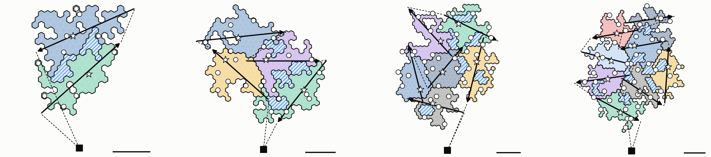
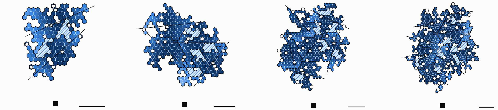
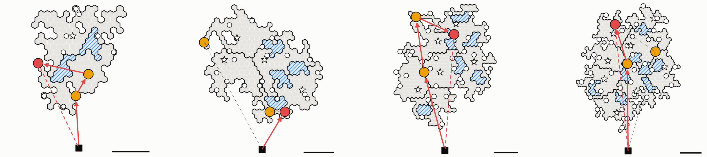
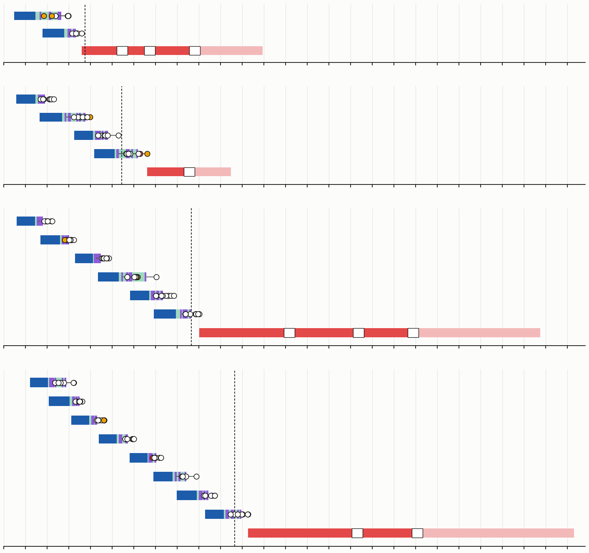
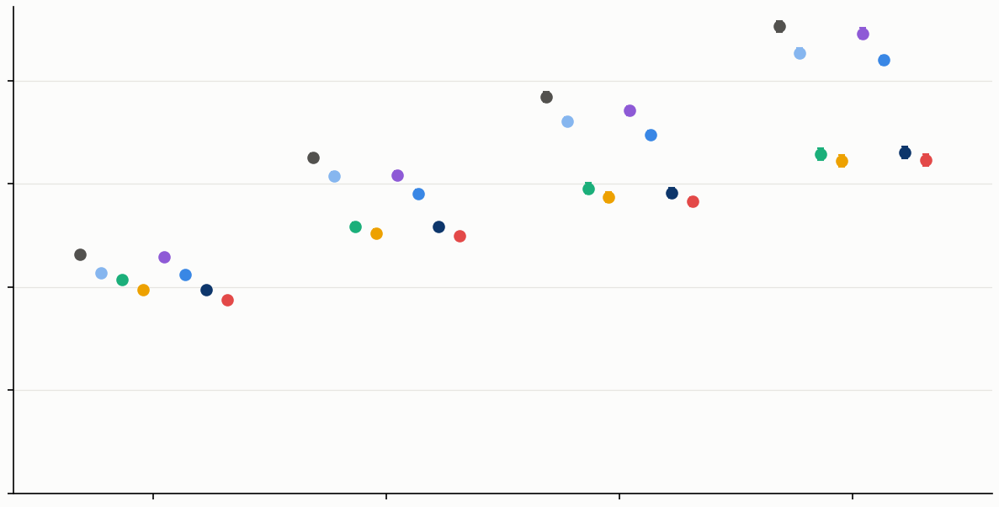
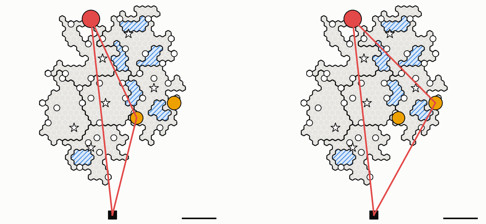
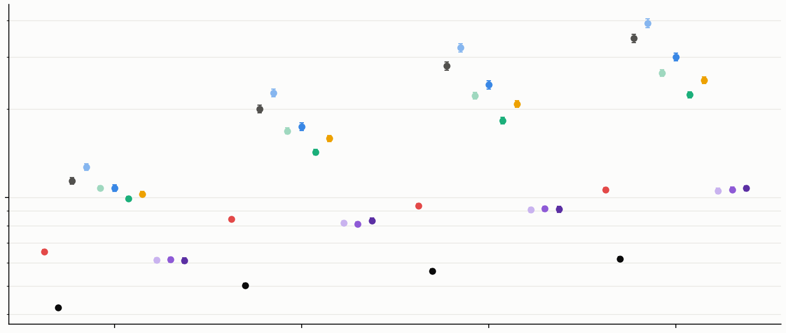
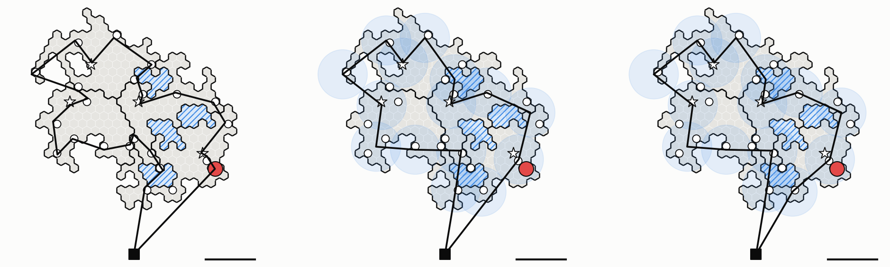

# Giả lập trọn nhiệm vụ Pha 1 — từ bản đồ tới khi đội 2 về BS

Lời gốc: CLAUDE.md §8 mục 68. Lõi của giả lập là cơ chế tầng 3 (River, [`../../uav-coop2/docs/L3-vi.md`](../../uav-coop2/docs/L3-vi.md)),
chạy trên ns-3 với MAC 802.15.4 đầy đủ, 7 màu, gateway chọn theo chất lượng liên kết. Hình không có chữ
(mục 63), mọi con số nằm trong bảng dưới đây.

**Chạy lại:**
```
python3 tools/mission.py --clusters 4 --seed 2 --work WORK/k4 --bin BIN     # tương tự: 2/3, 6/4, 8/4
python3 tools/mission_report.py --works WORK/k2,WORK/k4,WORK/k6,WORK/k8 --figs docs/figures \
    --out docs/data/mission/mission
```
`BIN` chứa các binary đóng băng: `deploy-bin`, `pass-bin` (thư viện `pass-lib/`), `river-bin` (thư viện `lib/`).
Kết quả gọn của từng bản đồ nằm ở `docs/data/mission/k{2,4,6,8}/`. Bảng tổng: `mission-summary.csv`. Từng
critical cell: `mission-cells.csv`.

**Mỗi bản đồ chỉ chạy một lượt.** Số liệu ở đây minh hoạ chuỗi nhiệm vụ, chưa phải số để công bố
(quy tắc N ≥ 120).

## Kịch bản và giả định

| Công đoạn | Mô hình |
|---|---|
| Bản đồ | Miền "khối có hồ" (`map_gen`), mọc 80 × số cluster cell, mỗi cluster một hồ 10 cell; node 1 / 35 m × 35 m. BS cách cell thấp nhất 1 km về phía nam |
| Chia cluster | `partition.py`, chặn trên 80 cell |
| Triển khai | `uav-coop-deploy` với miền và node có sẵn: CH, CL, route PECEE, gateway. CH cách biên ≥ 300 m; cluster quá mảnh hạ xuống 200, 100 hoặc 0 m |
| Đường bay đội 1 trong cluster | Thẳng qua CH theo hướng có đoạn nằm trong cluster dài nhất (quét 0–178°, bước 2°). Nếu Dubins không ra được ngoài cluster thì lấy hướng dài kế tiếp |
| Đội 1 | Một UAV cánh bằng, 50 m/s, độ cao 100 m. Tour BS → đoạn bay của mọi cluster (mỗi đoạn chọn chiều) → BS, ngắn nhất theo Held–Karp. Đoạn chuyển tiếp là đường thẳng (chưa tính bán kính quay) |
| Phát dữ liệu | `uav-coop-pass` lượt 1: một gói / 10 ms. Mỗi cluster chỉ tính gói khi UAV bay trên đoạn của chính nó (gói tràn sang cluster khác bị bỏ qua) |
| Tầng 3 | `uav-coop2-river`, cluster bắt đầu khi UAV rời nó. Ba phương án: **River chuẩn bị sẵn** (chính), **River Circle 12** (Circle động cố định 12 thành viên), **kéo thẳng** |
| Đối sánh | Bắt đầu khi critical cell có đủ D của cluster; tạm là một khoảng chờ 5 s |
| Báo cáo | Mỗi critical cell gửi vài byte về BS qua LoRa: 0,4 s phát + chờ duty cycle ngẫu nhiên 0–30 s |
| Nghi vấn | Trên toàn bản đồ: 1 critical cell là nghi vấn thật, 2–3 critical cell khác là nghi vấn giả (bốc ngẫu nhiên một lần mỗi bản đồ). Các critical cell còn lại báo không thấy gì |
| Đội 2 | Một UAV cánh quay, 15 m/s, rời BS khi mọi critical cell đã báo cáo. Bay tour TSP chính xác BS → nghi vấn → BS (không ràng buộc độ cong), theo chiều có chặng đầu ngắn hơn. Lơ lửng 30 s xác minh mỗi điểm. Tới nghi vấn thật thì bay thẳng về BS, nhiệm vụ kết thúc |

Thứ tự thăm do TSP quyết định, nên nghi vấn thật có thể rơi vào lần thăm đầu hoặc cuối hoàn toàn do may rủi.
Vì vậy bảng có thêm cột **"TB mọi nghi vấn"**: thời điểm kết thúc trung bình nếu lần lượt coi từng nghi vấn
là thật, với cùng tour.

## Công đoạn 1–3: bản đồ, cluster, đường bay đội 1



Bốn panel từ trái sang là 2, 4, 6, 8 cluster.
- Màu: cluster. Gạch chéo: hồ. Viền đậm: biên cluster.
- Mũi tên đậm: đoạn bay phát dữ liệu trong cluster. Nét đứt: chặng chuyển tiếp.
- ■: BS. ★: CH. ○: các critical cell khác.
- Thanh ngang: 1 km.

| Bản đồ | Cell đất | Node | Cluster (cell) | Critical | Tour đội 1 | Đội 1 về BS |
|---|---|---|---|---|---|---|
| k2 | 147 | 3 118 | 80 / 67 | 12 | 11,3 km | 225 s |
| k4 | 308 | 6 532 | 80 / 80 / 80 / 68 | 27 | 16,3 km | 327 s |
| k6 | 465 | 9 862 | 80 / 80 / 80 / 80 / 78 / 67 | 45 | 26,0 km | 519 s |
| k8 | 595 | 12 619 | 80 / 80 / 74 / 78 / 70 / 72 / 68 / 73 | 52 | 32,0 km | 640 s |

- **Đoạn bay trong mỗi cluster dài 1,8–2,4 km,** nên mỗi cluster nhận |D| = 3 600–4 800 gói.
- **Hai trường hợp phải dùng phương án dự phòng:**
  - k4/C4 quá mảnh để có node cách biên 300 m, nên hạ xuống 200 m.
  - k8/C4 lõm tới mức đường vào từ điểm biên ngẫu nhiên không khả thi, nên thử điểm vào khác.

## Công đoạn 4: sau lượt phát



Màu cell là tỉ lệ D của cluster mà cell đó (gộp mọi node) đã nhận được: nhạt là ít, đậm là đủ. Đường mảnh là đoạn bay.

| Bản đồ | Cell giữ TB | Cell thấp nhất | Critical TB | Critical thấp nhất |
|---|---|---|---|---|
| k2 | 84 % | 48 % | 85 % | 64 % |
| k4 | 89 % | 40 % | 88 % | 46 % |
| k6 | 91 % | 42 % | 90 % | 42 % |
| k8 | 92 % | 22 % | 92 % | 52 % |

Ngay sau lượt bay, một critical cell trung bình đã có khoảng 9/10 dữ liệu. River chỉ phải lấp phần còn
thiếu, thường 8–15 %. Một số critical cell nằm xa đường bay thiếu tới khoảng một nửa.

## Công đoạn 5: River trong từng cluster


- Xanh đậm: Axe. Xanh lá: Bank. Xanh nhạt: River. Xám: phần còn lại của cluster.
- ★ / ○: critical cell.

**Thời gian từ lúc UAV rời cluster tới khi critical cell cuối cùng của cluster đủ D (s), và số khung MAC:**

| Cluster | Axe | \|D\| | Crit | River chuẩn bị | Circle 12 | Kéo thẳng | Khung: River / Circle 12 / kéo thẳng (nghìn) |
|---|---|---|---|---|---|---|---|
| k2-C2 | 16 | 4 628 | 6 | 66,9 | 63,4 | 75,4 | 217 / 193 / 244 |
| k2-C1 | 15 | 4 538 | 6 | 27,9 | 21,1 | 36,2 | 65 / 42 / 66 |
| k4-C3 | 15 | 4 324 | 7 | 21,5 | 25,6 | 32,0 | 68 / 36 / 77 |
| k4-C1 | 14 | 3 735 | 7 | 59,6 | 62,2 | 61,2 | 160 / 135 / 171 |
| k4-C4 | 12 | 4 157 | 6 | 36,3 | 30,9 | 48,8 | 92 / 56 / 88 |
| k4-C2 | 18 | 4 548 | 7 | 60,0 | 53,5 | 65,0 | 148 / 113 / 156 |
| k6-C6 | 13 | 4 104 | 7 | 16,8 | 17,8 | 20,6 | 24 / 14 / 29 |
| k6-C1 | 16 | 4 325 | 7 | 20,6 | 20,1 | 22,7 | 52 / 28 / 67 |
| k6-C5 | 15 | 3 870 | 7 | 17,1 | 21,2 | 18,9 | 26 / 17 / 31 |
| k6-C4 | 17 | 4 757 | 7 | 71,3 | 71,1 | 94,0 | 182 / 126 / 236 |
| k6-C2 | 13 | 3 631 | 9 | 32,8 | 33,3 | 57,1 | 142 / 110 / 151 |
| k6-C3 | 16 | 4 580 | 8 | 37,3 | 40,6 | 56,0 | 146 / 112 / 183 |
| k8-C6 | 13 | 3 939 | 7 | 46,1 | 41,4 | 42,2 | 108 / 90 / 122 |
| k8-C3 | 16 | 4 549 | 6 | 22,4 | 23,2 | 35,6 | 60 / 41 / 71 |
| k8-C1 | 14 | 3 870 | 7 | 17,4 | 17,7 | 19,2 | 24 / 15 / 28 |
| k8-C5 | 13 | 3 905 | 7 | 26,6 | 26,6 | 42,1 | 54 / 39 / 68 |
| k8-C7 | 15 | 3 847 | 6 | 19,6 | 19,3 | 19,6 | 21 / 9 / 16 |
| k8-C8 | 14 | 4 369 | 4 | 32,6 | 25,7 | 28,4 | 44 / 32 / 49 |
| k8-C4 | 17 | 4 548 | 7 | 27,0 | 28,1 | 32,3 | 68 / 43 / 83 |
| k8-C2 | 15 | 4 247 | 8 | 43,3 | 44,9 | 58,9 | 123 / 86 / 142 |

Mọi critical cell của cả 20 cluster đều nhận đủ D ở cả ba phương án.

- **River chuẩn bị sẵn so với kéo thẳng:**
  - Nhanh hơn ở 17/20 cluster, hoà 1, chậm hơn 2 (k8-C6, k8-C8).
  - Ít khung hơn ở 18/20 cluster.
  - Tổng khung trên bản đồ giảm 9 % (k2), 5 % (k4), 18 % (k6), 13 % (k8).
- **Circle 12 so với River chuẩn bị sẵn:**
  - Ít khung hơn ở **cả 20/20** cluster. Tổng giảm 17 / 27 / 29 / 29 %.
  - Về thời gian thì lẫn lộn: nhanh hơn ở 9 cluster, chậm hơn ở 10, hoà 1.
  - Phát hiện của lượt C3 (Circle càng lớn càng tiết kiệm khung) lặp lại trên mọi cluster. Lợi thế về thời gian thì không.
- **Thời gian tầng 3 của một cluster là 17–95 s.** Các cluster chậm nhất (k2-C2, k4-C1/C2, k6-C4) có Axe dài và nhiều critical cell nằm xa đường bay.

## Công đoạn 6–7: đối sánh, báo cáo, nghi vấn và đội 2



- ●: critical cell. Đỏ: nghi vấn thật. Cam: nghi vấn giả.
- Mũi tên đỏ: đường đội 2 đã bay. Nét đứt đỏ: chặng về BS. Chấm xám: phần tour TSP không cần bay tiếp.



**Dòng thời gian** (River chuẩn bị sẵn). Mỗi khối là một bản đồ, mỗi hàng là một cluster theo thứ tự tour,
hàng cuối là đội 2. Lưới dọc cách nhau 60 s.
- **Mỗi hàng cluster:**
  - Xanh đậm: UAV bay trên cluster.
  - Xanh lá: tầng 3, tới critical cell cuối.
  - Tím: 5 s đối sánh của từng critical cell.
  - Chấm: lúc báo cáo tới BS (đỏ là thật, cam là giả, trắng là không thấy gì).
- **Hàng đội 2:** đỏ là bay, ô trắng là 30 s xác minh, hồng là đường về.
- Nét đứt dọc: lúc đội 1 về BS.

| Bản đồ | Phương án | Critical cuối đủ D | Đội 2 xuất phát | Thấy nghi vấn thật (lần thăm) | Kết thúc | TB mọi nghi vấn |
|---|---|---|---|---|---|---|
| k2 | River chuẩn bị | 194,8 s | 215,5 s | 513,0 s (3) | **716,7 s** | 570,7 s |
| | Circle 12 | 188,0 | 206,8 | 504,3 | 708,0 | 562,0 |
| | kéo thẳng | 203,1 | 221,2 | 518,7 | 722,4 | 576,4 |
| k4 | River chuẩn bị | 366,5 | 397,2 | 498,3 (1) | **629,3** | 811,0 |
| | Circle 12 | 360,0 | 390,7 | 491,8 | 622,8 | 804,5 |
| | kéo thẳng | 371,5 | 402,3 | 503,3 | 634,4 | 816,1 |
| k6 | River chuẩn bị | 513,3 | 540,7 | 1 117,5 (3) | **1 485,2** | 1 305,9 |
| | Circle 12 | 516,6 | 547,2 | 1 124,1 | 1 491,7 | 1 312,4 |
| | kéo thẳng | 532,0 | 560,4 | 1 137,3 | 1 504,9 | 1 325,7 |
| k8 | River chuẩn bị | 652,7 | 676,2 | 1 129,0 (2) | **1 577,9** | 1 515,2 |
| | Circle 12 | 654,3 | 673,1 | 1 125,9 | 1 574,8 | 1 512,1 |
| | kéo thẳng | 668,3 | 682,7 | 1 135,5 | 1 584,4 | 1 521,7 |

## Đọc kết quả

1. **Nhiệm vụ do đường bay chi phối, không do tầng 3.**
   - Đội 1 cần 225–640 s. Đội 2 cần thêm 230–950 s.
   - Tầng 3 chỉ kéo dài 17–95 s sau khi UAV rời mỗi cluster, và phần lớn chồng lên lúc đội 1 đang bay cluster kế tiếp.
   - Vì vậy, đổi phương án tầng 3 chỉ dịch thời điểm kết thúc khoảng 6–20 s (1–3 %).
2. **Đường găng là cluster đội 1 bay qua cuối cùng.**
   - Đội 2 phải chờ báo cáo chậm nhất. Báo cáo đó gần như luôn thuộc cluster cuối tour (hoặc cluster có tầng 3 dài như k4-C2), cộng 5 s đối sánh và tới 30 s chờ LoRa.
   - Ở k4, đội 2 xuất phát sau khi đội 1 đã về BS 70 s.
   - Tầng 3 nhanh có ý nghĩa nhất ở cluster cuối tour.
3. **Đội 2 chiếm phần lớn nửa sau.**
   - Ví dụ k6: 3 nghi vấn rải trên 3–4 km, 15 m/s, 30 s xác minh mỗi điểm.
   - Thứ tự TSP không biết nghi vấn nào là thật. Ở k4 thăm trúng ngay lần đầu (629 s), nhưng trung bình mọi nghi vấn là 811 s.
4. **Tầng 3 vẫn là nơi tiết kiệm tài nguyên.**
   - River giảm 5–18 % khung so với kéo thẳng. Circle 12 giảm thêm 17–29 % so với River chuẩn bị.
   - Mạng càng lớn thì mức giảm càng ổn định.
5. **Chưa mô hình hoá:**
   - Bán kính quay của đội 1 ở chặng chuyển tiếp.
   - Gói tràn sang cluster láng giềng khi bay ngang (dữ liệu "miễn phí", hiện bị bỏ).
   - Năng lượng.
   - Đối sánh thật (lớp 1).
   - Điểm nghi vấn có xác suất (đội 2 có thể ưu tiên theo điểm).

## Hướng phát triển (đã làm ở phần sau: mục 70)

- **Cho đội 2 xuất phát sớm:** ngay khi có nghi vấn đầu tiên, hoặc khi các cluster đã báo đủ phần lớn, thay vì chờ mọi critical cell. Theo dòng thời gian, cách này rút được tới vài trăm giây ở bản đồ lớn.
- **Sắp tour đội 1 sao cho cluster có tầng 3 dài được bay sớm,** để phần River của nó chồng hết lên thời gian bay.
- **Thăm nghi vấn theo điểm nghi vấn × khoảng cách** thay cho TSP thuần.
- **Chạy nhiều lượt** (N ≥ 120) trên mỗi kích thước trước khi rút kết luận định lượng.

---

# Phần 2 — Chính sách nhiệm vụ, phản hồi LoRa qua CH, nhiều lượt (CLAUDE.md §8 mục 70)

**Chạy lại:**
```
python3 tools/mission.py --clusters N --seed S --work W/kN-sS --bin BIN --jobs 4 --schemes rf
python3 tools/mission_policy.py --works "W/k*" --draws 100 --figs docs/figures \
    --out docs/data/mission/policy --example W/k6
```
Dữ liệu gọn của 36 bản đồ mới: `docs/data/mission/camp/`. Từng lượt bốc: `policy-draws.csv`. Bảng tổng: `policy-summary.csv`.

## Mô hình mới

**Phản hồi qua CH (ràng buộc mới, mục 70).** Kênh LoRa thuộc về CH:
- Critical cell đối sánh xong (5 s) thì chuyển kết quả cho CH, mất 0,1 s cho mỗi cell khoảng cách.
- CH phát với thời gian phát 0,4 s và duty cycle 1 %, nên tối đa **một bản tin mỗi 40 s**. Pha của CH bốc đều trong [0, 40) s.
- Mỗi bản tin mang mọi kết quả đã về CH tính tới lúc phát, và tới BS sau 0,4 s.

**Điểm nghi vấn.** Báo cáo của nghi vấn thật mang điểm bốc đều trong 0,5–1,0, nghi vấn giả trong 0,2–0,8. Hai khoảng chồng nhau, nên điểm cao nhất không phải lúc nào cũng là thật.

**Tám chính sách**, tổ hợp của ba lựa chọn:

| Lựa chọn | Cũ | Mới |
|---|---|---|
| Tour đội 1 | `short`: tour ngắn nhất | `l3first`: tour làm **mọi critical cell xong sớm nhất**, tức cực tiểu max_k(rời_k + L3dự_k), giải chính xác bằng Held–Karp Pareto (thời gian, độ sẵn sàng) |
| Đội 2 xuất phát | `wait`: chờ mọi báo cáo | `early`: ngay khi **báo cáo nghi vấn đầu tiên** về BS |
| Thứ tự thăm | `tsp`: theo tour TSP | `score`: chọn nghi vấn có **điểm / (thời gian bay + 30 s)** lớn nhất trong các nghi vấn đã biết |

**Dự báo L3 cho BS.** L3dự = max(15, −52 + 6,92 · maxFar) s, với maxFar là khoảng cách lớn nhất (tính bằng cell) từ một critical cell tới một cell Axe.
- BS biết maxFar từ kế hoạch River, nên dự báo này dùng được trước khi bay.
- Hệ số được khớp trên 20 cluster của phần 1 (r = 0,67). Các ứng viên khác yếu hơn: số cell Axe r = 0,32, |D| r = 0,34.

**Cách đội 2 ra quyết định.** Đội 2 quyết định tại BS và sau mỗi lần xác minh. Nếu chưa biết nghi vấn nào còn lại, nó chờ tại chỗ.
- `early/tsp`: điểm kế tiếp là điểm đầu của tour TSP mở từ vị trí hiện tại, qua các nghi vấn đã biết, về BS.
- `wait/tsp`: giữ nguyên cách cũ (một tour kín cố định).

**Quy mô.** 4 kích thước × 10 bản đồ = 40 bản đồ, 200 cluster. River chuẩn bị sẵn chạy trên ns-3, mỗi cluster một lượt. Mỗi bản đồ có 100 lượt bốc (nghi vấn, điểm, pha LoRa), so cặp giữa các chính sách.
- Tầng 3 của một cluster không phụ thuộc lúc UAV tới, nên mọi tour dùng chung một kết quả ns-3.
- **Đơn vị độc lập là bản đồ (10 mỗi kích thước).** 1 000 lượt bốc chỉ trung bình hoá phần ngẫu nhiên của nghi vấn và LoRa, không thay thế được số bản đồ.

## Kết quả



Thời điểm kết thúc nhiệm vụ, trung bình ± khoảng tin cậy 95 %. Bốn nhóm từ trái sang là 2, 4, 6, 8 cluster; lưới ngang cách nhau 300 s. Màu trong mỗi nhóm, từ trái sang:

| # | Màu | Chính sách |
|---|---|---|
| 1 | xám | short / wait / tsp (cũ) |
| 2 | xanh nhạt | short / wait / score |
| 3 | xanh lá | short / early / tsp |
| 4 | cam | short / early / score |
| 5 | tím | l3first / wait / tsp |
| 6 | xanh vừa | l3first / wait / score |
| 7 | xanh đậm | l3first / early / tsp |
| 8 | đỏ | l3first / early / score (đủ ba cải tiến) |

**Kết thúc nhiệm vụ (s)** — trung bình [± 95 %]; thay đổi so với cách cũ, ghép cặp theo lượt bốc; số bản đồ có trung bình tốt hơn:

| Chính sách | 2 cluster | 4 cluster | 6 cluster | 8 cluster |
|---|---|---|---|---|
| short / wait / tsp (cũ) | 695 [±9] | 977 [±12] | 1 153 [±14] | 1 358 [±16] |
| short / wait / score | −53 (10/10) | −53 (10/10) | −71 (10/10) | −77 (10/10) |
| l3first / wait / tsp | −7 (2/10) | −51 (8/10) | −40 (8/10) | −20 (6/10) |
| short / early / tsp | −74 (10/10) | −200 (10/10) | −266 (10/10) | −371 (10/10) |
| short / early / score | −102 (10/10) | −220 (10/10) | −292 (10/10) | **−391** (10/10) |
| l3first / early / tsp | −103 (10/10) | −202 (10/10) | −279 (10/10) | −367 (10/10) |
| **l3first / early / score** | **−132** (10/10) | **−228** (10/10) | **−304** (10/10) | −389 (10/10) |
| → kết thúc | 562 | 749 | 849 | 969 |
| → giảm | −19 % | −23 % | −26 % | −29 % |

**Các thời điểm trung gian (s)** — trung bình trên các lượt bốc:

| | 2 | 4 | 6 | 8 |
|---|---|---|---|---|
| Đội 1 về BS: short / l3first | 211 / 213 | 356 / 380 | 498 / 508 | 647 / 678 |
| Báo cáo cuối về BS: short / l3first | 239 / 233 | 429 / 377 | 529 / 489 | 661 / 641 |
| Báo cáo nghi vấn thật về BS (short) | 181 | 276 | 329 | 385 |
| Đội 2 xuất phát với `early` (l3first) | 131 | 176 | 194 | 232 |
| Số lần thăm: cũ / đủ ba cải tiến | 2,20 / 1,86 | 2,25 / 2,01 | 2,23 / 1,99 | 2,25 / 2,08 |



**Ví dụ: bản đồ 6 cluster, cùng một lượt bốc.** Trái là cách cũ, phải là đủ ba cải tiến.
- Đỏ: nghi vấn thật. Cam: nghi vấn giả. Cỡ chấm tỉ lệ với điểm nghi vấn.
- Đường đỏ: đường bay của đội 2.

| | Cách cũ | Đủ ba cải tiến |
|---|---|---|
| Đội 2 xuất phát | 531 s | 211 s (báo cáo nghi vấn đầu tiên) |
| Thấy nghi vấn thật | 1 014 s | 768 s |
| Kết thúc | 1 413 s | 1 167 s |

## Đọc kết quả

1. **Cho đội 2 đi sớm là cải tiến lớn nhất:** −74 s ở 2 cluster, −371 s ở 8 cluster, tốt hơn ở 78–88 % lượt bốc và ở 10/10 bản đồ mọi kích thước.
   - Bản đồ càng lớn càng lợi, vì "chờ mọi báo cáo" thực chất là chờ cluster cuối tour. Ở 8 cluster, việc này tốn tới 661 s, trong khi báo cáo nghi vấn đầu tiên về từ khoảng 230 s.
2. **Thăm theo điểm nghi vấn:**
   - Đứng riêng thì bớt 53–77 s, tốt hơn ở 10/10 bản đồ, và giảm số lần thăm từ khoảng 2,2 xuống khoảng 2,0.
   - Kết hợp với đi sớm thì chỉ thêm 20–28 s, vì đi sớm đã buộc đội 2 thăm theo thứ tự báo cáo về.
3. **Tour ưu tiên cluster tầng 3 dài:**
   - Chỉ có ích khi đội 2 còn **chờ mọi báo cáo**. Nó làm báo cáo cuối về sớm hơn 6–52 s, đổi lại đội 1 bay dài hơn 2–31 s.
   - Khi đội 2 đã đi sớm, tour này hết tác dụng. Ở 8 cluster, l3first/early/score (969 s) bằng short/early/score (967 s).
   - Lý do: với đi sớm, đường găng chuyển sang **lúc báo cáo nghi vấn thật về**, mà nghi vấn thật có thể nằm ở bất kỳ cluster nào. Không còn là lúc cluster chậm nhất xong.
   - Dự báo L3 cũng chỉ ở mức r = 0,67. Ở 2 cluster nó tốt hơn ở 2/10 bản đồ, ở 8 cluster ở 6/10.
4. **Gộp cả ba:** nhiệm vụ ngắn hơn 19–29 %, mức giảm tăng theo kích thước mạng; tốt hơn ở 10/10 bản đồ mọi kích thước.
   - Ở 8 cluster, có thể bỏ l3first mà không mất gì.
5. **Kênh LoRa qua CH đáng kể.** Với khe 40 s, một kết quả chờ trung bình khoảng 20 s mới được phát, cộng thêm thời gian xếp hàng nếu CH có nhiều kết quả. Mức này gấp khoảng bốn lần 5 s đối sánh. Chưa đo riêng phần trễ này so với các phần khác.

## Giới hạn

- **Số bản đồ:**
  - 10 bản đồ mỗi kích thước, mỗi cluster 1 lượt ns-3, tức 50 cluster cho kích thước nhỏ nhất (2 cluster × 10 bản đồ, kênh lượt 1).
  - Dưới quy tắc N ≥ 120, nên số tuyệt đối mới là ước lượng.
  - Chiều và độ lớn của các thay đổi thì nhất quán: 10/10 bản đồ với đi sớm và với thăm theo điểm.
- **Phân bố điểm nghi vấn là giả định.** Lợi thế của `score` phụ thuộc trực tiếp vào độ tách giữa điểm của nghi vấn thật và giả.
- **Các tham số đội 2 cố định:** 15 m/s, 30 s xác minh.
- **Mô hình LoRa đơn giản:** một CH một kênh, không va chạm giữa các CH, không mất gói.
- **Đội 1 vẫn bỏ qua bán kính quay ở chặng chuyển tiếp.**

---

# Phần 3 — Xác minh có tệp lớn và các baseline (CLAUDE.md §8 mục 72–73)

**Chạy lại:**
```
python3 tools/mission_baselines.py --works "W/k*" --draws 100 --figs docs/figures \
    --out docs/data/mission/base --example W/k4
```
- Cùng 40 bản đồ (10 bản đồ mỗi kích thước), cùng kết quả ns-3 của River, cùng 100 lượt bốc nghi vấn và pha LoRa mỗi bản đồ như phần 2.
- Bảng tổng: `base-summary.csv`. Từng lượt bốc: `base-draws.csv`.

## Xác minh (đội 2, mọi phương án)

UAV cánh quay hover ở 100 m ngay trên cell nghi vấn và thực hiện tuần tự:
1. Ổn định 5 s.
2. Gửi **tệp lớn 1 MB** (con số tạm, sẽ thay khi có mô hình nhận dạng) bằng unicast 802.15.4 tới CL.
3. Cell đối sánh trong 5 s.

**Thời gian truyền unicast** = 10 592 khung × 6,88 ms ≈ **73 s**, nên mỗi lần xác minh mất **83 s** (trước đây 30 s).
- 6,88 ms mỗi khung gồm: CSMA lùi trung bình 1,12 ms, CCA và quay vòng 0,32 ms, khung 4,26 ms, ACK 0,54 ms, LIFS 0,64 ms.
- Ở 100 m ngay trên CL còn khoảng 30 dB dự trữ, nên bỏ qua mất gói.

**Multicast:**
- Phát 1 khung mỗi 10 ms như lượt bay, không ACK, giả định có mã fountain lý tưởng.
- Nhóm xong khi node nhận kém nhất đủ tệp: số khung / (1 − PER của node đó).
- PER lấy theo mô hình A2G của mục 2 (Nakagami m = 1,8), tính từ điểm hover tới từng CL:

| Khoảng cách ngang | 0 m | 300 m | 500 m | 800 m |
|---|---|---|---|---|
| PER | 0,000 | 0,003 | 0,040 | 0,305 |

- Gửi tệp lớn bằng multicast mất 106 s cho nhóm gần (lâu hơn unicast vì mỗi khung chiếm 10 ms).

**Tệp nhẹ** (B3, B6) = |D| trung bình của bản đồ ≈ 0,41–0,45 MB.

## Các phương án

Mọi đội dùng một UAV cánh quay 15 m/s; chưa so năng lượng.

| Ký hiệu | Mô tả |
|---|---|
| **P** | Đề xuất: cánh bằng + River (ns-3) + LoRa qua CH + đội 2 l3first / early / score (phần 2), với xác minh 83 s |
| **B1** | Không pha 1. Một UAV đi TSP qua mọi critical cell (láng giềng gần nhất + 2-opt); tại mỗi cell unicast tệp lớn rồi chờ đối sánh; về khi gặp cell thật |
| **B2-r** | Không pha 1. Gom critical cell trong bán kính r quanh một điểm hover (phủ tham lam); multicast tệp lớn mỗi nhóm, chờ đối sánh; về khi nhóm chứa cell thật xong |
| **B3-r** | Pha 1 bằng UAV cánh quay multicast **tệp nhẹ** trên các nhóm đó; mỗi cell đối sánh, báo qua LoRa ở CH; đội 2 (UAV thứ hai) như P |
| **B6** | Như B3 nhưng mỗi critical cell một lần hover, unicast tệp nhẹ |
| **B4-t** | P nhưng **không hợp tác tại biên**: critical cell dùng phần dữ liệu cả cell của nó nhận được sau lượt bay (gom nội cell theo ns-3). Mô hình lớp 1 tạm: cell thật chỉ phát hiện được nếu giữ ≥ t của D, nếu không thì nhiệm vụ thất bại (đội 2 thăm hết nghi vấn giả rồi về) |
| **B7** | Cận dưới lý tưởng: đội 2 biết trước cell thật, bay thẳng tới lúc t = 0, xác minh rồi về |

## Kết quả



**Thời điểm kết thúc nhiệm vụ** (trung bình ± khoảng tin cậy 95 %, **trục log**). Bốn nhóm là 2, 4, 6, 8 cluster. Màu: P đỏ; B7 đen; B1 xám; B2-300 / B2-500 xanh nhạt / xanh; B3-300 / B3-500 xanh lá nhạt / xanh lá; B6 cam; B4-0,85 / 0,9 / 0,95 tím nhạt dần đậm.

**Thời điểm kết thúc nhiệm vụ (s).** Với B4, trung bình chỉ tính trên các lượt tìm thấy cell thật.

| Phương án | 2 cluster | 4 | 6 | 8 |
|---|---|---|---|---|
| **P** | **654** | **845** | **937** | **1 060** |
| B7 (cận dưới) | 421 | 502 | 562 | 618 |
| B1 | 1 138 | 2 002 | 2 802 | 3 474 |
| B2-300 | 1 269 | 2 268 | 3 232 | 3 913 |
| B2-500 | 1 077 | 1 742 | 2 413 | 3 009 |
| B3-300 | 1 074 | 1 682 | 2 218 | 2 650 |
| B3-500 | 992 | 1 424 | 1 825 | 2 232 |
| B6 | 1 027 | 1 585 | 2 075 | 2 505 |
| B4-0,85: tỉ lệ thành công / kết thúc | 61 % / 611 | 64 % / 817 | 73 % / 906 | 75 % / 1 052 |
| B4-0,9 | 53 % / 613 | 51 % / 811 | 63 % / 915 | 66 % / 1 062 |
| B4-0,95 | 45 % / 609 | 38 % / 834 | 53 % / 910 | 55 % / 1 073 |

Ở mọi kích thước, P nhanh hơn B1, B2 và B3 trên **10/10 bản đồ**.



**Đường bay trên bản đồ 4 cluster, cùng một lượt bốc** (chấm đỏ là cell thật):

| Panel | Đường bay |
|---|---|
| Trái | B1: TSP qua mọi critical cell, dừng ở cell thật |
| Giữa | B2-500: các nhóm hover (đĩa 500 m), dừng ở nhóm chứa cell thật |
| Phải | B3-500: pha 1 đi hết các nhóm để phát tệp nhẹ |

## Đọc kết quả

1. **Không có pha 1 (B1, B2) chậm gấp 1,7–3,3 lần P, và khoảng cách tăng theo kích thước mạng.**
   - B1 phải thăm trung bình 7–26 critical cell, mỗi cell 83 s xác minh cộng thời gian bay.
   - Multicast chỉ có lợi khi nhóm đủ lớn. B2-500 nhanh hơn B1 (ít điểm dừng hơn), nhưng B2-300 lại chậm hơn B1, vì multicast tốn 10 ms mỗi khung so với 6,88 ms của unicast mà nhóm 300 m lại nhỏ.
2. **Pha 1 bằng UAV cánh quay (B3, B6) đỡ hơn nhiều nhưng vẫn chậm hơn P 1,5–2,1 lần.**
   - Rải tệp nhẹ bằng hover tốn 15–50 lần hover, mỗi lần 40–60 s, và bay 15 m/s.
   - Cánh bằng 50 m/s cộng River làm cùng việc đó trong 4–11 phút cho cả bản đồ.
3. **Không hợp tác tại biên (B4) gần như không nhanh hơn: chỉ bớt 2–16 s, nhưng làm mất cell thật ở 25–62 % lượt.**
   - Sau lượt bay, critical cell thường có khoảng 90 % D nhưng hiếm khi đủ 100 %.
   - Đúng với bài học ở uav-sar: **hợp tác ở đây không mua thời gian, nó mua độ đầy đủ của dữ liệu**, tức khả năng phát hiện.
   - Mức thiệt hại cụ thể phụ thuộc mô hình lớp 1, hiện mới là ngưỡng tạm.
4. **P cách cận dưới B7 khoảng 230–440 s.**
   - Phần này là thời gian đội 1 bay tới cluster của cell thật, cộng đối sánh, cộng LoRa, cộng các lần thăm nghi vấn giả.

## Giới hạn

- Chưa có mô hình nhận dạng:
  - Tệp lớn 1 MB và ngưỡng B4 là số tạm.
  - Mọi phương án giả định đối sánh với tệp lớn luôn đúng.
- Chưa có baseline quét luống (B5), vì cần quyết định cách River áp dụng cho đường bay nhiều luống.
- Chưa tính năng lượng; một UAV mỗi đội; không có gió.
- Unicast giả định không mất gói khi hover ngay trên CL. Multicast giả định mã fountain lý tưởng.
