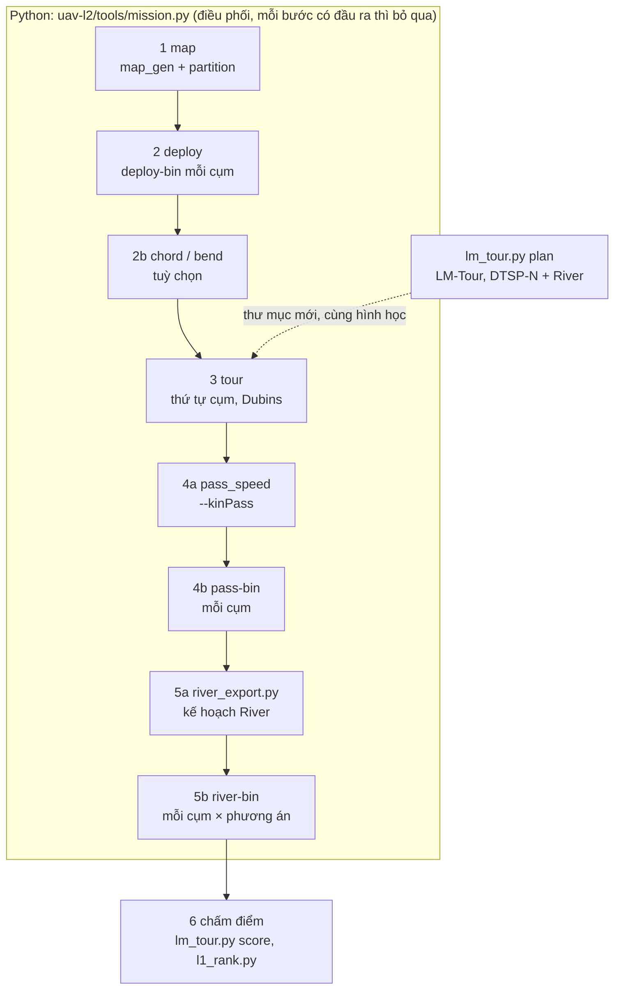

# Luồng thực thi của mô phỏng ns-3 (một nhiệm vụ pha 1)

Tài liệu này mô tả cách các script Python và ba binary ns-3 nối với nhau để chạy một nhiệm vụ trên một bản đồ, như chiến dịch 4 (`logs/2026-10-27_1714-campaign4/job.sh`) đang dùng. Nguồn: phần docstring và hàm `main` của các tệp được nêu; đọc mã ngày 2026-11-09.

## 1. Tổng quan

Ba binary đều là chương trình ns-3 riêng, được Python gọi qua `subprocess`:

| Binary | Mã nguồn | Việc | Mô hình kênh |
|---|---|---|---|
| `deploy-bin` | `uav-coop/examples/coop-deploy.cc` | chọn CH, CL; dựng đường bay qua CH; bảng định tuyến cell, gateway | không mô phỏng truyền |
| `pass-bin` | `uav-coop/examples/coop-pass.cc` | UAV bay và phát quảng bá; ghi node nào nhận gói nào | A2G: không gian tự do tới 100 m, rồi α = 3, Rician K = 2 mỗi gói, `--lossDb` theo kênh; PHY trực tiếp, không MAC |
| `river-bin` | `uav-coop2/examples/coop2-river.cc` | vận chuyển mặt đất sau lượt bay (River, kéo trực tiếp, Trickle) | G2G: n = 3,5, shadowing tĩnh 7,8 dB, Rayleigh khối 100 ms; MAC 802.15.4 đầy đủ (CSMA/CA, ACK) và lịch PECEE |

Binary đóng băng của chiến dịch 4: `CAMP-BIN5` (`deploy-bin`, `pass-bin` + `pass-lib/`, `river-bin` + `lib/`), giải nén từ `logs/2026-10-27_1714-campaign4/camp-bin5.tar.xz`. Chạy với `LD_LIBRARY_PATH` trỏ vào `pass-lib/` hoặc `lib/` (`mission.py` tự đặt).

## 2. Các bước của `mission.py`

Lệnh: `python3 uav-l2/tools/mission.py --clusters K --seed S --work WORK --bin BIN [cờ]`. Mọi tệp ghi vào `WORK`; bước nào đã có đầu ra thì bỏ qua, nên chạy lại được sau khi bị ngắt.

| # | Hàm | Việc | Đầu ra chính trong `WORK` |
|---|---|---|---|
| 1 | `stage_map` | `map_gen` sinh miền có hồ, lớn tới 80 × K cell, một node mỗi 35 × 35 m; `partition.py` chia cụm ≤ 80 cell (k-medoids; hoặc `--partition lane/subch`); BS cách cell thấp nhất 1 km | `map.json`, `c{k}-cells.csv`, `c{k}-nodesin.csv` |
| 2 | `stage_deploy` | `deploy-bin` mỗi cụm, hai lần: lần 1 chọn CH (node mạnh nhất cách biên ≥ 300 m, nới dần 200/100/0 m) và CL; quét hướng 0–178° (bước 2°) tìm đường thẳng qua CH dài nhất trong cụm; lần 2 dựng lại theo `--bearing` đó (Dubins vào/ra phải nằm ngoài cụm, không được thì lấy hướng dài kế tiếp) | `c{k}-nodes-s35.csv`, `c{k}-path-s35.csv`, `c{k}-routes-s35.csv`, `c{k}-gateways-s35.csv`, `c{k}-bearing.json` |
| 2b | `stage_chord`, `stage_bend` | tuỳ chọn: CHORD-T (`--chordTour`), uốn về critical cell (`--bendCrit`); **chiến dịch 4 không dùng** (CHORD thường) | đường bay mới |
| 3 | `stage_tour` | thứ tự đội 1 bay qua các cụm, mỗi đoạn theo một trong hai chiều (Held–Karp trên đoạn × chiều, hoặc heuristic) | `tour.json` |
| 4a | `pass_speed.run` (khi `--kinPass`) | hồ sơ vận tốc: ≤ 50 m/s, giới hạn độ cong, ±2 m/s²; cụm ngắn thì bay chậm (≥ 25 m/s) hoặc lượn vòng bán kính 63,7 m tại CH, cho tới khi phát đủ một bản bộ manh mối (4 041 gói, 40,4 s) trên cell của cụm | `c{k}-path-s35.csv` có cột `t`, `c{k}-speed.json` |
| 4b | `stage_runs` → `one(k)` | `pass-bin --bits`: một lượt bay mỗi cụm, chỉ node của cụm nghe; mã lượt (mission) = 100000 K + 100 S + k + 10⁷ (R − 1) khi `--mapRuns` | `pass{k}-bits-r1.bin` (bitmap nhận gói của từng node) |
| 5a | `one(k)` | `uav-coop2/tools/river_export.py`: kế hoạch River từ đường bay (Axe và Seg, Bank, cửa sổ từng critical cell, Circle, đường kéo trực tiếp) | `plan{k}.txt` |
| 5b | `stage_runs` → `river(k, tag)` | `river-bin` cho mỗi cụm × mỗi phương án trong `--schemes` (bảng `SCHEMES`: `rf` River, `d`/`d2` kéo trực tiếp, `t`/`dla`/`dlb` Trickle/Deluge, `rfT`/`rfS` takeover…); `--limit=900`, `--gwSelect=quality`, `--colours=7`, `--repair` khi có `--riverRepair` | `r{k}-{tag}-runs.csv`, `-crit.csv`, `-energy.csv` |

Bước 4b và 5 chạy song song bằng `ThreadPoolExecutor(--jobs)`: trước hết pass + kế hoạch của mọi cụm, rồi mọi cặp (cụm, phương án) của River. River của một cụm bắt đầu tính giờ khi UAV rời cụm đó (thời điểm rời lấy từ tour và hồ sơ vận tốc).

## 3. Bên trong ba binary

**`deploy-bin`** (một cụm): đọc cell và node (`--regionIn`, `--nodesIn`) → gán vai trò CH, CL → đường Dubins vào → CH → ra theo `--bearing`, lấy mẫu mỗi 2 m → bảng định tuyến PECEE (tới CL, tới mỗi cell kề, đường chính về CH) → cặp gateway của mỗi cặp cell kề (thêm liên kết để không node nào bị cô lập) → kiểm tra hình học rồi mới ghi tệp.

**`pass-bin`** (một cụm, một lượt):
1. Đặt UAV ở độ cao 100 m trên đường bay (cột `t` nếu có, không thì 50 m/s) và mọi node trên mặt đất.
2. Từ đầu đoạn vào tới cuối đoạn ra, cứ 10 ms phát một PSDU 127 B có đánh số, công suất +10 dBm, xuống thẳng PHY.
3. Gói s mang mảnh s mod Q, nên một lượt bay đánh giá được mọi cỡ tệp cùng lúc.
4. Mỗi lượt được xác định bởi `(seed, firstRun)`, nên tách lượt ra nhiều tiến trình được.
5. `--bits` ghi bitmap nhận gói của từng node; `--offPlan` dùng cho đường bay lệch do gió.

**`river-bin`** (một cụm, một phương án, một lượt):
1. **Đầu vào tĩnh:** node, bảng định tuyến, gateway, kế hoạch `plan{k}.txt`, bitmap lượt bay.
2. **Kênh:** mỗi cell một kênh theo lưới 7 màu PECEE; mỗi cặp gateway một kênh riêng trong số còn lại (kênh 18–26). Mỗi số kênh là một `SpectrumChannel` riêng.
3. **Mạng ns-3:** mỗi node một thiết bị lr-wpan đầy đủ (CSMA/CA không khe, ACK, gửi lại); node gateway có thêm một thiết bị trên kênh của cặp.
4. **Định tuyến trong cell:** ETX nhỏ nhất trên các liên kết của lượt. Dữ liệu của một cell gom về CL.
5. **Lịch PECEE:** mỗi cell và mỗi cặp gateway chỉ một máy phát tại một thời điểm, xoay vòng giữa các radio có frame (`--noSchedule` tắt lịch).
6. **Phương án:**
   - `river --prep=full`: Axe lấp đầy Bank, thành viên Circle lấy phần của mình từ Bank, critical cell kéo phần còn thiếu từ Circle;
   - `ondemand` / `adaptive`: Circle chỉ lấy khi được hỏi, hoặc định cỡ lúc chạy;
   - `direct`: critical cell hỏi thẳng các ô Axe;
   - `trickle`: Deluge, khám phá lúc chạy;
   - `--repair`: Axe tự lấp gói của Seg mình và hỏi lại khi bị kẹt;
   - `--takeover`: SPINE còn thiếu thì hỏi lan trong 3 hop.
7. **Chạy:** `Simulator::Run()` tới khi mọi critical cell đủ cửa sổ hoặc hết `--limit` (900 s).
8. **Ghi:** thời điểm xong của từng critical cell (`doneS`), số frame, năng lượng radio theo trạng thái PHY.

## 4. Chấm điểm (sau mô phỏng, chỉ Python)

| Lệnh | Việc | Đầu ra |
|---|---|---|
| `lm_tour.py score WORK --mode ns3` | readiness và T\* của tour trong `WORK` từ kết quả River ns-3 | `score-*.csv` |
| `l1_rank.py --set … --draws 100 --methods …` | mô hình lớp 1: mỗi critical cell khớp manh mối theo các ảnh nó giữ, báo qua CH bằng LoRa (1 tin / 40 s), BS cập nhật xác suất, đội 2 (15 m/s, khoảng 78 s mỗi cell) thăm theo xác suất trên thời gian; T\* là lúc xác minh xong cell đích; 100 lượt bốc ghép cặp giữa các phương án | `l1-draws.csv`, `l1-summary.csv`, `l1-cells.csv` |

Bảng của paper: `logs/2026-10-27_1714-campaign4/table.py` gộp các `score-*.csv` (chỉ những seed mà mọi phương án đều xong) thành `uav-l2/docs/data/results/campaign4.csv`, `paper/icc-v5/table-campaign4.tex` và `uav-l2/docs/RESULTS-vi.md` §7.1.

## 5. Bốn phương án của chiến dịch 4 đi qua luồng này thế nào

`job.sh SCH R ENV K` (cờ chung: `--seed 1 --windowKB 400 --windowAt crit --critRing domain --axeNear --kinPass --mapRuns --env ENV --riverRepair 20 --schemes rf --runSeed R`):

| Phương án | Hình học | Bước chạy |
|---|---|---|
| CHORD + River (`cp`) | `mission.py` đủ bước 1–5 | thêm `lm_tour.py score` và `l1_rank.py` (chấm luôn FC + DTSP-N, B1, B7 trên cùng thế giới lớp 1) |
| LM-Tour + River (`lmd`) | `lm_tour.py plan CP --dtspn --weight cl --wmin 1` sinh thư mục mới, giữ cụm, CH, critical cell của CHORD, chỉ đổi đường bay mỗi cụm | `mission.py` trên thư mục đó (bước 4–5), rồi `lm_tour.py score` |
| DTSP-N + River (`dr`) | `lm_tour.py plan CP --dtspnRiver`, rồi `prefly.py` | như trên |
| FC + DTSP-N | không chạy River ns-3; mô hình giải mã fountain + gom trong cell, chấm trong `l1_rank.py` (`DN-…`) | — |

Hình học CHORD (bước 1–3) không phụ thuộc seed mô phỏng R, nên với R > 1 chiến dịch chép sẵn từ seed 1 (`camp2.sh`) và chỉ chạy lại bước 4–5 với mã lượt mới.

## 6. Ghi chú khi sửa

- Thêm phương án vận chuyển mới: thêm khoá vào `SCHEMES` trong `mission.py` và nhánh `--scheme` trong `coop2-river.cc`. Phải build lại `river-bin`, nên **không** làm giữa chiến dịch.
- Tham số kênh A2G nằm trong `coop-params.h` và `ENV_LOSS` (`mission.py`); bảng nguồn tham số ở `paper/PARAMS-vi.md`, sinh từ `params.yaml`. Mã chưa đọc `params.yaml`.
- Đường bay lệch do gió: `wind_path.py` sinh đường mới, `pass-bin --offPlan`; River vẫn giữ kế hoạch tính trên đường đã định (`logs/2026-10-31_0000-wind`).
